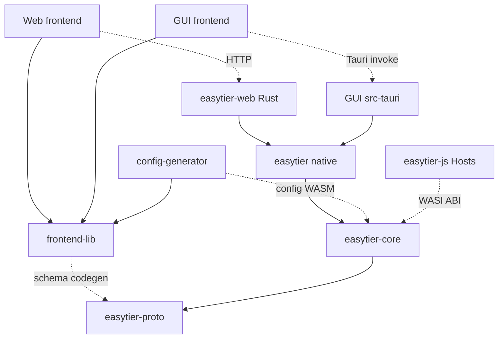

# 架构规范索引

## 目的与适用范围

本目录为 EasyTier 的 AI 编码助手和贡献者提供可执行规范，涵盖前端、后端、产品设计和命名。它规范今后的改动，不要求现有代码一次性达到所有新规则，也不授权与任务无关的重构。

AI 自动入口为仓库根目录的 [AGENTS.md](../../AGENTS.md)。不自动加载该文件的工具，应将它设为项目上下文入口；无需复制各文档内容到多个工具配置中。

| 文档 | 解决的问题 | 主要适用范围 |
| --- | --- | --- |
| [前端规范](frontend.md) | 组件、状态、平台适配、类型、样式、国际化与验证 | Vue/TS/JS 前端和共享组件库 |
| [后端规范](backend.md) | 分层依赖、Host 能力、协议、并发、持久化、安全与验证 | Rust、Web 服务、平台桥接、Go/JS SDK |
| [产品设计规范](product-design.md) | 用户任务、状态、反馈、风险、可访问性与验收 | Web、桌面、移动、CLI 与配置体验 |
| [命名规范](naming.md) | 文件、符号、契约字段、术语、单位与状态 | 全仓库 |
| [需求与任务协作](../../process/README.md) | 文档归档、任务看板、并行拆分、联调与状态交接 | 所有需求分析、计划和任务执行 |

`MUST`（必须）为不可省略的要求；`SHOULD`（应）允许有理由的例外，须在变更说明中解释；`MAY`（可）为按需采用。文中“现状/事实”描述已有代码，“规则”约束后续修改，不能将新规则当作已实现能力。

## 仓库架构地图

| 模块 | 当前职责 | 主要边界 |
| --- | --- | --- |
| `easytier-proto` | Protobuf schema、生成的 Rust/RPC 类型、描述符及 feature 切片 | 不承载原生平台实现或 UI 业务 |
| `easytier-core` | 可移植配置、协议与连接策略、路由、包处理、实例生命周期 | 经 Host 能力访问平台，保持 native/WASI 可移植性 |
| `easytier` | 原生组合根、平台资源与协议引擎、CLI/进程集成 | 组装 Core，不复制核心策略或维护第二套 peer graph |
| `easytier-web/src` | Web 服务、认证授权、数据库、配置管理、中央网络业务 | HTTP/持久化/业务编排不下沉到 portable core |
| `easytier-web/frontend-lib` | 共享配置与状态 UI、类型、国际化、`RemoteClient` 接口 | 不依赖某个消费应用或原生平台 |
| `easytier-web/frontend` | Web 控制台、页面编排及 HTTP 适配 | 消费共享能力；服务端仍负责最终授权 |
| `easytier-web/config-generator` | 配置生成页面及 Core 配置 WASM 接入 | 复用 Core 的配置语义 |
| `easytier-gui` | Vue 界面、桌面/移动体验及 `src-tauri` 原生桥接 | 前端与原生代码分属各自规范 |
| `easytier-js` | 独立 pnpm 工作区，WASI 共享运行时与 Browser/Cloudflare Host | JS Host 适配，不是 Vue 前端组件库 |
| `easytier-contrib`、`easytier-go`、`tauri-plugin-vpnservice` | 各平台集成、精简宿主、FFI/SDK、附属应用 | 保持各自 README、平台和 ABI 约束 |

下图的实线表示主要依赖/消费方向，虚线表示运行时调用或代码生成输入；省略非关键依赖。



## 与既有文档的关系

- [Core 架构](../core-architecture.md)是核心所有权、依赖方向与 feature 边界的既有权威说明；本目录不替代它。
- [CONTEXT.md](../../CONTEXT.md)说明 credential grant、attached peer、运行时及配置消费者等领域语义，修改相应功能前必须阅读。
- [贡献指南](../../CONTRIBUTING_zh.md)提供开发说明；实际命令、工具版本和脚本以当前清单、锁文件、工具链文件和 [CI](../../.github/CI.zh-CN.md)为依据。发现文档漂移时明确记录，不猜测脚本存在。
- `docs/` 中的既有设计和历史验证记录只证明其标注的范围与时间，不代表所有设想已实现或当前提交已通过验证。活动需求、计划和任务按 [协作规则](../../process/README.md) 集中到各自的需求目录。

## 一次变更的执行方式

1. **核实项目现状并先写汇总**：读取适用规范与相关代码，找到所属模块、状态所有者及契约来源；每个独立需求建立 `process/<需求名称>-<状态>/`，先将根 `README.md` 写成需求/计划汇总，记录基线、进度、问题及下一步。现状描述引用实际代码路径与符号，区分事实、拟新增与待核实；不同需求分目录管理，只通过链接关联依赖。
2. **按汇总展开需求、计划与任务**：分析放入 `require/`，实施计划拆成 `plan/plan-<编号>-<名称>.md`，任务拆成 `task/task-<任务编号>-<任务名称>.md`；各目录 `README.md` 只维护索引/看板。用户说“需求拆分”时必须完成两级拆分，不能只交计划。强制分析多 Agent 的独立范围、共享写入者和依赖，具体内容结合核查过的代码、用户约束与缺口；先交付契约，再并行独立任务，最后接线与联调。发现新问题时同步汇总；完整流程见 [协作规则](../../process/README.md)。
3. **写清兼容性**：协议、配置、API、CLI、数据库或 ABI 变化必须说明旧客户端/旧配置如何处理。
4. **实现与验证**：实际代码变更选择能验证行为的现有检查，明确环境前置条件。仅修改需求、计划、任务、规范等文档时，只检查目录、链接、编号和状态一致性，不安装依赖、不运行构建/测试、不主动触发或等待 CI。
5. **同步说明**：交付说明列出实际结果和未覆盖范围；变更架构事实时同步相关设计文档，避免 AI 下次读到相反规则。

小型样式、文案或局部修复不需要单独的架构决策文件。跨模块所有权、新公开契约、持久化模型或新增重要依赖的变更，**SHOULD** 在 PR 或 `docs/` 的相关设计文档中记录以下信息；现有文档能承载时不另建模板文件。

```text
问题与目标用户任务：
现有约束与事实来源：
选择的方案及状态/资源所有者：
考虑过的替代方案与取舍：
受影响的契约、兼容/迁移与回退：
验收场景、验证证据和剩余限制：
```

## 规范维护

- **MUST** 将可复用规则写在对应规范中，入口文件只保留索引与关键约束，避免多处维护同一细节。
- **MUST** 新增包、移动目录、替换生成流程时检查本索引及 `AGENTS.md` 的路径路由。
- **SHOULD** 对规则例外说明范围、原因和兼容性，而非悄悄忽略规则或要求无关代码一起整改。
- 当前规范依靠 AI 加载与评审执行；新增自动检查须另行实现和验证，不能把本文描述为已启用的 lint/CI 功能。
