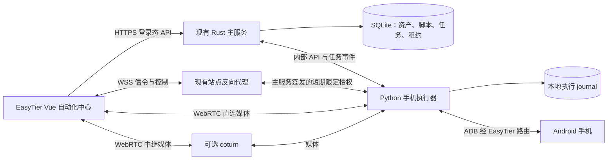

# R02 后端服务架构、执行边界与数据关系

> 更新：2026-10-24。已进入架构设计阶段，产品尚未验收。以下为当前建议，尚未实现、联调或验证；取代旧版“WSS + WebCodecs 首选”的讨论建议。当前推荐 WebRTC 传输画面，WSS 承担信令与控制，不同时建设两套首发媒体链路。

本轮深化内容见[R08 部署、路由与手机运行时](require-08-runtime-and-deployment.md)、[R09 任务、数据契约与故障处理](require-09-execution-contracts.md)：明确单执行器跨节点的路由前提、单worker、首版单观看者建议，以及持久派发、撤权和历史记录。R02保留总体结构。

## 1. 两个核心服务，复用开源底层能力

|服务|实现建议|职责|
|---|---|---|
|EasyTier 主服务|现有 Rust / Tokio / Axum + SQLite，沿用 SQLx / SeaORM 及迁移机制|资产身份、actor/owner 权限、脚本草稿与运行快照、任务业务记录、控制租约签发及撤销|
|手机执行器 Runner|新增 Python / FastAPI 服务|管理 ADB、scrcpy 采集和人工控制、aiortc 媒体转发、uiautomator2 有限动作；逐设备顺序执行、并发限制、授权校验、控制互斥和执行 journal|
|可选公网媒体中继|开源 coturn|浏览器与 Runner 无法直接建立媒体路径时提供 TURN；不是第一版必需的第三个业务服务|

一个 Runner 服务可以管理多个工作子进程；阻塞脚本放在可终止的独立子进程，避免阻塞 FastAPI/aiortc 事件循环。不为每台手机、每个任务再拆一个微服务。

第一版默认一个 Runner，放在能够经 EasyTier 路由访问手机的 NAS/Linux 主机；与主服务同机、不同容器可行。跨节点要求路由无歧义；不同网络的相同地址不能凭资产ID区分，需已有改址映射或独立Runner。仅在网络隔离、就近接入或容量需要时增加 Runner，不要求每个网络节点安装。OpenWrt 优先承担网络与发现职责。Runner API首版单进程，不通过多个uvicorn worker复制内存注册表来扩容。

不默认引入 Redis、RabbitMQ、Kafka、Go/Pion、SFU 或 Kubernetes。已有主服务 SQLite 是业务唯一真源；Runner 保存本地轻量 journal 作为执行事实、去重与结果重传依据，不共享主服务数据库文件，不另建手机资产库。

## 2. 连接与媒体路径

手机通过 scrcpy 编码 H.264，Runner 经 ADB 取得编码包并封装为 WebRTC 媒体，浏览器连接 Runner。手机不是直接将裸视频推到浏览器；视频帧不写入 SQLite，也不经 Rust 的业务 JSON 请求。

WSS 经站点反向代理传输 SDP/ICE 信令、输入命令和会话事件，前提是该代理及主服务能访问Runner；此路由为待实施适配，不假定现有配置已支持。WebRTC 媒体有独立网络路径。网站 HTTPS 可访问不代表媒体 UDP 可达，EasyTier 端口映射也不会自动配置 ICE/TURN。公网部署需验证 TLS、反代升级、ICE 候选地址和 UDP；需中继时提供有有效期的 TURN 凭据。

浏览器取得主服务签发的短期、单账号、限定设备及能力的会话授权；Runner 校验后才接入。长期 Runner 密钥只保存在后端，禁止复用 EasyADB 全局 token 到浏览器。控制通道有有界队列和顺序号，停止/触点释放不排在大视频包之后。

## 3. 开源复用与自研边界

|组件|复用内容|本项目需要自研的适配|
|---|---|---|
|ADB|已授权设备连接与设备侧进程通道|按资产解析目标、配对配置、密钥保管、错误与超时归一化|
|scrcpy|手机编码采集、触控/按键协议|固定版本适配、画面几何变化、按设备资源释放与输入互斥|
|aiortc / PyAV|WebRTC、RTP 和预编码 Packet 转发|短期会话授权、信令、ICE/TURN、队列与断线治理；不默认转码|
|uiautomator2|控件定位、文本输入、等待和断言所需基础动作|有限动作协议、子进程隔离、步骤超时、取消、结果与截图归档|
|FastAPI|执行器 HTTP / WebSocket 框架|Runner API、租约校验、命令 journal、状态事件；不另做独立管理后台|
|coturn（可选）|公网媒体中继|凭据签发、部署配置、可达性与带宽验证|

EasyADB 的代码可作为真实适配参考，不能把整个独立后台、设备库、全局 token 或“新观看抢占旧会话”的规则原样搬入。当前 `feat/node-attributes-tech-console` 分支尚未集成这些媒体和 ADB 能力。

已有证据：EasyADB `m2_live.py:399–407` 将 scrcpy 编码数据提交给 track；`m2_webrtc.py:227–241` 构造并返回 PyAV `Packet`；`live_handler.py:389–395` 添加该 track 并选择 H.264。这条路径已有预编码包转发基础，不能误述为每路必需服务器解码后重编码。

但 `live_handler.py:387` 仍为 `iceServers=[]`，尚不构成完整公网方案。已读代码未见完整的“PLI 请求 → 手机产生 IDR”或“拥塞反馈 → 调整手机编码参数”闭环，不能宣称已支持动态自适应。丢包后的关键帧恢复、码率切档和清理必须进入 PoC；需要重启采集才能切档时应如实展示。

## 4. 主服务数据和新增接口

控制对象只引用现有 `asset_devices.id`，沿用其 owner、网络节点、网关归属和实例绑定；地图 JSON 中的 `MapLanDevice`、服务导航 `network_services` 都不是新的控制资产来源。

建议新增对象如下，表名及字段为待实施设计：

|对象|主要数据|
|---|---|
|automation_executors / targets|执行器连接配置、现有资产到执行器的映射、可用动作；人工设备名称/型号仍在资产表|
|automation_sessions / session_devices|观看/人工控制会话、固定设备集、目标快照、每台媒体/控制状态和结束原因|
|automation_scripts|名称、说明、可编辑草稿、结构化步骤及参数|
|automation_runs|run_id、owner/actor、不可变脚本和参数快照、固定目标集、并发/失败策略、业务状态|
|automation_run_devices / step_results|每设备进度、step_id、command_id、派发/执行/检查结果、错误和截图引用|
|automation_control_leases|设备与执行目标的控制权、持有者、epoch、能力、有效期及撤销状态|

脚本流程为“保存草稿 → 运行时生成不可变快照”，不额外增加发布按钮。已开始的运行不受后续草稿编辑影响；重新运行创建新的运行记录。

owner、设备、运行状态、时间和序号使用可索引列；步骤定义/参数使用版本化 JSON。视频不入库，高频触摸移动不逐条写主数据库；动作边界、任务步骤及必要结果持久保存。

主服务新增 `/api/v1/automation/devices`、`sessions`、`scripts`、`runs` 及取消/状态接口；Runner 新增受内部认证的会话、执行、取消、结果查询接口，以及受短期授权的 WSS 信令/控制通道。事件带递增序号，支持断连后按已确认位置补取；事件重传不等于再次执行命令。

现有 Axum 路由、登录、OIDC 和 config-server 保持职责。迁移按最新分支的实际列表追加；当前已有服务公开和位置迁移，不能假定上一工作区的 Discovery/ADB 迁移已合入。

## 5. 权限、控制权及目标固定

- 普通账号只操作本人资产；管理员沿用 `can_manage_others`，先明确目标账号。创建会话、派发命令和运行步骤检查 actor 与 owner 均未删除，不仅判断 owner 行存在。
- 会话固定 asset ID、Runner、路由域、目标 IP/端口、实例绑定及新计算的target_fingerprint。后者只涵盖影响目标的字段，不用updated_at或编辑预览preview_version代替。绑定或地址变化后旧授权不能静默改指向新目标。
- “全局操作”仅作用于当前明确选中并冻结在会话/任务中的 targets；单机动作永不广播，也不能因筛选改变而悄悄扩大范围。
- 控制租约同时约束“设备 ID”和“Runner + 路由域 + 规范化 ADB 目标”。两条资产别名指向同一目标不能绕过唯一写入权；这不是跨Runner的永久物理身份识别。首版同一资产固定一个Runner。
- 人工控制、群控与脚本共享排他写入权，旧 epoch 命令拒绝执行。新观看不自动抢走旧控制权；首版建议同手机一位观看者，第二页面提示占用。同页放大复用播放器；多观看者需独立订阅队列与生命周期，不能假定现有track已提供。
- 自动化登记使用短数据库事务和按目标协调，不将现有网络配置全局 `mutation_lock` 扩成自动化授权/每条输入的全局锁。既有变更中的必要协调必须在外部I/O前释放；Runner按设备顺序执行并限制总体并发。
- 图片、控件树、日志和媒体同样受账号与目标权限约束；目录不能直接暴露为公开静态资源。

## 6. 命令确认、恢复与生命周期

主服务以request_id及摘要幂等创建run_id，先在同一短事务持久化运行快照/逐设备明细/dispatch_pending，提交后才派发。每设备命令包含 run_id、step_id、command_id、epoch 和目标版本。Runner journal先记录接收，再回复accepted，记录派发、完成、失败或未确认及事件标识；主服务对结果去重。手机动作不能与数据库组成原子事务，不能宣称 exactly-once。

命令已发出但回执丢失时标记“结果未确认”，不得自动重放点击、输入或提交。启动时根据 journal 和业务记录标记中断/未确认；后续仅经任务事件、明确查询协调结果，重试由用户发起，不添加定时补偿或重启自动续跑。

用户重试也必须先确认旧run/command不会迟到执行：Runner持久登记拒收/撤销记录，再开放新运行；一次查询未找到不等于旧请求不存在。控制代际和撤销记录持久保存，Runner重启使旧会话失效，重新授权及清理后才能控制；数据卷丢失需重新登记。详见R09。

网页关闭或人工会话断开：停止人工输入并释放触点/人工控制权。用户已明确提交的任务可以继续运行，任务执行与观看会话分别释放；关闭视频不能误杀任务，任务完成也不能错误关闭无关观看。

所有执行授权有有限期限，任务与步骤都有最长时长；在任务事件交互或开始下一步骤前校验/续授权。账号删除、目标删除或变更时，在对应事务中登记撤权/取消意图，提交后通知Runner停止；不能只做可能丢失的事后内存通知。撤销通道断开时显示停止待确认；授权到期停止新步骤，进行中的动作最多执行至其超时边界，不允许无限离线运行。历史任务保留设备及脚本快照，不随设备服务级联删除消失。

事件驱动不是没有时钟：活跃媒体的协议连接维护、授权有效期、空闲释放和步骤超时是必要治理；仅在明确启动的会话/任务内生效。不新增全网心跳、后台设备扫描、业务 cron 或自动重连。既有 config-server 生命周期机制不因本需求改写。

## 7. 脚本、截图与检查结果

首期有限动作建议为 `tap`、`swipe`、`input_text`、`key`、`launch_app`、`wait_for`、`assert`、`checkpoint`；由 Runner 适配 uiautomator2/scrcpy，不开放任意 Python 或 shell。同设备不并行运行多个控件引擎。

控件优先 resource-id/description，其次文本；0个匹配在有限期限内等待或失败，多个匹配默认拒绝，控件失败不自动退回旧坐标。显式坐标步骤记录方向和画面几何版本。旋转/分辨率变化时释放旧触点、拒绝旧坐标版本；只对方向、几何、前台包名及明确控件前置条件判断匹配，不承诺自动识别任意布局差异。中文输入可能依赖辅助输入法，设备准备中明确说明并实测。

脚本静态检查只验证结构、动作、参数和目标条件，不证明手机操作成功；控件存在检查只证明本次查询时可见。动作回执表示命令执行结果，只有显式断言通过才能标注“检查通过”。截图是当时画面的证据，不自动等于 App 业务成功。

录制保存实际发出的动作，再允许用户借助控件树修正定位；无法明确匹配的步骤保持坐标并标注。默认仅保存明确截图、检查点及失败证据，设数量/容量上限和手动清理；不默认保存所有视频或使用定时清理任务。

首版建议任务只提供取消和确认后创建新运行，任务暂停及任意中途续跑后置；录制暂停保留。脚本先用实际App的手写有限步骤验证执行闭环，再接入录制转换；首版原有多屏/群控/脚本目标不变，见R09。

## 8. 真实网络 PoC 与代码依据

按 1 → 2 → 5 → 10 台递增验证，不能把历史设备总量估计当成已确认的同时投屏容量。分别覆盖同网、经 EasyTier 路由、远程浏览器直连和需要 TURN 的路径；未经实测不承诺高清路数或延迟。

待测：首次授权和中文输入、首帧、真实操作到画面变化延迟、旋转坐标、断线及关键帧恢复、同目标别名争抢、旧 epoch、手工与脚本互斥、网页关闭后任务生命周期、账号删除/授权到期、Runner 重启后不重放、journal 结果补取、CPU/内存/带宽和手机发热。

EasyADB 既有省流档约为长边 960、24fps、目标 3Mbps；10 路目标编码码率合计约 30Mbps，另计协议与中继开销。这是配置预算，不是实测吞吐。小卡片的低分辨率/帧率档及放大切档仍需新增适配和验证。

已阅读的本地代码依据：

- [Rust/Axum/数据库依赖](/workspace/EasyTier-tech-console-review/easytier-web/Cargo.toml:25)、[同一 SQLx/SeaORM 连接池和迁移](/workspace/EasyTier-tech-console-review/easytier-web/src/db/mod.rs:267)。
- [API 与认证挂载](/workspace/EasyTier-tech-console-review/easytier-web/src/restful/mod.rs:342)、[资产跨账号授权](/workspace/EasyTier-tech-console-review/easytier-web/src/restful/assets/mod.rs:184)、[can_manage_others](/workspace/EasyTier-tech-console-review/easytier-web/src/restful/assets/mod.rs:216)。
- [账号软删除与禁网](/workspace/EasyTier-tech-console-review/easytier-web/src/restful/user_admin.rs:119)、[全局配置锁](/workspace/EasyTier-tech-console-review/easytier-web/src/central_network/service.rs:241)、[仅覆盖资产 CRUD 的幂等实现](/workspace/EasyTier-tech-console-review/easytier-web/src/db/assets/idempotency.rs:35)。
- [scrcpy 编码包提交](/workspace/EasyADB/server/m2_live.py:399)、[PyAV Packet 转发](/workspace/EasyADB/server/m2_webrtc.py:227)、[现有空 ICE 配置与 H.264 track](/workspace/EasyADB/server/api/live_handler.py:387)。

本轮仅架构文档改写；未执行测试、构建、手机操作或部署。上述 API、表、租约、journal 和媒体授权均为新增设计，不是现有分支已经完成的能力。
