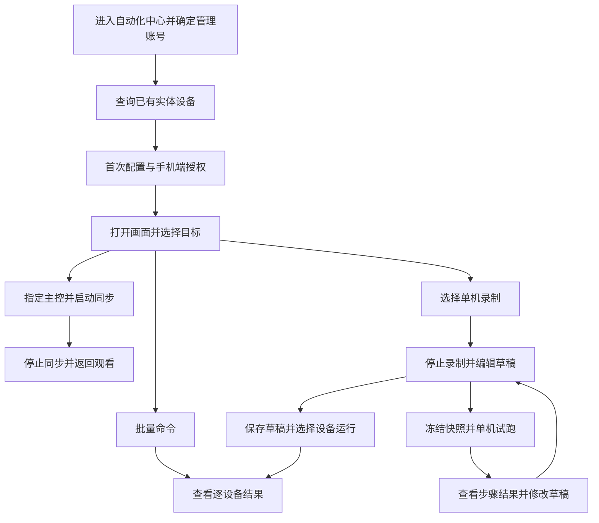

# R06 第二版产品交互流程

用户在三张示例稿后要求“继续”。本轮据此先以多屏设备工作台为主界面，将主控群控和脚本编辑接成完整流程；这是继续设计时采用的默认方向，不表示用户已经选择某号稿或完成验收。本文承接[R05 产品设计稿说明](require-05-product-design.md)，仍是产品建议，不实现功能、不确定技术架构。

第二版的手机、账号、运行结果均为示例。图片中的“已连接”“执行失败”等文案用于展示交互状态，不是真实设备测试结果。未知的连接能力和容量仍需后续架构及实机验证。

稿件入口：[A 多屏设备工作台](../task/artifacts/2026-10-24/product-design-v2/01-device-workbench.png)、[B 进行中的主控群控](../task/artifacts/2026-10-24/product-design-v2/02-active-group-control.png)、[C 脚本编辑与试跑结果](../task/artifacts/2026-10-24/product-design-v2/03-script-edit-and-result.png)。本文同时补充首次连接、脚本库、批量运行及完整结果页的流程，这些页面尚未单独绘制；图片残留的视觉差异见[本轮记录](../task/test-report.md)，不能以示例图覆盖本文的状态与数量规则。

## 1. 入口、账号与已有资产

沿用当前科技风控制台。工作区菜单顺序为：服务导航、仪表盘、网络地图、网络节点、缩进的节点详情、拟新增的自动化中心、服务管理、具备权限时显示的用户管理。下方保留“网络”分区及其动态网络列表；不要把已有“网络地图”改回“网络拓扑”。普通账号部署与现有菜单可用性条件继续生效。

自动化中心内部保留“设备工作台、脚本库、执行记录”。群控是设备工作台的子流程；脚本编辑是脚本库的子流程。返回入口明确，不另建一套侧栏。

- 顶栏账号表示当前登录操作人。内容区“管理账号”及“当前管理账号：xxx”表示资产归属，两者不能混为一项。
- 沿用现有资产上下文的`available`和`can_manage_others`。只有具备跨账号资产权限时显示管理账号选择器，选项使用`id/username`；普通账号固定管理自身资产。用户管理菜单的`can_manage_users`不直接作为资产跨账号权限。
- 手机使用已有`asset_devices`身份，保留账号、节点、网关及地址关系。一次工作区只处理一个账号，可以筛选多个节点；不把地图展示记录直接当成可控手机，不创建重复手机台账。
- 切换管理账号先结束当前手动同步及录制，清空旧账号的选中目标，显示新账号资产；已经明确提交的脚本仍在原账号的执行记录中，不转移归属。

当前分支没有上一轮Discovery/ADB集成。已有顶栏“设备接入”用于EasyTier节点登记，不等同于手机发现或ADB授权。OpenWrt发现同步可作为后续便捷来源，手工登记的手机也可进入连接配置；本轮不增加自动扫描任务。

## 2. 从工作台到操作结果

查询沿用“设置条件后点击查询”的习惯。先区分无资产、查询无结果、尚未配置连接三种情况，分别引导登记资产、调整条件或配置连接，不展示一个泛化的空白画面。

画面按原始比例完整展示，状态栏和底部操作区域不能被裁切；横屏、竖屏和旋转后的内容均不拉伸。按用户最新要求，控制浮球及展开图标直接叠加在画面边缘，不预留操作列或缩窄视频；展开时可临时遮挡小部分画面，手动收起恢复观看，事件不穿透为手机操作，具体见R07。若保留失联前最后一帧，必须标注“非实时”。

## 3. 首次连接弹窗

从单台手机卡片的“配置连接”进入居中弹窗。已有资产名称和地址可作为上下文，但不能仅凭手机类型或节点在线就显示为已授权。以下为必要产品字段建议，连接模式的实际可用条件和校验规则待架构验证。

|内容|产品表达|
|---|---|
|目标身份|只读显示管理账号、设备名称、所属节点、网关，防止配到错误设备|
|连接方式|按设备实际支持能力展示“首次配对后连接”或“已有授权连接”；不能暗示所有Android版本都具备相同方式|
|连接地址和端口|展示将要使用的地址及连接端口，允许明确选择或填写；与既有组网IP、内网IP对应关系可见，不悄悄改资产地址|
|首次配对资料|仅需要配对时显示手机提供的配对地址、配对端口和配对码；配对端口与连接端口分别标注，不要求用户误填成同一个值|
|手机端操作提示|说明需要在手机端开启相应功能、显示配对信息或同意授权；待授权时提供“重新检查”，不伪装成平台能绕过手机确认|
|操作与结果|分别表达资料保存、配对结果、连接结果、打开画面结果；配置保存成功不直接显示“画面已连接”|

配对码只用于本次操作，不写入脚本内容或普通结果说明。配对失败、等待授权、地址不可达分别保留具体原因，允许修正后手动重试。取消弹窗不启动新的连接操作，也不影响其他已打开的手机画面。

## 4. 选择目标与操作前处理

选择表示操作意向，不代表当前具备控制能力。“本页全选”与“全部查询结果”明确分开；查询命中数、已选数和可操作数分别展示。切换筛选不自动选中新出现的设备，提交时固定实际目标清单。

第二版A稿固定为4台手机：01、02、03已连接且勾选，04待授权且未选。显示“共4台，已选3台”；图中“全选本页”使用文字按钮，没有全选复选框，不展示误导性的全勾状态。若后续实现改为复选框，此时必须呈半选。卡片勾选、工具条数字和后续群控目标保持一致。04仍有完成授权的入口，不能用假画面显示其正在实时投屏。

用户也可能选中尚不可控制的设备。提交批量命令、开始群控或脚本运行前，需要按本次操作检查授权、连接与占用状态，列出不可用目标及原因，让用户先处理，或明确选择“移除不可用目标后继续”。不能静默跳过并报告全部成功，也不能把失败设备的操作排队等待其恢复后自动执行。

## 5. 主控群控的完整生命周期

本轮补充的页面级与单机悬浮入口见[R07](require-07-floating-controls.md)。同步期间的全局操作标识固定会话目标；当前会话内单机写入按钮禁用，需先停止同步再进行本机调整。单机按钮不会隐式触发群控，立即停止同步入口持续可见。

从A稿选中01、02、03后进入群控准备，指定01为主控，02和03为跟随。页面提示先检查应用、页面和方向是否一致，再由用户点击“开始同步”。进入群控页面本身不会发送操作，普通卡片点击也不会自动开启群控。

|阶段|界面与行为|
|---|---|
|准备|显示主控及跟随清单、共3台；不可用目标处理完后才允许开始|
|同步中|明确标识主控，显示固定目标数及“立即停止同步”；只同步用户明确发出的操作|
|部分中断|保留失联设备的位置、原因和原目标身份，不把该设备计为成功，也不悄悄改为两台任务|
|停止同步|立即阻止新的同步操作，结束当前交互并释放控制；已打开且仍可用的画面继续观看|
|停止待确认|无法确认某台当前操作是否结束时保留说明，不显示该台已经成功停止|
|返回工作台或离开页面|结束手动同步并释放控制，不让离开后的页面继续发送操作；重进时默认查看，不自动恢复群控|

第二版B稿表现正在进行的部分中断：固定目标为“主控01＋跟随02、03，共3台”；03失联后展示“当前2台可操作，1台中断”。01和02可以继续接收后续新操作，03不接收补发。原目标清单保持不变，03卡片保留中断状态；不要用“全部正常”或整组成功覆盖这一事实。

03恢复连接后只恢复观看，不自动加入正在进行的同步，也不补发失联期间的点击、输入和滑动。用户需要先检查其页面状态，再停止当前同步并重新发起包含03的同步。若主控01失联，整组暂停手动控制，用户重新选择或恢复主控后显式启动，不能自动换主控。

“停止同步”与“断开画面”是独立操作。恢复失联设备、调整目标集合和重新开始都应有明确操作入口；浏览器意外退出后的释放时效留待架构验证，不在产品稿中承诺瞬时完成。

## 6. 录制、保存与单机试跑

用户从工作台选择一台可操作手机，进入脚本录制。录制时显示当前手机及录制状态，提供暂停、停止；记录的是在工作台发出的操作，不是视频，也不承诺捕获在实体手机上直接进行的操作。录制与试跑不能同时控制同一手机。

停止录制后得到可编辑草稿，可以查看和修改步骤、调整顺序、删除步骤及编辑参数。点击稿中的“保存草稿”形成可引用的保存记录，并明确显示保存结果；未保存的改动持续显示“草稿·未保存”。本轮不另加“保存版本”或“发布”按钮，保存草稿与启动运行分别操作。

单机试跑可以针对当前草稿，但启动时固定一份试跑快照，并显示目标设备、快照标识及参数。之后编辑草稿不改变该次试跑内容，也不覆盖历史结果。用户再次试跑时产生新的快照和记录，结果区始终说明属于哪一次。

第二版C稿同时展示两件不同的事：

- 编辑区正在选中并修改第3步，顶部显示“草稿·未保存”。这只是编辑位置，不是执行进度。
- 结果区显示历史“快照01”的单机试跑：第4步等待10秒超时，第5步未执行。超时说明与失败高亮位于结果区；不能把编辑区第3步误标为运行中，也不能把第5步显示为已完成。

在结果中点击失败步骤，可定位当前草稿的对应步骤；若草稿调整过顺序或删除过步骤，需要说明已变化，不能仅按相同序号认定它们仍是同一步。用户修正后主动再次试跑，旧失败记录仍归历史快照01，不随草稿修改变成成功。

## 7. 批量运行与逐设备结果

从脚本库选择已保存的草稿，或编辑后先点击“保存草稿”，再进入运行准备。展示当前管理账号、所用保存记录、实际目标清单及本次参数；提交时固定这次保存内容作为执行快照，后续修改草稿不改变已经提交的运行。按第4节处理不可用目标后，由用户明确提交。设备数量与工作台选中数量的差异必须有可见原因，不增加单独的发布版本流程。

每台设备单独展示状态和步骤进度；建议某台失败先停止该台，其他已正常运行的设备继续，整批状态显示“部分失败”而不是成功。已发送指令不等于检查通过，检查通过也只代表脚本已定义的条件，不能泛化成任意业务成功。

|设备结果|后续处理|
|---|---|
|未开始或排队|允许明确取消，不记为执行成功|
|执行中|显示当前步骤；停止后不再发送后续动作|
|失败|说明设备、执行快照、步骤及具体原因，允许用户修正后选择该设备再次运行|
|失联或结果未确认|说明最后确认位置；不自动重放，避免重复点击或输入|
|停止待确认|保留待确认标记，不把无法联系的设备当作已停|
|已完成或检查通过|保留结果，不因其他设备失败而自动重跑|

“再次运行失败设备”必须重新展示目标及将要使用的保存内容，由用户提交新一次运行并固定新快照；已经成功的设备默认不进入重跑清单。重复执行可能再次产生操作效果，应在重新运行的范围说明中表达。任意中途续跑或自动回滚不作为本轮已承诺能力。

离开手动群控会结束同步；已经明确提交的脚本任务则继续按其运行状态处理，用户返回执行记录查看，不把关闭页面等同于任务成功或取消。任务停止、失败恢复和权限变化的实际处理方案留待架构设计，产品上始终要求真实区分完成、失败、中断及未确认。

## 8. 本轮边界

本轮只细化产品稿和交互说明，不新增定时任务、自动发现、无限自动重连或自动重跑成功设备。没有执行开发、测试、构建、浏览器验证、设备连接或部署；首次连接模式、可用脚本步骤及容量指标仍需后续架构师结合设备验证。本文件不确定媒体协议、控制组件、数据库或执行器方案。
