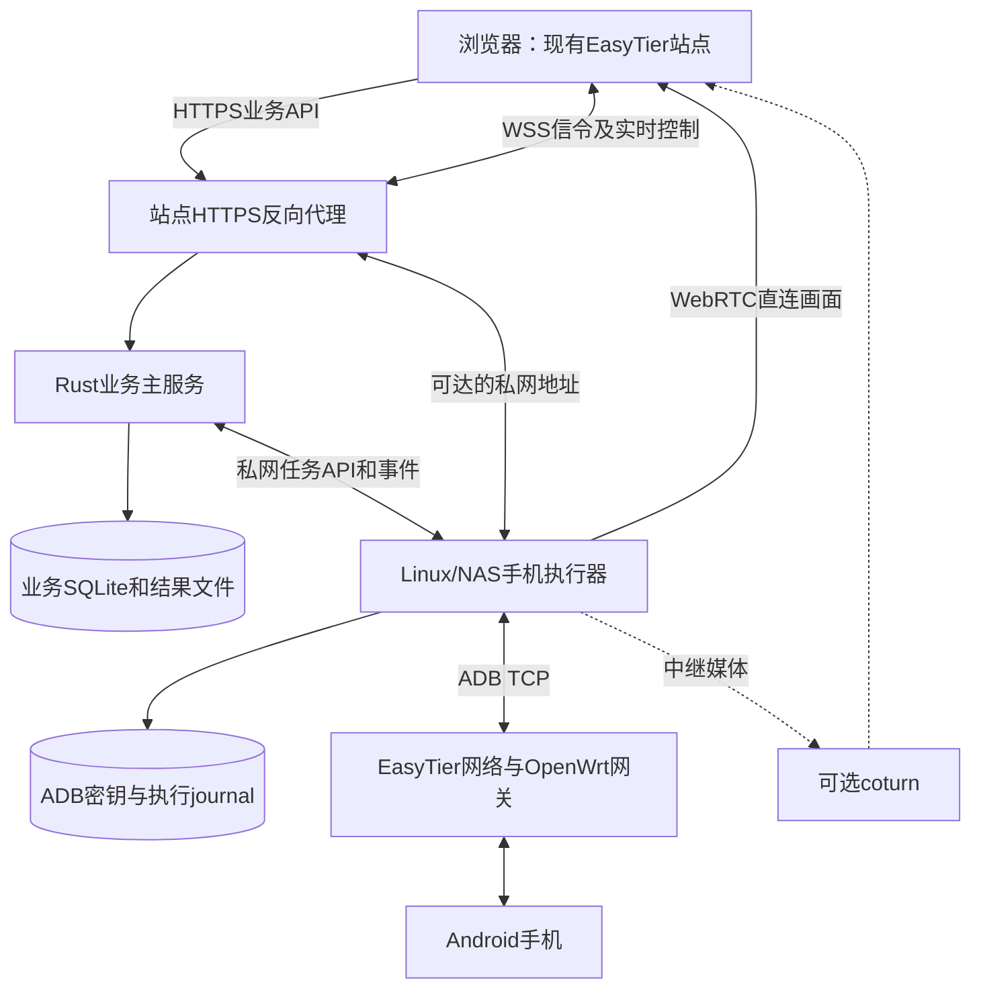

# R08 部署、路由与手机运行时

> 2026-10-24（Asia/Shanghai）。用户要求进一步细化架构。本文件为源码复审后的建议，未实现、未测量；补充R02。产品限制与默认值仍是建议，不代表用户已经验收。

## 1. 选型要解决什么问题

首版保留两个业务服务：EasyTier Rust/Axum主服务和新增Python/FastAPI手机执行器。公网媒体需要时再部署coturn。主服务使用现有SQLite；执行器不另建可编辑设备台账，不分享主数据库文件。

|方案|当前选择及原因|重新评估的触发条件|
|---|---|---|
|Rust主服务直接包含全部手机执行能力|保留业务管理；媒体与设备工具放到独立进程，避免ADB阻塞、手机工具崩溃影响现有控制台|不为统一语言重写已可适配的手机协议|
|Python/FastAPI＋aiortc＋uiautomator2|首选：本地EasyADB已有预编码H.264转发、控制与清理实现，控件执行生态也适配Python|实际测出事件循环、包处理或加密成为容量瓶颈，再评估拆媒体进程或Go/Pion|
|Go/Pion独立媒体服务|不首发引入：增加语言与进程并不能自动解决手机编码反馈、路由和权限|测量证明媒体层需替换，保留业务及控制协议不变|
|完整接入DeviceFarmer/STF|不首发引入：已有账号、资产、网关/实例关系，整体设备农场带来重复管理和部署体系|用户改为建设独立大型测试设备池|
|Appium或Maestro作为主引擎|保留替代可能；目前目标是边看边操作、网页录制及逐机结果，有限控件API更便于嵌入|以WebDriver兼容、复杂WebView或已有YAML测试资产为主要目标时|

选Python不是容量承诺；选开源库也不代表已有完整执行器。真正自研的边界是目标解析、权限与占用、设备资源管理、有限步骤解释、持久任务交接和结果管理。完整候选来源见R04，本轮没有重新联网检索或基准测试。

## 2. 部署与三条独立链路



三条链路独立验收：浏览器到站点的HTTPS/WSS；主服务/反代到执行器的私网连接；执行器到手机的ADB。WebRTC另需可达的ICE媒体路径。网页能打开，只能证明第一条链路的一部分。

默认部署建议：主服务与执行器可以同一台Linux机器、独立容器；手机在OpenWrt下时通过EasyTier路由访问。也允许主服务放云端、执行器放NAS，前提是云端反代及主服务能经私网访问NAS执行器。没有这条路径时需要另做接入适配，不能把当前架构图当作已提供反向隧道。

OpenWrt继续承担网络接入和发现；不默认在每台路由器上安装Python媒体服务。一个执行器能管理多个节点的前提是路由明确、地址无歧义、资源足够。

已有EasyADB的WebRTC部署使用Linux host网络，并明确单个uvicorn worker；不能直接改成普通Docker端口映射后假设ICE继续可用。首版先复用这一部署方向，API只绑定可信接口；ADB server的5037端口不对外开放。aiortc当前使用动态ICE UDP端口，不能未经适配就写出一个“已经支持”的固定媒体端口范围。最终主机防火墙、候选地址及TURN的监听/relay端口需在S0形成实际部署配置。

TURN只转发媒体，不解决执行器访问手机、ADB授权或主服务访问执行器的问题。浏览器和执行器两端均需正确的ICE配置。需要时使用有有效期的凭据；选择直连还是中继以实际协商结果展示，不能以WSS成功推断画面必定成功。

## 3. 网络实例与设备地址是控制前置条件

实际代码已有三种地址模型，自动化必须复用，而不是重新发明网段拼接：

|既有address_mode|实际含义|执行器连接地址来源|
|---|---|---|
|direct_instance|实体设备直接绑定一个网络实例|实例IPv4所派生的组网地址|
|gateway_rule|网关组规则下的实体设备|无改址规则使用真实子网地址；改址规则使用映射子网＋host_offset|
|gateway_self|网关自身实体设备|组网地址来自网关实例；内网地址可按指定规则派生|

示例：规则为192.168.1.0/24 → 10.30.1.0/24，手机内网地址192.168.1.20，对应组网地址10.30.1.20。执行器经组网连接时使用10.30.1.20及已配置ADB端口，不拨网关本身的实例地址。若是不改址代理子网，组网可达地址可能仍是192.168.1.20。实现使用已有前缀长度和主机偏移算法，不能硬编码/24或字符串拼最后一位。

目标快照建议包括：asset_device_id、owner、machine_id、executor_id、route_context_id、实例config_ref/相关规则摘要、连接IPv4、ADB连接端口和target_fingerprint。route_context是执行器实际使用的网络环境标识；第一版一个执行器可只有一个预配置路由域，不据此承诺自动创建网络命名空间。

两个网络都暴露192.168.1.20时，普通Linux路由不会因为请求里带了不同资产ID就自动选对手机。首版优先使用现有无冲突映射；不能区分时拒绝连接并说明地址冲突，改映射或分配另一个执行器后再处理。禁止依次尝试内网IP、组网IP直到“有一个能连”。

新target_fingerprint只纳入影响控制目标的字段；不使用会因改名而改变的updated_at，也不误用现有编辑预览的preview_version。绑定为changed/replaced/missing/unavailable时阻止新会话及新动作，用户先处理原绑定。运行中地址、端口、执行器或实例代际改变，应撤销旧控制授权，不能把同一任务无声迁往新目标。这些失效钩子目前需要新增。

## 4. 一个执行器内部的结构

```text
单个FastAPI进程：API、事件循环、授权与资源注册表
├─ DeviceRuntime A：ADB连接引用、媒体源、观看引用、控制占用
│  ├─ 受限ADB/scrcpy读包线程 → 有界H.264队列 → aiortc Peer
│  └─ 当前任务的有限步骤子进程
├─ DeviceRuntime B：同样结构，与A分别清理
├─ 有界启动队列和任务调度器
└─ 本地持久journal：命令事实、结果、未确认清理
```

进程数量不是服务数量。首版API进程固定一个；已有进程内注册表不能通过uvicorn --workers N直接扩容，否则会出现多份设备锁和配额。媒体仍走已有异步/读包线程方向；阻塞控件调用放在可终止的任务子进程，受总并发限制。子进程只接收已授权目标和有限步骤，不接收任意shell/Python脚本；父进程负责占用和回收。

DeviceRuntime至少区分：

|资源|使用者|何时释放|
|---|---|---|
|ADB连接和设备工具|观看或执行需要的设备运行时|没有使用者且本次清理确认后；不全局kill-server|
|scrcpy采集/控制通道|人工投屏；明确依赖该通道的动作|最后一个依赖结束；不能只看页面是否存在|
|观看订阅/PeerConnection|某个浏览器|该页面明确关闭或连接结束|
|写入控制权|单机、群控、录制或脚本，互斥|结束、撤权、取消或授权到期|
|任务子进程|明确提交的脚本|完成/失败/取消/超时；结束不等于撤回手机已执行动作|

控件脚本可在没有视频观看者时运行，不强制持续采集视频。关闭观看释放Peer与人工触点，脚本仍可继续；停止脚本释放自己的资源，已存在的观看不必结束。若代码仍沿用WebSocket finally直接stream.stop()，就不符合此设计。

ADB连接只释放本执行器管理且已无引用的目标，不能因关闭自动化页面而断开外部工具仍在使用的ADB连接。任务取消时回收其进程组及所属ADB子进程；手机侧动作可能已发生，清理未确认时仍保留占用，不以kill本地子进程作为设备恢复可控的充分条件。

## 5. 媒体连接、观看人数与负载

首版建议每台手机一个独立PeerConnection；开10台约需10条Peer，逐台连接、停止、切档，避免单手机故障触发整墙重新协商。同手机首版建议仅允许一位观看者，第二页面明确提示占用，不自动接管；同一页面放大应复用原播放器而不是再开一路。该人数限制是本轮建议，不是已确认产品约束。

将来支持多人观看，需要一份采集、多份订阅队列和Peer，各自背压和清理。现有track.recv()从单队列取包，直接复用给两个消费者会分掉帧，不是广播。暂不引入SFU；是否需要由实际观看人数与媒体负载决定。

预编码H.264转发避免这条应用路径的解码重编码，不代表零成本：RTP封包、加密、内存复制、重传和浏览器解码仍占资源。现有960长边/24fps/3Mbps配置下，10台目标码率约30Mbps，只是编码预算。使用TURN时还会形成中继收发流量，公网计费与瓶颈需按实际链路测量。

队列要限制帧数、字节数和帧龄；过载后不能播放长队列中的旧画面。丢弃依赖帧后需要等待新IDR及配置；超过有限等待时间仍不能恢复，应结束该媒体尝试、提示手动重开。手机静态画面不能只靠“最近没有新帧”判为离线，应结合连接和编码状态。

首版只承诺预设画质档位及显式切档。EasyADB虽有队列溢出等IDR处理，应用代码尚未形成已验证的PLI到手机关键帧、拥塞反馈到手机编码器闭环；不能宣称WebRTC已自动完成码率适配。切档如需重启采集，UI显示该台重新准备且禁止旧几何坐标写入。不得借切档静默中断正在执行的脚本。

## 6. 初次准备与ADB密钥

已登记资产 ≠ 已配对 ≠ 已连接 ≠ 可控制 ≠ 正在投屏。设备类型只是分类，真正能力来自该设备的明确准备结果及其观察时间。

初次弹窗区分传统TCP ADB与Android无线调试；无线调试的配对端口、六位配对码、连接端口分别填写，不能默认都是5555。配对码只用于本次请求，不写日志或持久配置。平台不能绕过手机上的调试开启与信任确认。

ADB私钥保存在实际执行器的受限持久卷，更新镜像不能重建密钥。改用另一执行器可能需要再次授权；不自动复制私钥给所有节点。无线调试端口变化后由用户更新连接资料，不为寻找端口而扫描网段。

只观看和基础控制先使用scrcpy所需能力；启用控件脚本时再明确准备uiautomator2依赖。手机侧辅助组件/中文IME的安装或切换在首次准备中说明，不能悄悄把其视为已经存在。返回具体能力和错误，不用一个在线绿点代替全部状态。

## 7. 部署制品与源码依据

建议在同一EasyTier仓库管理独立executor目录、Python锁定依赖、协议契约及镜像，便于一起评审版本；构建部署仍是两个制品。主服务与执行器交互携带protocol_version/capabilities，不兼容时拒绝会话并展示升级要求。

锁定ADB platform-tools、scrcpy-server/控制协议适配器、aiortc/PyAV和uiautomator2的兼容版本及依赖摘要。现有EasyADB虽固定scrcpy-server 5.0.1，但platform-tools仍下载latest，Python依赖也有范围约束，不能声称现在已具备完整可复现制品。

首版手动备份主库、执行器journal、ADB密钥及结果文件；升级前停止接纳新任务，结束人工会话，运行任务明确完成或取消，未确认操作保持可追溯。两套SQLite各有用途，执行器journal只作为执行证据及重传依据，不成为另一套业务主库。无需为本设计新增备份cron。

源码依据：

- [IPv4地址派生](/workspace/EasyTier-tech-console-review/easytier-web/src/db/assets/address_derivation.rs:103)、[绑定代际与规则检查](/workspace/EasyTier-tech-console-review/easytier-web/src/db/assets/bindings.rs:48)。
- [执行器host网络及单worker](/workspace/EasyADB/compose.webrtc.yaml:1)、[当前制品版本处理](/workspace/EasyADB/Dockerfile:1)。
- [单队列Packet输出](/workspace/EasyADB/server/m2_webrtc.py:227)、[新会话撤销旧请求](/workspace/EasyADB/server/services/session_manager.py:72)。
- [现有投屏资源停止](/workspace/EasyADB/server/m2_live.py:192)、[配对及一次性集成目标校验](/workspace/EasyADB/server/services/easytier_integration.py:42)。

这些是阅读证据。实际端口连通、浏览器兼容、手机端安装、并发上限及恢复时效均未测试。
