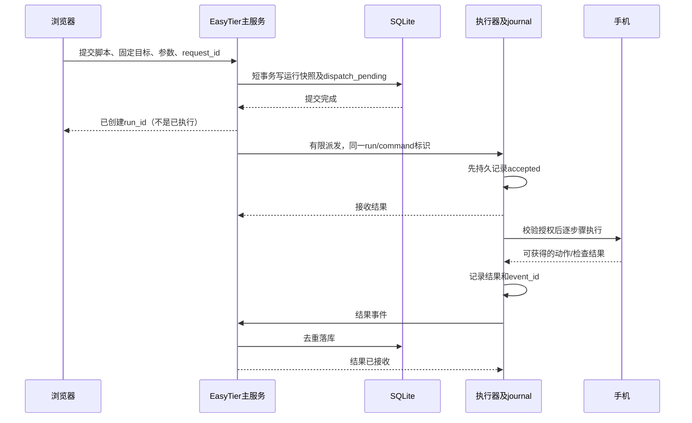

# R09 任务、数据契约与故障处理

> 2026-10-24（Asia/Shanghai）。架构深化建议，尚未实现或测试。与R08共同补充R02；所有表名/API/状态为待实现契约，不代表现有接口。

## 1. 六个需要自研的模块

|模块|主服务职责|执行器职责|
|---|---|---|
|目标解析|现有资产/实例/规则解析，生成不可变目标快照|核验指定路由域、地址和端口；拒绝目标版本不符|
|授权及占用|活跃actor/owner检查、签发范围授权、持久占用/撤销意图|每目标串行写入、版本校验、授权到期停止新动作|
|会话管理|会话归属、固定目标集、账号变化及关闭记录|独立管理观看、采集、控制和脚本资源|
|有限步骤解释|保存并校验结构、参数及运行快照|调用scrcpy/uiautomator2有限动作，检查前置条件及超时|
|任务交接|持久运行记录、待派发标记、有限并发、逐机结果汇总|journal先记录再接收，步骤执行与结果去重重传|
|证据管理|按账号鉴权读取、任务历史和手动清理|截图/错误归档、受限上传、局部失败与容量保护|

这六块构成执行器与业务整合的工作量。FastAPI、ADB或uiautomator2本身没有提供本项目的账号、资产和批量生命周期。有限步骤解释器只负责固定动作顺序、条件、时限与结果，不扩张为通用DAG、任意代码执行或调度平台。

## 2. 建议的数据落点

业务唯一真源继续为主服务SQLite。需要查询/约束的归属、状态、设备、时间使用普通列及索引；不可变步骤/参数/目标快照可保存版本化JSON。高频触摸MOVE和媒体包不逐条写主库。

|建议对象|主要字段及约束|
|---|---|
|automation_executors|受信任执行器标识、私网端点、协议版本、能力、管理员配置；密钥为后端秘密引用|
|automation_targets|唯一asset_device_id、executor_id、route_context、ADB模式及端口、配置版本；资产姓名/型号不在此重复维护|
|automation_sessions及目标明细|owner/actor、固定asset集合、用途、授权期限、目标快照、观看/控制独立状态|
|automation_scripts|owner、名称、draft_revision、schema_version、稳定step_id及步骤JSON；保存草稿无额外发布按钮|
|automation_runs|owner/actor、请求幂等键与摘要、不可变脚本及目标快照、参数、并发和失败策略、创建时间|
|automation_run_devices|run_id＋目标快照ID唯一；派发状态、执行状态、当前步骤、取消意图、最后确认时间|
|automation_step_results|逐机step_id、command_id、动作回执、断言结果、错误、时间及截图引用；同回执去重|
|automation_control_leases|asset_id及规范目标占用、持有会话/任务、epoch、有限有效期、撤销状态|
|automation_artifacts|任务/步骤/owner关联、类型、受控文件键、字节数、摘要和保存结果|

以上是逻辑对象，不强制每个对象都拆成独立服务或复杂Repository框架。主服务单实例，SQLite足够当前资料和低频任务记录。当前连接代码没有显式声明已启用WAL/busy_timeout，若实施调整需记录迁移与验证，不把建议写成现状。

资产删除仍按原规则处理设备和服务。活跃自动化配置可随资产清理，但历史任务保存设备名称/地址/步骤快照，资产关联允许失效；不能因为外键级联把旧运行结果一起抹掉，也不能为了历史记录擅自禁止原本允许的删除。账号软删保留历史归属，停止新操作，遵守现有管理员查询边界。执行结果是本功能必要记录，不新增全站操作审计系统。

可清理的是绑定配置；尚未确认的取消/撤销意图、旧目标快照、授权代际与cleanup_pending记录必须保留到处理完成，不能依赖仍存在的asset行，也不能被级联删掉。新资产即便复用同一地址，仍要受旧目标未清理占用限制。

截图由执行器生成，建议经内部鉴权接口写入主服务的受限结果目录；数据库只存引用，不存视频/大截图Blob。执行器只保留有上限的待确认上传；失败截图失败单独记录，不能覆盖原始步骤错误。文件按任务手动清理、容量达到上限时明确拒绝新证据写入，不增加后台清理cron。

## 3. 一个设备对应什么控制目标

目标从现有资产生成，不接受浏览器直接提交一个任意IP就启动ADB。target_fingerprint包含影响路由的实例代际/规则、连接IPv4/端口、执行器及route_context；字段来源和冲突例子见R08。

同一资产首版只绑定一个执行器。写入互斥同时检查asset_id和同路由域的实际ADB目标；两条资产指向同一实际端点时不能获得两把写锁。不同执行器或不同IP背后的同一真实手机仍无法仅凭IP识别，首版不承诺物理去重，也不允许故意重复配置绕开控制限制。

目标版本检查需覆盖创建、派发与后续步骤；绑定变更、删除、管理员降权或账号软删产生主动撤销信号。不能凭一张页面刚加载过的资料永久授权。

## 4. 授权、控制权与远程撤销

主服务创建或续授权时同时检查活跃actor与活跃owner，再检查本人或有效管理员权限。管理员先选目标账号；一次群控/任务不混多个owner。现有普通资产authorize只检查owner存在等条件，必须补活跃状态逻辑，不能直接复用后宣称撤权完整。external webhook的新自动化能力后置。

浏览器使用短效、限定executor/session/asset/target_fingerprint/capability的票据；长期执行器凭据不下发浏览器。票据校验使用成熟签名库，首版可采用主服务签名、执行器仅持公钥的方式；入口凭据短期且不可变成任意ADB代理。观看授权不隐含控制权限，截图与控件树读取同样鉴权。

控制权epoch是每次重新授予时递增的代号，旧页面/旧任务的命令即使延迟到达也应拒绝。普通命令有序且队列有上限；停止和释放触点有独立高优先级处理路径，不能排在大量滑动事件之后。单机浮球始终本机，全局浮球只能使用该次明确冻结的目标集。

主服务持久化控制代际，Runner持久保存已见代际、撤销和拒收记录。Runner每次启动更换会话代际，旧活跃会话不自动恢复；新控制必须与主服务重新握手授权并确认旧资源清理。主服务不可达时不能用重启前票据重建控制。执行器数据卷丢失视为重新登记，不沿用丢失状态的旧执行器身份。

账号删除事务中同时持久撤销相关自动化授权、登记取消意图，再提交并通知执行器；既有禁网逻辑继续。资产地址变更/删除也需同样的失效钩子。管理员降权要撤销其作为actor发起的跨账号操作；账号删除还要覆盖其作为owner的资产操作。

数据库撤权成功和远程手机已停止分开反馈。执行器不可达时显示“权限已撤销，停止待确认”；有限授权到期后不得执行新动作，长步骤必须受超时边界限制。运行中的查看媒体也受授权期限约束。授权续期只在明确活跃的会话/任务中进行；全网不增加轮询、扫描或业务cron。具体期限及停止时效需后续验证，不能承诺网络断开时瞬时撤权。

自动化使用短数据库事务、按目标协调和有界调度。现有网络配置mutation_lock不得扩为每次控制/任务的全局锁；必要的既有资产变更协调也必须在外部I/O前结束。调用ADB、Runner、WebRTC及等待步骤时不得持有主库写事务或网络配置全局锁。

## 5. 不用MQ时，任务如何可靠交接

request_id相同且摘要相同返回原run；相同ID不同内容拒绝。Runner接收重传返回原记录，不能再次创建任务。主服务结果事件用稳定event_id去重；运行重启后事件游标不能简单从零复用旧身份。任务步骤有稳定step_id，不按UI显示的第几行识别。

主服务持久化与唤醒内存调度器之间可能崩溃，所以dispatch_pending在库内保存。状态推进由用户提交、完成事件、明确查询/恢复触发；应用启动可做一次记录核对，不自动继续派发中断任务。没有MQ也不能只把任务塞进内存然后返回成功。

启动或人工查询发现旧任务时，先向Runner查询同一run/command的事实：已完成补回结果；已发送但无法确认标为outcome_unknown。查询未找到不代表旧派发请求不会迟到。准备重新运行前，应持久登记旧run/command取消或拒收记录、撤销旧授权，收到Runner确认且目标清理完成后才允许新运行；迟到的旧请求必须命中拒收记录。无法确认时保留未知状态和占用限制，不能把一次404当作安全重试依据。仅补结果的请求可以重发，不能把网络重连当作重放点击、输入或提交的许可。

排队仅用于本次明确提交、仍有效且可执行任务的容量等待，设总容量和最长等待时间。离线/未授权/目标改变的设备不是“等它回来就自动执行”。运行前检查不可用目标，用户先处理或明确移除；实际派发前再次检查，因为期间仍可能变更或被占用。

手机动作与SQLite无法组成原子事务。即使journal中有command_id，也存在“手机已执行，结果尚未写入”的窗口；该设计只提供请求去重与真实状态记录，不宣称动作exactly-once。用户主动重新运行属于新操作，可能再次产生副作用。

## 6. 逐机状态与取消

每台设备的派发状态、执行状态、断言结果、取消请求分别记录，不用一个success布尔值压平。

|状态/事实|页面含义|允许的后续|
|---|---|---|
|dispatch_pending / queued|已登记，尚未开始设备动作|明确取消或在本次有效任务容量内等待|
|accepted / starting|执行器已接收，准备运行|仍不能标为手机操作成功|
|running|正在执行某一步|有限等待、继续、取消|
|action_sent|动作已写入控制通道|仅表示发送；按步骤定义等待或显式断言|
|assertion_passed|声明的检查条件通过|继续下一步；不泛化为任意业务成功|
|completed / failed|计划已完成或步骤明确失败|保留动作回执和检查证据|
|cancel_requested|用户要求取消，尚待停止确认|不派新动作，展示实际确认进度|
|cancelled / interrupted|已确认未再执行，或进程/授权导致中断|保留最后动作结果是否明确|
|outcome_unknown|动作是否发生无法确认|查询事实或用户明确新运行，不自动重放|

总任务由逐机结果汇总为运行中、全部完成、部分失败、已取消或有未确认结果。取消恰好与正常完成同时发生时保存真实终态，不把已完成强行改成取消；迟到的starting事件不得使已完成任务倒退。

取消先停止接纳下一步，取消有限等待，释放触点，再回收工作进程。终止Python进程不代表已发到手机的动作撤销。资源未清理完保持cleanup_pending并禁止同目标新控制；不使用全局adb kill-server解决单机问题。

当前建议首版只提供取消和“选择设备、确认快照及参数后创建新运行”。任务暂停和从任意中间步骤恢复后置，因为还需定义保留控制权的时限及手机页面前置条件；录制过程的暂停仍保留。这项收敛替换早期R01中的宽泛承诺，不是删掉用户明确要求的功能。

## 7. 实时手势、录制与脚本是不同执行路径

实时单控/群控走规范化命令及逐机顺序队列；脚本由执行器持有任务上下文、一步一步运行。它们共用目标、授权、占用及动作适配器，不把WebSocket鼠标事件直接当后台任务引擎。

录制从已接收的规范化控制事件生成步骤：DOWN/MOVE/UP合并为点击、长按、滑动；记录方向、有效视频尺寸、几何版本、时长及坐标。没有完整UP、发生旋转或结果不明的手势标为不完整，不能生成看似验证通过的步骤。未保存编辑仍按产品草稿处理，敏感内容不默认进入持久录制或日志。

控件步骤优先resource-id/description，文本次之；命中0个在有限期限内等待或失败，命中多个默认拒绝而不是静默点击第一个。显式坐标步骤可以作为回退方式，但控件查找失败不能自动改用旧坐标继续。

首版能检查的匹配条件是前台包名、方向、几何版本和用户明确设定的控件前置条件。不能声称能自动辨认所有手机的任意页面是否一致。坐标归一化只解决几何映射，不解决弹窗、字体、系统版本、WebView或自绘布局差异。

wait_for允许在该步骤的最长时限内进行有界的只读条件查询，这是用户已启动任务的执行逻辑；不属于全网定时扫描。点击/输入等有副作用动作不因等待超时而自动重试。截图只作证据，显式断言才有检查结果。

## 8. 建议接口与错误契约

主服务前缀建议为/api/v1/automation：devices聚合、设备connection-config及prepare、sessions、scripts、runs、runs/{id}/cancel、runs/{id}/events、artifacts/{id}。prepare只执行用户明确请求的有限准备；打开列表不自动扫描或连接。删除/绑定更改仍经原资产接口及新增失效钩子。

运行创建至少提交request_id、script_id及预期草稿revision（或试跑快照）、固定device_ids、参数和失败策略。浏览器不提交可信owner声明、shell命令或任意执行地址；主服务核对当前选定账号并解析目标。参数与脚本revision冲突提示刷新，不默默运行最新草稿。

Runner内部API使用协议版本、持久run_id/command_id、目标快照、授权和有限步骤；返回accepted及可查询标识。浏览器信令/输入走受票据保护的WSS；结果推送断开时页面显示资料可能过期，提供明确查询重取，不添加页面定时轮询。

错误结构建议包括code、可显示message、asset_id、step_id、request_id、是否可由用户重试。稳定错误码至少包括target_changed、route_ambiguous、adb_unauthorized、device_busy、capability_missing、grant_expired、media_not_ready、cleanup_pending、outcome_unknown。错误文本不得回显配对码或敏感输入。

## 9. 故障场景与实际验证门槛

|场景|应有行为|
|---|---|
|关网页|人工控制结束；已提交任务在有效授权内继续；重开查同run|
|主服务重启，Runner仍在执行|不重复派发；先查事实；Runner仅在剩余授权与步骤时限内运行|
|Runner重启|按journal标中断/未确认，清理旧资源；不自动续跑动作|
|手机断线或无线端口改变|相关设备中断，不改拨其他地址；手工处理后新运行|
|设备改名|历史快照保留原名，当前列表显示新名；不因展示改动撤控制权|
|实例重建、地址规则改变|旧目标授权失效，停止新动作；不静默跟随新IP|
|账号删除或管理员降权|持久撤权并通知，网络不可达则停止待确认；旧票据不能无限继续|
|磁盘满/证据上传失败|接收任务或记录结果失败明确返回；不确认尚未持久化的接收；截图失败不改写原步骤结果|

实现验证先打通：一台手机准备/投屏/单控/释放；两台手机固定范围批量与互斥；一个真实App的5–10步手写脚本，含输入/等待/断言/取消及关网页后查结果。之后把录制生成的步骤接入同一执行引擎，再完善同步手势和1/2/5/10台容量。此次只调整内部工程依赖顺序，保留用户的多屏、群控和脚本目标。

每阶段需收集真实首帧、输入到画面变化时间、掉帧/排队、CPU/内存、网络流量、手机发热及实际异常结果；未测量前不承诺高清路数或毫秒延迟。所有验证项待用户授权测试阶段执行，本轮没有运行。

源码依据：[账号删除事务](/workspace/EasyTier-tech-console-review/easytier-web/src/db/user_admin.rs:178)、[现有资产授权](/workspace/EasyTier-tech-console-review/easytier-web/src/restful/assets/mod.rs:184)、[绑定预览及更新](/workspace/EasyTier-tech-console-review/easytier-web/src/db/assets/bindings.rs:158)、[设备删除](/workspace/EasyTier-tech-console-review/easytier-web/src/db/assets/devices.rs:206)、[CRUD幂等的范围](/workspace/EasyTier-tech-console-review/easytier-web/src/db/assets/idempotency.rs:16)、[现有命令回执边界](/workspace/EasyADB/server/api/live_handler.py:575)。
