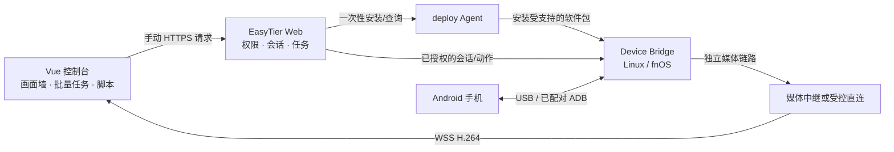

# 自动化中心产品与技术实现方案

## 推荐架构

复用 EasyTier Web 的账户、权限、节点资产与部署 Agent。新增独立的 Device Bridge 手机接入组件，负责 ADB、scrcpy 会话和脚本执行。主机 Agent 安装与管理组件，EasyTier Web 负责授权、任务记录和入口，手机控制由 Bridge 承担。



以上箭头描述按需建立的通信，不表示常驻心跳或反向隧道。媒体与控制分流，避免大视频帧阻塞操作命令。EasyTier 提供 IP 可达性；现有配置服务器 RPC 不承担视频传输。

### 组件职责

| 组件 | 首期建议 | 边界 |
| --- | --- | --- |
| Web 前端 | 复用 Vue 3、PrimeVue、控制台主题；独立会话状态模块；Web Worker 解码队列 | 浏览器能否解码目标 H.264 profile 需运行时检测；无页面定时查询 |
| Web 后端 | 复用 Rust/Axum、现有登录与用户隔离；持久化会话、脚本版本、任务结果 | 只在点击或会话事件到达时工作；不能把旧的在线状态当作手机当前可控 |
| deploy Agent | 复用 HTTPS 身份验证、目录校验、原任务编号和安装锁 | 未来添加经过审核的 Bridge 软件条目及平台清单；当前目录中尚无此应用 |
| Device Bridge | 推荐独立 Go 服务，使用主机 ADB 与固定版本的 scrcpy server；每设备独立会话 | USB 访问使用专用账户/udev 权限；避免让视频和脚本以部署 Agent 的 root 权限运行 |
| 脚本引擎 | 初期声明式步骤解释器，按用户启动的任务执行 | 不暴露任意 shell、任意 Python 或无限循环；语义控件后续接 UiAutomator2 |

fnOS x86_64 先做原生服务。Linux ARM64 需验证 ADB 工具包、USB 驱动及 scrcpy 依赖来源；不能只因 Agent 是静态 Go 程序就认定手机控制也支持所有架构。OpenWrt ARM/ARMv7 首期继续支持 Agent，但不作为推荐多手机接入主机。主机需要数据线、独立供电 USB Hub、稳定 USB 控制器和足够散热。

## 手机与画面接入

### Android 首期链路

1. 用户连接 USB，手动开启开发者选项并在手机上授权该主机的调试密钥。
2. 点击「发现手机」，Bridge 运行一次设备枚举，区分 `device`、`unauthorized`、`offline`；保存稳定设备标识及所属主机。
3. 点击「打开画面」，Web 校验所属用户、目标列表和并发额度，创建明确的会话编号。
4. Bridge 对选中手机启动匹配版本的 scrcpy server，解析编码帧/元信息，将视频与控制放在独立连接上。
5. 浏览器解码显示；点击/拖动转换为该设备坐标系中的操作。会话关闭事件释放连接、进程与控制权。

scrcpy 是原生客户端/服务端方案，不能把桌面客户端直接嵌入浏览器；必须实现或集成协议适配层。其协议属于内部协议，客户端与 Android server 必须锁定相同版本，并校验下载摘要，不能安装时任意拉取最新版本。

### 传输选择

首期优先 **WSS + WebCodecs + H.264**，先在 Chromium 桌面浏览器验证。Bridge 负责正确传递 codec 配置、帧边界、时间戳、分辨率和关键帧；前端控制解码积压并在必要时从关键帧恢复，不能任意丢弃依赖帧。能力不足时明确提示不支持实时画面，可提供用户点击截屏，不能自动降级为轮询。

浏览器到接入主机不可直达时，用独立媒体中继转发；中继绑定当前登录用户、设备和会话，凭据不放在 URL。可在显式握手时使用一次性票据并校验有效时间，无需定期扫描。禁止绕过 HTTPS 验证。代理缓冲、消息大小和连接上限需按媒体流配置。

WSS 基于 TCP，弱网存在队头阻塞，不能承诺游戏级低延迟。WebRTC 可以作为后续弱网优化，但 ICE、DTLS、RTCP、STUN/TURN 与连接状态维护涉及协议定时行为；在用户坚持严格无定时器时，不应选用后又声称满足该约束。

首期不默认开启音频。受保护画面可能黑屏、锁屏设备可能不能控制，产品显示原因，不承诺绕过系统授权或限制。

## 画面墙与批量操作

### 页面结构

- 上方：接入主机/分组/搜索、选中数量、「发现手机」「打开选中画面」「关闭画面」。这些都是手动动作。
- 中间：可选择的画面卡片，显示名称、状态、最后一帧时间。未连接时是静态占位，不显示伪在线指示灯。
- 右侧抽屉：单机放大与控制区，设备属性和最近操作；放大不改变批量目标列表。
- 下方或独立区域：当前任务，逐台结果、停止、手动查询、选择失败项重试。

可见卡片优先订阅视频；隐藏卡片暂停媒体订阅属于已经打开会话的视图事件，不重新发现设备。设备数超过预算时分页，不承诺一次同时解码无限路视频。

### 容量预估

| 场景 | 试点参数 | 估算负载 |
| --- | --- | --- |
| 画面墙 | 约 480p、5–10fps、0.2–0.5Mbps/路 | 20 路约 4–10Mbps，另加协议开销与突发关键帧 |
| 单机放大 | 720p/1080p、15–30fps、1–4Mbps | 额外 1–4Mbps；其他卡片维持低档位 |
| 中继 | 原编码帧转发，不做无必要转码 | 中继同时承担入口与出口带宽，多观看者出口随人数增加 |

这些是容量规划假设，实际取决于手机编码器、画面变化、浏览器硬件解码、USB 拓扑和链路丢包。需要实测 CPU、内存、GPU、手机温度与供电，不能只按服务器 CPU 核数承诺手机数量。

### 批量一致性

每次执行固定 `device_ids`、操作版本和唯一 `command_id`，先做权限、屏幕尺寸/方向、授权与控制占用预检；结果逐设备保存。坐标以可视内容区域归一化，去掉黑边，并携带屏幕方向/尺寸版本，旋转后拒绝旧坐标动作。不同 App 布局不能仅靠坐标归一化保证一致。

每台设备只允许一个操作会话。任务按设备分队列，按显式事件推进并限制并发；不是定时调度器。Bridge 对重复编号记录状态，防止普通重复发送；手机已经执行但结果未落盘时只能标为 `outcome_unknown`，不能声称端到端恰好一次。重启后不自动重放。批量发送是尽力接近同时，不能保证所有手机毫秒级同步。

## 脚本能力

第一版脚本为有版本的 JSON DSL：`launch_app`、`tap`、`swipe`、`input_text`、`key`、`manual_checkpoint`、`assert_screen_size`。录制来自用户本次控制会话，保存顺序及坐标基准；不要把所有录制事件的时间间隔自动转换成等待定时器。

```json
{
  "schema_version": 1,
  "name": "打开设置并等待人工确认",
  "platform": "android",
  "steps": [
    { "type": "launch_app", "package": "com.android.settings" },
    { "type": "manual_checkpoint", "prompt": "检查页面后点击继续" },
    { "type": "key", "key": "HOME" }
  ]
}
```

编辑器展示步骤列表、参数表单、校验错误、适用设备和版本差异；参数通过引用注入敏感值，日志不保存明文凭据。运行前展示不可变脚本版本、目标列表和预计动作；中途修改脚本不改变已开始的任务。

第二阶段再接 UiAutomator2/Appium 实现 `resource-id`、文本和 accessibility selector。需要 Java/Android SDK、每设备独立端口和实际 App 兼容性验证；scrcpy 本身不提供语义控件识别，不能把坐标录制包装成稳定的语义脚本。

严格无定时器模式下不提供 `sleep`、自动重试、周期运行、等待控件的循环查询。页面加载衔接先用用户确认继续或明确的事件。若用户后续允许“手动启动任务内部的有界等待/超时”，再增加有界 `wait_for` 和超时策略，并明确某些引擎的等待实际上会轮询。

## 数据模型与接口草案

复用 `asset_devices` 作为可选资产关联，`deploy_agents` 作为接入主机；手机资产、Agent 主机和 ADB 连接必须是不同实体。不能把资产登记或 EasyTier 在线自动推断为手机可控。

建议新增（尚未创建）：

| 表 | 关键字段 |
| --- | --- |
| `automation_devices` | `id`, `owner_user_id`, `host_agent_id`, `asset_device_id?`, 稳定设备标识、平台、别名、最后发现结果 |
| `automation_sessions` | 会话编号、用户、目标设备、状态、当前控制者、开始/结束时间、最后事件 |
| `automation_scripts` / `script_versions` | 所有者、名称、不可变 DSL 版本、适用平台、参数定义 |
| `automation_runs` / `run_devices` / `run_steps` | 脚本版本、目标快照、逐设备/逐步骤状态、原指令编号、脱敏结果 |

设备标识不能用临时 USB 地址或 IP 单独决定；无线配对信息、ADB serial、所属主机及已验证设备信息需组合核验。重新配对/换机时显式确认绑定关系。

建议 API 前缀 `/api/v1/automation`，沿用登录会话并逐对象校验所属用户；权限区分查看、控制、编辑脚本和执行：

- `GET /devices`：仅保存的结果；`POST /hosts/{id}/discover`：一次发现。
- `POST /sessions`、`POST /sessions/{id}/close`：打开/关闭显式会话。
- 会话内独立媒体流与控制通道：验证用户、会话和设备范围，不转发任意地址或命令。
- `POST /batch-actions`、`POST /runs`、`POST /runs/{id}/cancel`：启动/停止。
- `GET /runs/{id}`：保存的数据；`POST /runs/{id}/refresh`：用户请求远端最新结果。
- `POST /scripts`、`POST /scripts/{id}/versions`：保存草稿与新版本。

会话状态：`opening → active → closing → closed`，异常分 `failed` 与 `unknown`。任务状态：`accepted/running/succeeded/partial/failed/cancel_requested/cancelled/interrupted/outcome_unknown`。任务中的明确结果可随当前会话事件返回，关闭页面后不靠 Web 轮询追赶。

## 无心跳与故障处理

无心跳时不能可靠实时判断半开连接，也不能保证断网后立即清理僵尸会话。收到 EOF/关闭事件时立即清理；未收到事件的会话保留上次观测状态。提供「检查会话」「停止并清理」「重新连接」手动操作，不把旧状态继续标为实时在线。

不加定期租约续约或定时清扫来掩盖这个限制。任务超时、僵尸回收、活动会话保活是否允许，需由用户明确放宽范围后实现。网络和设备重启后均不自动恢复脚本或重放控制动作。

## iOS 路线

iPhone 单独做可行性验证，通常需要 macOS + Xcode、已签名的 WebDriverAgent、设备信任及相应开发设置。fnOS/Linux 主机不能直接承诺承载完整 XCUITest 开发链；需要另配 Mac 接入节点。画面采集、输入控制、系统弹窗和可执行动作均需逐项验证。首期不把 iOS 写入支持列表。

## 参考依据

2026-10-23 阅读官方仓库文档；实际实施应锁定具体版本重新验证：

- [scrcpy 开发与协议](https://github.com/Genymobile/scrcpy/blob/master/doc/develop.md)：视频、音频、控制为独立通道，默认 H.264，内部协议必须匹配版本。
- [Appium UiAutomator2](https://github.com/appium/appium-uiautomator2-driver#requirements)：主机平台、Android SDK/Java 和 Android 最低版本随驱动版本变化。
- [Appium XCUITest](https://github.com/appium/appium-xcuitest-driver)：iOS/iPadOS 的独立驱动路线；实施前根据具体 iOS/Xcode 版本复核安装条件。
