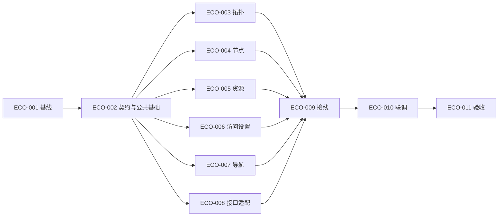

# 网络拓扑与资源集成计划索引

先阅读[需求/计划汇总](../README.md)，再进入对应小计划文件。本期11个计划工作包对应15项任务已全部验收，已实现范围与未支持能力见验收记录。总体进度与已遇问题在根汇总维护，任务执行状态以明细及[看板](../task/README.md)为准。

公共目标、兼容边界、页面范围、需求追踪、待决项及历史记录见 [PLAN-ECO-000](plan-eco-000-overview.md)。它是公共说明，不计为第12工作包。独立 Web 美化见 [PLAN-WUI](../../web-ui-optimization-done/plan/README.md)，原 ECO-012 只保留迁移记录，不再作为执行包或前置。

## 小计划目录

| 计划文件 | 原工作包 | 前置 | 文档状态 |
| --- | --- | --- | --- |
| [PLAN-ECO-001 基线与复用清单](plan-eco-001-baseline.md) | ECO-001 | 无 | draft；未执行 |
| [PLAN-ECO-002 页面契约与公共基础](plan-eco-002-contract.md) | ECO-002 | ECO-001 | draft；未执行 |
| [PLAN-ECO-003 拓扑页面](plan-eco-003-topology.md) | ECO-003 | ECO-002 | draft；未执行 |
| [PLAN-ECO-004 节点详情与资料](plan-eco-004-node-details.md) | ECO-004 | ECO-002 | draft；未执行 |
| [PLAN-ECO-005 服务/设备组/设备详情](plan-eco-005-resource-details.md) | ECO-005 | ECO-002 | draft；未执行 |
| [PLAN-ECO-006 访问设置](plan-eco-006-access-settings.md) | ECO-006 | ECO-002 | draft；未执行 |
| [PLAN-ECO-007 导航入口](plan-eco-007-navigation.md) | ECO-007 | ECO-002 | draft；未执行 |
| [PLAN-ECO-008 现有接口适配](plan-eco-008-api-adapter.md) | ECO-008 | ECO-002 | draft；未执行 |
| [PLAN-ECO-009 页面与宿主接线](plan-eco-009-host-integration.md) | ECO-009 | ECO-003、ECO-004、ECO-005、ECO-006、ECO-007、ECO-008 | draft；未执行 |
| [PLAN-ECO-010 真实接口联调](plan-eco-010-integration-verification.md) | ECO-010 | ECO-009 | draft；未执行 |
| [PLAN-ECO-011 验收与交接](plan-eco-011-acceptance.md) | ECO-011 | ECO-010 | draft；未执行 |

## 计划到小任务

| 小计划 | 实际任务 |
| --- | --- |
| [PLAN-ECO-001](plan-eco-001-baseline.md) | [ECO-101 源码基线与接口能力清单](../task/task-eco-101-source-capabilities.md)、[ECO-102 现有页面与请求行为取证](../task/task-eco-102-page-baseline.md) |
| [PLAN-ECO-002](plan-eco-002-contract.md) | [ECO-103 资源视图与按需查询契约](../task/task-eco-103-domain-contract.md)、[ECO-104 公共展示组件与语言资源](../task/task-eco-104-shared-components.md)、[ECO-105 独立预览与验证入口](../task/task-eco-105-preview-harness.md) |
| [PLAN-ECO-003](plan-eco-003-topology.md) | [ECO-106 拓扑选择与可访问表达](../task/task-eco-106-topology-view.md) |
| [PLAN-ECO-004](plan-eco-004-node-details.md) | [ECO-107 节点资料与类型目录](../task/task-eco-107-node-details.md) |
| [PLAN-ECO-005](plan-eco-005-resource-details.md) | [ECO-108 服务设备组与设备详情](../task/task-eco-108-resource-details.md) |
| [PLAN-ECO-006](plan-eco-006-access-settings.md) | [ECO-109 公网映射与导航设置表单](../task/task-eco-109-access-settings.md) |
| [PLAN-ECO-007](plan-eco-007-navigation.md) | [ECO-110 资源导航入口与回链](../task/task-eco-110-navigation-view.md) |
| [PLAN-ECO-008](plan-eco-008-api-adapter.md) | [ECO-111 现有接口适配与请求结束](../task/task-eco-111-api-adapter.md) |
| [PLAN-ECO-009](plan-eco-009-host-integration.md) | [ECO-112 拓扑页面组合与能力注入](../task/task-eco-112-page-composition.md)、[ECO-113 正式路由与宿主导航接线](../task/task-eco-113-host-routing.md) |
| [PLAN-ECO-010](plan-eco-010-integration-verification.md) | [ECO-114 真实接口联调与失败回派](../task/task-eco-114-integration-verification.md) |
| [PLAN-ECO-011](plan-eco-011-acceptance.md) | [ECO-115 验收范围与交付回退记录](../task/task-eco-115-acceptance-handoff.md) |

任务 DAG、共享文件单一写入者、可并行批次和验收状态统一见[任务看板](../task/README.md)。`PLAN-ECO-000` 是公共说明，不产生第16项任务；ECO-14/ECA-17 deploy 后置，迁出的 ECO-012 不复用。

## 依赖与并行摘要

并行集合为 ECO-003、ECO-004、ECO-005、ECO-006、ECO-007、ECO-008。它们在 ECO-002 契约交付后独立工作，通过 props/events、插槽及接口类型衔接；不直接依赖尚未完成的页面实现。ECO-009 负责统一接线，ECO-010 负责真实联调。原 ECO-012 已迁出独立 Web 美化计划，编号保留、不复用；本计划仍为11个工作包，对应15项已验收任务；任务层额外区分两项基线核查、公共基础职责及组合/正式接线。

## 5. 里程碑与交付顺序

| 里程碑 | 工作包 | 交付与退出条件 |
| --- | --- | --- |
| M1 设计基线明确 | ECO-001 | 定位实现分支/SHA，检查已有页面、组件、接口和构建入口；记录界面证据与现状，无证据不开始基于猜测的改版 |
| M2 页面与契约基础 | ECO-002 | 信息架构、布局/交互规范、字段与能力矩阵、公共类型和组件边界明确；独立页面可编译和预览的最小接线就绪 |
| M3 独立页面与接口适配 | ECO-003 至 ECO-008 | 各拓扑/资源页面拥有独立设计产物和自身验证；适配层只调用确认存在的接口；共享文件无并发写入冲突 |
| M4 统一接线与真实联调 | ECO-009、ECO-010 | 先完成路由/布局/页面/API 接线，再验证已确定的真实接口流程及无新增周期状态请求 |
| M5 验收交接 | ECO-011 | 按本期接入清单记录已验证、缺口、未验证与后置项，交付设计/运行证据及回退说明 |

本计划不预估日历工期；在基线和接口清单明确前，页面数量、复用程度和外部能力不足以支持可靠工期。

## 8. 当前待决项与记录

当前问题与进度见[根汇总](../README.md#问题缺口与下一步)，原待决项及历史记录已迁至 [PLAN-ECO-000](plan-eco-000-overview.md#8-当前待决项与记录)。旧第8节入口保留用于既有引用。

2026-10-21：按编号拆分计划文件并更新任务入口；本次仅文档整理，不运行构建、测试或 CI，不改变交付范围、状态与既有历史证据。

2026-10-21：继续完成需求→小计划→小任务的拆分；15项任务全部待认领，0项实现完成；本轮只读代码并整理文档，未运行构建、测试或 CI。

## 当前实施快照

已验收 15/15；；其余 0 项 backlog。

总控维护任务与共享锁；监工 `/root/iteration_monitor` 审查后才能完成或进入联调。实际验证见各任务交接，未运行场景不作通过结论。
