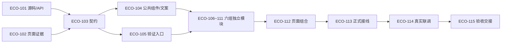

# 网络拓扑与资源集成任务看板

[需求/计划汇总](../README.md) · [需求与验收](../require/README.md) · [11份小计划与公共说明](../plan/README.md) · [跨需求共享文件调度](../../README.md#跨需求共享文件调度)

当前任务进度见下方实施快照与任务明细。

## 进度

| backlog | ready | in_progress | blocked | in_review | done | cancelled | 总计 |
| --- | --- | --- | --- | --- | --- | --- | --- |
| 0 | 0 | 0 | 0 | 0 | 15 | 0 | 15 |

当前任务进度见下方实施快照与任务明细。

## 任务明细

| 任务 | 计划 | 状态 | 负责人 | 前置任务 | 并行组 |
| --- | --- | --- | --- | --- | --- |
| [ECO-101 源码基线与接口能力清单](task-eco-101-source-capabilities.md) | [PLAN-ECO-001](../plan/plan-eco-001-baseline.md) | done | /root/iteration_exec1 | 无 | `eco-discovery` |
| [ECO-102 现有页面与请求行为取证](task-eco-102-page-baseline.md) | [PLAN-ECO-001](../plan/plan-eco-001-baseline.md) | done | /root/iteration_exec2 | 无 | `eco-discovery` |
| [ECO-103 资源视图与按需查询契约](task-eco-103-domain-contract.md) | [PLAN-ECO-002](../plan/plan-eco-002-contract.md) | done | /root/iteration_exec1 | ECO-101、ECO-102 | `eco-contract` |
| [ECO-104 公共展示组件与语言资源](task-eco-104-shared-components.md) | [PLAN-ECO-002](../plan/plan-eco-002-contract.md) | done | /root/iteration_exec1 | ECO-103 | `eco-foundation` |
| [ECO-105 独立预览与验证入口](task-eco-105-preview-harness.md) | [PLAN-ECO-002](../plan/plan-eco-002-contract.md) | done | /root/iteration_exec3 | ECO-103 | `eco-foundation` |
| [ECO-106 拓扑选择与可访问表达](task-eco-106-topology-view.md) | [PLAN-ECO-003](../plan/plan-eco-003-topology.md) | done | /root/iteration_exec1 | ECO-104、ECO-105 | `eco-pages` |
| [ECO-107 节点资料与类型目录](task-eco-107-node-details.md) | [PLAN-ECO-004](../plan/plan-eco-004-node-details.md) | done | /root/iteration_exec1 | ECO-104、ECO-105 | `eco-pages` |
| [ECO-108 服务设备组与设备详情](task-eco-108-resource-details.md) | [PLAN-ECO-005](../plan/plan-eco-005-resource-details.md) | done | /root/iteration_exec1 | ECO-104、ECO-105 | `eco-pages` |
| [ECO-109 公网映射与导航设置表单](task-eco-109-access-settings.md) | [PLAN-ECO-006](../plan/plan-eco-006-access-settings.md) | done | /root/iteration_exec3 | ECO-104、ECO-105 | `eco-pages` |
| [ECO-110 资源导航入口与回链](task-eco-110-navigation-view.md) | [PLAN-ECO-007](../plan/plan-eco-007-navigation.md) | done | /root/iteration_exec3 | ECO-104、ECO-105 | `eco-pages` |
| [ECO-111 现有接口适配与请求结束](task-eco-111-api-adapter.md) | [PLAN-ECO-008](../plan/plan-eco-008-api-adapter.md) | done | /root/iteration_exec3 | ECO-104、ECO-105 | `eco-pages` |
| [ECO-112 拓扑页面组合与能力注入](task-eco-112-page-composition.md) | [PLAN-ECO-009](../plan/plan-eco-009-host-integration.md) | done | /root/iteration_exec3 | ECO-106、ECO-107、ECO-108、ECO-109、ECO-110、ECO-111 | `eco-composition` |
| [ECO-113 正式路由与宿主导航接线](task-eco-113-host-routing.md) | [PLAN-ECO-009](../plan/plan-eco-009-host-integration.md) | done | /root/iteration_exec3 | ECO-112 | `eco-host-integration` |
| [ECO-114 真实接口联调与失败回派](task-eco-114-integration-verification.md) | [PLAN-ECO-010](../plan/plan-eco-010-integration-verification.md) | done | /root/iteration_exec2 | ECO-113 | `eco-verification` |
| [ECO-115 验收范围与交付回退记录](task-eco-115-acceptance-handoff.md) | [PLAN-ECO-011](../plan/plan-eco-011-acceptance.md) | done | /root/iteration_exec3 | ECO-114 | `eco-acceptance` |

## 强制多 Agent 批次

| 批次 | 可同时工作 | 串行条件与交付 |
| --- | --- | --- |
| A 源码/页面取证 | ECO-101 与102 | 同一采用提交，不同证据文件；源码/API清单与页面证据分别交103 |
| B 契约 | ECO-103 | 等待101/102必要输入，先固定真实接入清单和公共类型；缺失信息明确限制受影响后续任务 |
| C 公共基础 | ECO-104 与105 | 103完成后，组件/文案与验证入口按文件分离；跨需求共享写入需先调度 |
| D 独立模块 | ECO-106、107、108、109、110、111 | 104/105交付后最多六组并行，各自目录、测试文件与设计产物独占；不等待另一独立页面实现 |
| E 组合与正式接线 | ECO-112 →113 | 六组产物齐备后先组合，再修改正式路由/MainPage；不得与WUI宿主写入者同时修改 |
| F 联调与交付 | ECO-114 →115 | 正式接线后真实联调，缺陷回派原所有者；通过既定范围后再验收交接 |

批次表示依赖允许的并行范围，不代表已经安排执行 Agent 或可忽略前置。可用 Agent 不足时，在批次内顺序执行；不能为了满并发打破契约和文件所有权。

## 共享文件与交接

| 文件/产物 | 本需求唯一写入任务 | 消费者和交接规则 |
| --- | --- | --- |
| D/baseline.md | ECO-101 | 102只写baseline-evidence目录，双方不互改 |
| D/contract.md、ecosystemTypes.ts | ECO-103 | 104～113只读；改约定先停受影响写入，再串行交接新版本 |
| ecosystem/shared/、cn.yaml、en.yaml | ECO-104 | 页面提交文案/组件需求；公共文件追加仍由104处理，不移交所有页面抢写 |
| package.json、tests/ecosystem-support/ | ECO-105 | 各模块仅写自己的断言文件，105负责脚本发现与支持入口 |
| api.ts、ecosystemApi.ts | ECO-111 | 其他任务只消费契约/客户端，WUI只读，不重写账号客户端行为 |
| EcosystemPage.vue | ECO-112 | 组件组合与能力注入；不同时修改宿主路由 |
| MainPage.vue、main.ts | ECO-113 | 与WUI-111互斥；保留用户身份/迟到响应/凭据清除与config-server命令 |
| tests/ecosystem-integration.test.mjs | ECO-114 | 联调缺陷回原模块；集中Dashboard/用户E2E文件属于WUI-112，不抢写 |
| 根汇总、需求正文、计划索引、看板、任务状态 | 协调者 | 本轮编制由当前协调团队分目录交接，未来执行者交结果后由协调者同步状态 |

D为本需求plan/design目录，所有未来产物与精确源码写入范围见任务元数据。不同需求共享cn/en、package.json、MainPage/main.ts时按[全局调度表](../../README.md#跨需求共享文件调度)串行；双方同时就绪默认WUI先ECO后，只有一方就绪可先执行，不建立全需求互相依赖。全局theme/console.css/style.css由WUI负责，ECO默认只读。

未来构建/预览/浏览器验证还会写产物或占用端口：须使用隔离工作树、frontend-lib/dist与frontend/dist、服务/浏览器数据和端口；不能共写目录或争用固定5198等端口。无法隔离时串行验证，源码可并行不代表运行资源也能并行。

## 启动条件、问题与失败回派

- 当前最先可以安排的是101/102的实际基线核查与设计取证；本轮只创建文档，未执行这些任务。真实页面证据或环境不足时记录范围，不以编造数据解除阻塞。
- ECO-ISSUE-001/002由101与103收敛字段、权限及外部能力；未核实API不进入111实际调用，缺口不自动转后端开发。
- ECO-ISSUE-003由102记录旧请求、103固定新查询规则，106～113消费约定，114用对应证据核对；不新增轮询、心跳或定时任务。
- ECO-ISSUE-004的运行环境由102/105记录，114按实际环境验证，缺环境只阻塞对应验收。
- 联调失败按所有权回派：契约103、公共组件/文案104、验证接线105、独立页面106～110、API111、组合112、宿主113；修复时暂停受影响读取/验证，完成后复验相关场景。
- 保护config-server客户端连接、认证、配置下发及接入命令；deploy后置、已否决ECO-C01～09和迁出ECO-012不生成任务。

## 本轮记录

2026-10-21：完成需求→11份小计划→15项任务的文档拆分，补齐真实代码依据、多Agent依赖和共享文件调度。所有任务未认领、未实现，纯文档仅做目录/链接/编号/状态/内容检查，未运行构建、测试或CI。

## 当前实施快照

已验收 15/15；；其余 0 项 backlog。

总控维护任务与共享锁；监工 `/root/iteration_monitor` 审查后才能完成或进入联调。实际验证见各任务交接，未运行场景不作通过结论。
