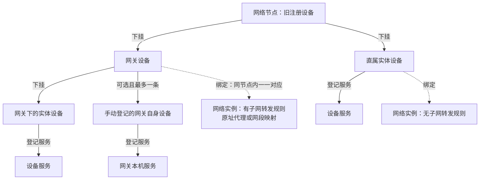

# 总拓扑图交付与当前草图

用户要求“完了后你给我一个总的拓扑图”。讨论收口后提供完整最终图；本文先记录已确认主干，不把未决定的地址跟随、迁移等设计画成已实施功能。与[网络及地址讨论](require-11-network-and-device-address-discussion.md)同步更新。

## 当前实体关系草图

以资产归属为主干：网络节点直接下挂网关设备和直属实体设备，网络实例用绑定关系表达。改网/不改网是实例的配置方式，不作为设备与服务之间的一层资产实体。

用户已认可该实体关系，并确认新增时按“当前节点 → 选择网关/普通角色 → 选择匹配实例 → 填写资料并保存”的顺序操作，见[新增设备正向流程](require-13-device-create-flow.md)。该操作流程单独记录，实体主图仍表达归属与绑定关系。

实线表示资产归属，虚线表示绑定网络实例；主图不混入地址推导或角色判断流程。网络实例仍实际运行在所属网络节点上，设备绑定所在节点的实例。图中两种实例框展示配置场景，不代表新增两类数据库网络实体。

“不改网”不能单独用于判定直属：配置 `192.168.1.0/24` 的普通代理也属于网关；`192.168.1.0/24->10.20.1.0/24` 映射同样属于网关。直属对应无子网转发规则的实例，同一节点可有多个实例，分别判断。网关自身服务继续挂在可选的自身设备下，网关下普通设备不自动要求另绑实例。

当前图说明目标业务关系，未表示真实连接已探测、路由已配置或设备服务已实际启动。网关设备与实例绑定及地址自动带出尚未实现；直属绑定的数量/排他约束仍保留后续设计边界。

## 最终图需要包含的内容

- 网络节点、实体设备、网络实例使用最新统一命名；多个节点上的实例加入同一逻辑网络的关系，不能画成网络只属于一台节点。
- 同一节点内实例与网关设备一一绑定；实例组网IP作为网关组网IP来源，网段转发规则作为下挂设备地址生成依据。
- 实体设备与服务的父子关系；直属实体设备按最新要求也须关联实例，可选自身设备规则保留。网关下普通实体设备按网关规则生成地址，不因直属设备的新要求自动强制每台下挂设备运行独立实例。
- 用已确认的IPv4规则标注组网侧网段、内网网段和主机号生成结果；IPv6本轮不展开。
- 普通子网代理保持下挂设备的原内网访问地址，网段映射按规则生成组网侧访问地址，二者均为网关。实例IP取值及配置变化后的处理仍需明确；具体IP只是说明示例，不伪装成用户真实环境数据。
- 如展示未来公网入口，明确标为后续阶段，不把公网转发或可达性画成已上线。

## 交付边界

本项是需求说明用的总拓扑图，不自动扩大成Web网络拓扑页面开发、自动发现、心跳或公网发布。纯文档整理不运行测试、构建或CI；最终图在讨论收口时同步到本文件并展示给用户。
