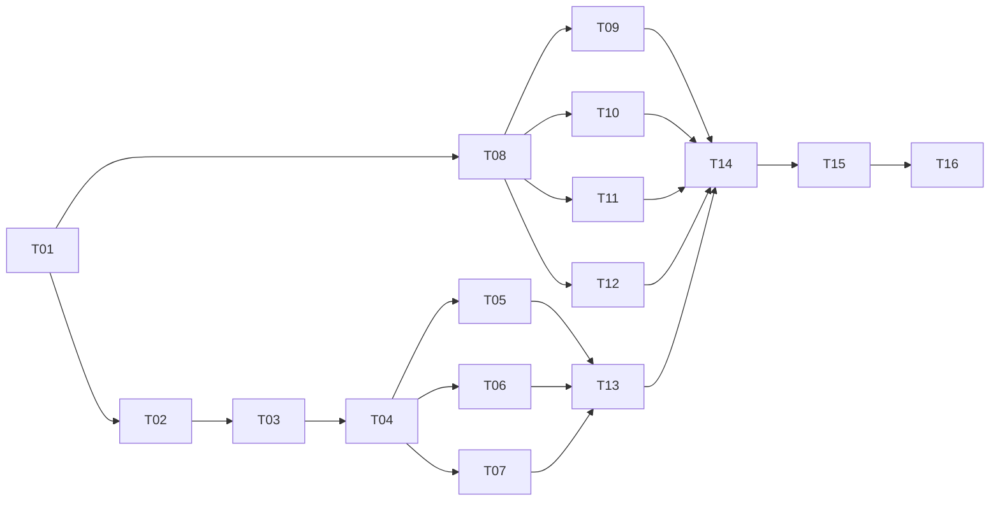

# 开发任务看板

**最新交付：** 16项任务已完成本轮交付范围，R01–R05在实例绑定版本中修复并实测，原服务11221已升级，手工备份与恢复证据均已记录。新版本的[验证报告](../../node-instance-binding-planned/task/verification-report.md)、[交付记录](../../node-instance-binding-planned/task/release-record.md)说明覆盖及边界；本目录此前验证报告仍代表当时版本。

|ID|任务|依赖|实施状态|
|---|---|---|---|
|T01|[基线与接口契约](task-01-baseline-and-contracts.md)|无|已完成/契约交接|
|T02|[数据库迁移与实体](task-02-schema-and-entities.md)|T01|已实现/本轮验证通过|
|T03|[通用校验与幂等](task-03-validation-and-idempotency.md)|T01、T02|已实现/本轮验证通过|
|T04|[权限与注册节点适配](task-04-auth-and-node-adapter.md)|T01、T02、T03|已实现/本轮验证通过|
|T05|[网关组与设备类型接口](task-05-groups-and-types-api.md)|T01、T02、T03、T04|已实现/本轮验证通过|
|T06|[设备接口与删除](task-06-devices-api.md)|T01、T02、T03、T04|已实现/本轮验证通过|
|T07|[服务接口](task-07-services-api.md)|T01、T02、T03、T04|已实现/本轮验证通过|
|T08|[前端类型与接口客户端](task-08-frontend-api-contract.md)|T01|已实现/本轮验证通过|
|T09|[详情页上下文与查询](task-09-node-assets-page.md)|T08|复审修复已通过新轮实测|
|T10|[网关组与类型弹窗](task-10-group-and-type-dialogs.md)|T08|已实现/本轮验证通过|
|T11|[设备表格与编辑](task-11-device-table-and-dialog.md)|T08|复审修复已通过新轮实测|
|T12|[服务明细与编辑](task-12-service-table-and-dialog.md)|T08|已实现/本轮验证通过|
|T13|[后端集成与删除前置保护](task-13-backend-integration.md)|T02–T07|已实现/本轮验证通过|
|T14|[前端入口与联调美化](task-14-frontend-integration-and-polish.md)|T09–T13|复审修复已通过新轮实测|
|T15|[授权后的功能验收](task-15-authorized-verification.md)|T14、测试授权|已完成/报告与截图已归档|
|T16|[备份升级与交付](task-16-backup-and-delivery.md)|T15、交付授权|随实例绑定版已备份/部署|

验证授权只限制执行检查，不要求每个模块开发前再次批准；调试模式继续生效。后续任务完成时更新其状态、交接内容与 [test-report](test-report.md)，不要把尚未执行的验收条件写成通过。

## 多 agent 波次与交接

图中传递依赖包含前置基础任务，精确依赖以上表为准。

|波次|可安排的 agent|并行前提/出口|
|---|---|---|
|A|契约 owner：T01|先确定字段、错误、路由、Props/Events、锁顺序及未答项默认；不是重复访谈|
|B|数据 owner：T02；接口 owner：T08|二者独立文件，可并行；Rust/TS 均使用同版契约|
|C|后端底座 T03→权限 T04；前端 T09/T10/T11/T12|前端四个组件/页面 agent 可并行，不等全部后端；与后端串行基础链重叠|
|D|网关/类型 T05、设备 T06、服务 T07|共享授权/事务/实体已就绪后，三个领域按独占文件并行；通过 FK/契约关联，不互调未完成 handler|
|E|后端集成 T13，然后前端集成 T14|接收所有路由、组件和翻译清单，统一接入；开发阶段不自动运行测试|
|F|验收 T15，然后交付 T16|实现成型后按授权验证/发布；未授权不影响前期开发准备|

当前最多可用的并发 slot 有限时按上述依赖顺排，不为了用满 agent 把同一文件拆给多人。建议每个实现任务用同一冻结基线的独立分支/工作树，集成时显式交接；本轮未新建实现分支或提交。

## 文件唯一负责人

以下为本轮实际文件归属。公共文件由 root 集中接入；独占模块在原 owner 完成交接后才顺序修正。

|owner/任务|实际独占代码范围|交接说明|
|---|---|---|
|root / T01|本需求 `plan/contracts/v1.md`|冻结字段、路由、错误、组件契约与默认项|
|schema / T02|本次新迁移及注册、`db/entity/` 9 个新资产实体及注册|原注册节点实体沿用|
|assets_store / T03、T05–T07|`db/assets/{mod,common,validation,idempotency,types,groups,devices,services}.rs`|领域层由单一 owner 实现，公共校验/事务不争写|
|schema / T04、T13 新路由|`restful/assets/mod.rs`|所有新 handlers、会话授权、账号/节点目录、节点属性适配|
|frontend_api / T08|`frontend/src/types/node-assets.ts`、`modules/api.ts`、`composables/useAssetMutation.ts`|类型、接口与新增重试 helper|
|root → frontend_api / T09|`NodeAssetsPage.vue` 由 root；`composables/useNodeAssetsPage.ts` 初版 root、交接后由 frontend_api 修正异步处理|两个文件分别写入，不同 agent 不共写|
|group_dialogs / T10|`components/node-assets/GatewayGroupDialog.vue`、`DeviceTypeDialog.vue`|翻译以 handoff JSON 交 root 合并|
|device_components / T11|`components/node-assets/AssetDeviceTable.vue`、`AssetDeviceDialog.vue`|服务通过 slot 交接|
|service_components / T12|`components/node-assets/AssetServicePanel.vue`、`AssetServiceDialog.vue`、`constants/asset-service-icons.ts`|内置图标及服务组件|
|root / T13 旧流程接入|`db/mod.rs`、`db/devices.rs`、`restful/mod.rs`、`central_network/service.rs`|旧节点删除前置保护、外键和路由注册；本轮未重写 config-server|
|root / T14|`frontend/src/main.ts`、`MainPage.vue`、`DeviceList.vue`、中英 YAML|入口/计数/翻译及页面组装；组件修复交原 owner|
|验证 / T15|DB/REST测试、`node-assets-api.test.mjs`、`node-assets-e2e.test.mjs`及报告/截图|按独占文件并行，最终结果见验证报告|
|待交付 / T16|后续交付/升级恢复记录及明确的部署文件|当前未备份、部署或提交|

所有实现交接至少包含：变更文件、契约版本、调用签名/事件、依赖、接入片段、翻译 key、已知限制和实际执行/未执行检查。新增共享文件先登记 owner；冲突返回唯一 owner，不让多 agent 各自覆盖解决。

## 状态流转与完成定义

`待依赖 → 可领取 → 开发中 → 待集成 → 待授权验证 → 已验证 → 已交付`。任务可按自身职责在代码/文档交接后完成，但看板明确标出整体验证状态；不能把模块完成直接统计为功能已部署。出现阻塞时记录具体文件、契约问题与处理 owner，不以未定细节为由继续向用户提问。

## 本轮实际分工与剩余事项

- root：v1 契约、页面组装、后端公共注册与旧节点删除前置保护、菜单/路由/数量入口、中英翻译、汇总报告。
- schema agent：T02 迁移与实体、T04/T13 新增 `restful/assets/mod.rs`；领域仓储由 assets_store agent 独占 `db/assets/`，承担 T03/T05–T07，避免并发修改公共事务和校验代码。
- frontend_api agent：T08 类型/API/幂等 helper，交接后人工审阅并修正 T09 controller；group/device/service 三个 agent 分别独占 T10/T11/T12 组件和翻译交接清单。
- 交叉阅读发现的问题已交原 owner 修正：定位标记、异步请求上下文、错误重试与计数刷新、未登录错误契约、IPv4-mapped IPv6 网段归一；未以源码阅读代替运行验证。
- T15 已完成：构建、数据库/权限/删除/幂等、真实HTTP与页面操作链、原节点属性回归及本地TCP注册均有实际证据。截图已归档；真实OIDC认证和原部署备份恢复未执行。下一阶段为 T16 备份部署；本轮用户已授权将代码提交并 push 到当前分支，远端结果以 Git 记录为准。
