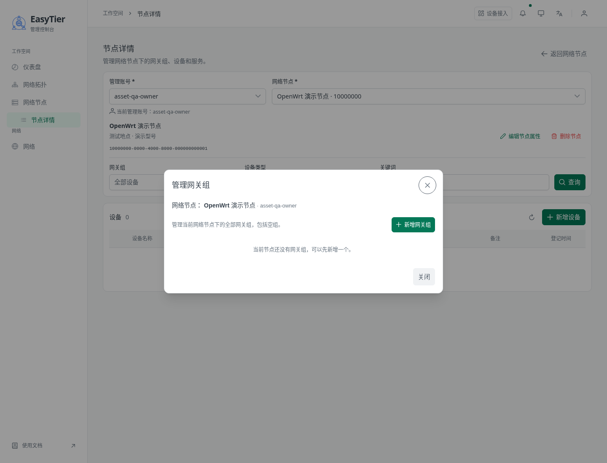
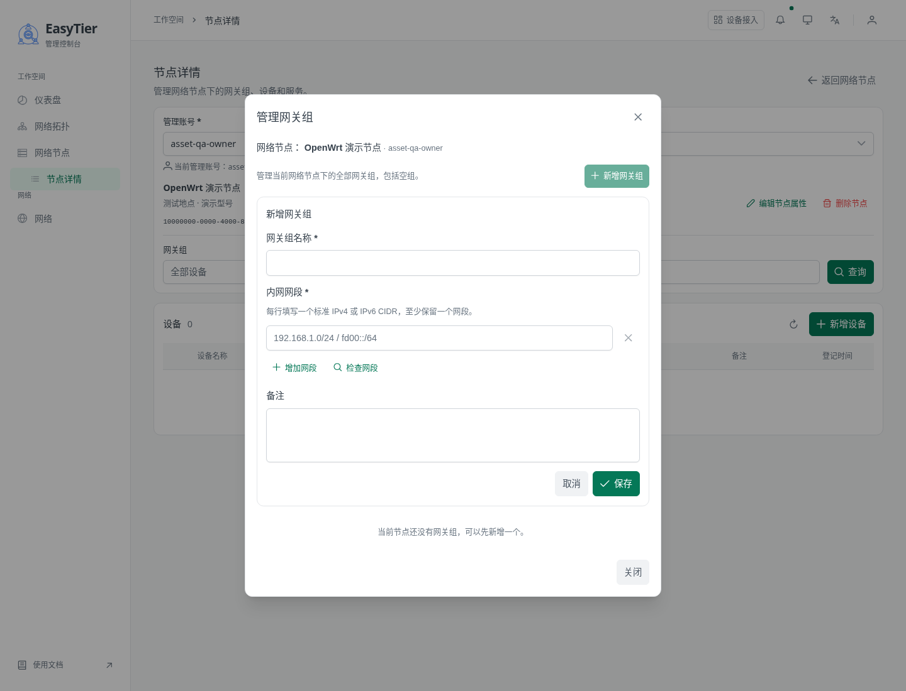
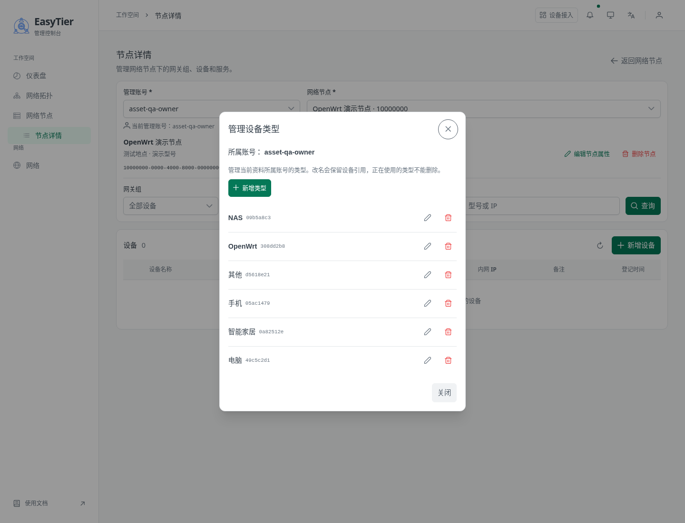
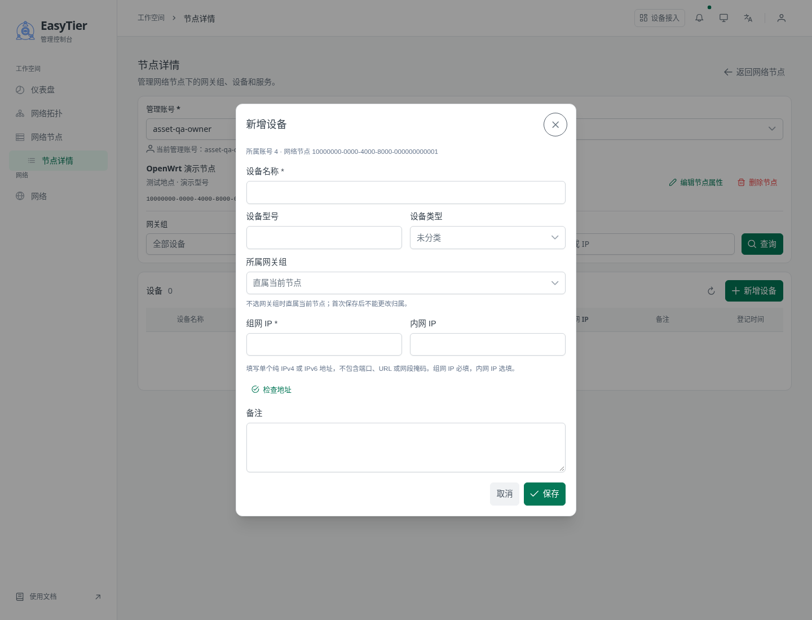
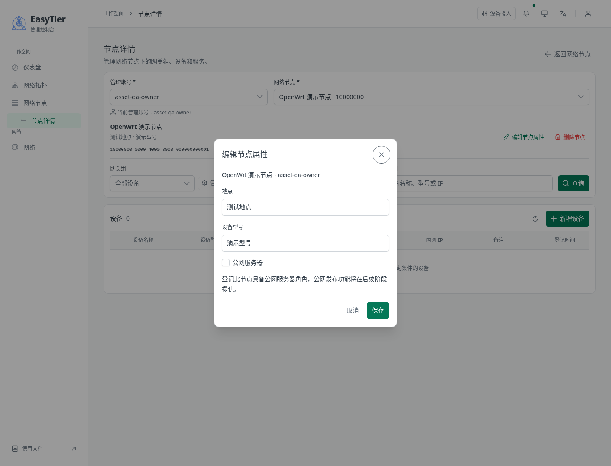

# 首期功能覆盖复审

2026-10-23；代码基线 `feat/node-attributes-main@77037206`。用户在查看管理窗口后要求“检查一下是不是缺少功能”。本轮对照最终需求、接口契约及实际代码，并打开当前已验证制品的真实隔离页面查看窗口；未保存业务资料、修改产品源码、构建、运行测试套件或CI。

## 结论

没有发现网关组、设备类型、设备或服务主CRUD整块遗漏；发现3处操作/恢复缺口与2处较小一致性问题。原测试通过结果保留，不能推导出未覆盖的交互没有问题。T09、T11、T14记为复审待完善，T16尚未部署。

## 需要补齐

|编号/优先级|证据及触发条件|影响与建议|关联任务|
|---|---|---|---|
|R01 / P2 操作入口离开当前视口|[AssetDeviceTable.vue:97](../../../easytier-web/frontend/src/components/node-assets/AssetDeviceTable.vue#L97)把新增服务、编辑、删除放在最后一列；列最小宽度合计约95rem，仅容器横向滚动，未固定操作列|常用屏宽需要横向滚至末尾才能找到操作，容易认为没做；固定右侧操作列或将次要列移入详情。本项为源码布局结论；本轮空列表未新增设备重演，不把历史截图当作新实测|T11、T14|
|R02 / P2 同名对象缺乏区分信息|[AssetDeviceDialog.vue:188](../../../easytier-web/frontend/src/components/node-assets/AssetDeviceDialog.vue#L188)、[NodeAssetsPage.vue:35](../../../easytier-web/frontend/src/components/NodeAssetsPage.vue#L35)：新增设备及筛选中的类型/组选项只展示名称；业务允许重名|两个同名组绑定不同网段时难以确认归属，且设备保存后不能移动；组选项补网段/短ID，类型选项补短ID，选中后仍应可辨识。管理列表已有这些辅助信息，选择器没有；本轮未创建同名演示资料|T09、T11、T14|
|R03 / P2 已失效节点/权限缺少恢复处理|[useNodeAssetsPage.ts:106](../../../easytier-web/frontend/src/composables/useNodeAssetsPage.ts#L106)、[218](../../../easytier-web/frontend/src/composables/useNodeAssetsPage.ts#L218)、[242](../../../easytier-web/frontend/src/composables/useNodeAssetsPage.ts#L242)：查询失败仍保留旧行，节点刷新仅替换目录，不重新处理当前nodeId及权限|其他会话清理并删除节点，或撤销当前管理员权限后，再查询/刷新仍保留旧上下文与操作入口。后端拒绝请求，不是越权成功；应在确认失效/无权后重取权限和节点、清理失效选择；临时网络失败继续保留旧结果。仅源码审查，本轮未执行撤权/删除场景|T09、T14|
|R04 / P3 返回列表未落实起始滚动位置|[NodeAssetsPage.vue:99](../../../easytier-web/frontend/src/components/NodeAssetsPage.vue#L99)仅路由跳转；[main.ts:91](../../../easytier-web/frontend/src/main.ts#L91)没有scrollBehavior，也未找到列表重置滚动逻辑|F15要求返回初始位置，当前仅能保证组件查询状态重建，未实现回顶部保证；应限定相关返回路径处理实际滚动容器。具体浏览器表现需后续针对性验证，本轮不宣称已复现错误滚动|T09、T14|
|R05 / P3 节点属性长度单位不一致|[NodeAssetsPage.vue:173](../../../easytier-web/frontend/src/components/NodeAssetsPage.vue#L173)原生maxlength=256/128按UTF-16计数；[restful/assets/mod.rs:259](../../../easytier-web/src/restful/assets/mod.rs#L259)按Unicode码点计数|含emoji等非BMP字符时，前端会提前限制后端允许的内容；应与原属性入口统一按字符校验。本轮仅源码推导，未提交此类内容|T09、T14|

R01–R03建议先处理；R04/R05随后一起收口。没有擅自加入公网、聚合或迁移等新范围。

## 当前窗口查看步骤与截图

1. **管理网关组：入口存在。** 当前节点无组，空态有新增按钮，没有伪造组资料。
   
2. **新增网关组：字段完整。** 名称、至少一行IPv4/IPv6 CIDR、增加网段、检查网段、备注和保存/取消入口可见；本轮没有提交。
   
3. **管理设备类型：入口齐全。** 6项预置类型及新增/编辑/删除入口可见；使用中禁删由代码审查确认。
   
4. **新增设备：默认字段齐全，有条件字段。** 名称、型号、类型、所属组、组网IP、内网IP、备注均有。默认直属节点；[AssetDeviceDialog.vue:204](../../../easytier-web/frontend/src/components/node-assets/AssetDeviceDialog.vue#L204)明确在选择组后显示“网关自身设备”。因当前无组，本轮没有造数据验证这个条件分支。
   
5. **编辑节点属性：公网标记已存在。** 在节点属性中登记“公网服务器”，没有放在新增设备里；页面明确真实发布后置。
   

## 代码覆盖及未纳入首期的能力

后端核对网关组多网段/CRUD、类型一次性初始化与使用中禁删、设备固定归属/自身设备唯一/地址规则/级联删除、服务协议端口冲突/链接图标、持久幂等、管理员账号隔离和节点删除前置保护，均有对应实现。前端服务面板/表单已实现TCP/UDP、单端口、备注、HTTP/HTTPS链接和内置图标，新增、编辑、删除均有接线。

服务公开开关、真实公网转发、设备接入、拓扑画布、Navloom/EasyADB/智能家居适配、导入导出、移组/迁移、回收站与操作历史已明确后置或不做，不记作本期遗漏。网关组本体不直接挂服务，按已确认设计通过手动自身设备登记。

## 证据边界

截图只证明当前窗口及可见入口，不证明保存、删除、并发、错误恢复或完整无障碍符合性。本轮未重跑自动化验收、未修改原部署，未声称所有场景运行通过。图标按钮在源码中有可访问名称；键盘和读屏器完整流程本轮未测试。当前表单显示账号数字ID/机器UUID是可读性改进点，没有将其夸大为缺少账号/节点归属功能。

本轮使用真实浏览器页面证据和独立源码复审；不是完整的Product Design端到端体验或无障碍合规审计。共享审查技能参考资源部分不可用，不影响本需求的源码覆盖核对。报告和新截图未自动提交或push。

## 2026-10-23 实例绑定实施轮的后续状态

R01–R05已在[实例绑定增量](../../node-instance-binding-planned/README.md)的T09/T11/T12中修改相关源码：固定操作列及展开区域、同名短ID、确认失效后清理上下文、返回列表复位、Unicode码点计数。当前没有运行复测，不覆盖或改写上面的原始复审证据；验收列入新目录T13。

## 2026-10-23 授权验证收口

R01–R05已实际复测通过：390px操作列可见及整页无横向溢出；同名实例/类型有短ID且可分别选择；真实撤权后清理上下文、资源404保留有效节点、临时请求失败保留旧行并可手动恢复；返回列表滚动复位；128/256 Unicode码点可保存，超限/控制字符拒绝。对应[验证报告和截图](../../node-instance-binding-planned/task/verification-report.md)。这次结果补充上面只读复审，不将原未执行项改写为当时已测。
