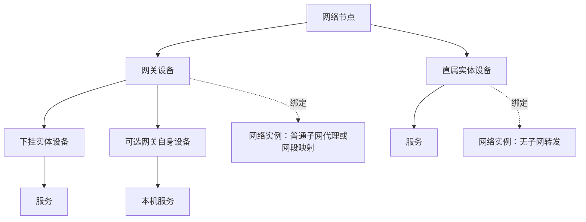

# 本轮改动范围与前后端对应关系

## 用户已确认的需求

输入为上一轮[网络与地址讨论](../../node-device-service-discussion/require/require-11-network-and-device-address-discussion.md)、[实体关系](../../node-device-service-discussion/require/require-12-overall-topology.md)、[新增设备正向流程](../../node-device-service-discussion/require/require-13-device-create-flow.md)，以本轮整理后的文档为实施入口。工作树为 `/workspace/EasyTier-main-node-attributes`，已推送基线 `77037206`；本轮查阅的是包含后续文档的当前工作树，不声称实现已更新。

1. 网络节点指旧注册设备；实体设备指资产设备；网络实例是节点上运行的EasyTier实例。
2. 网络节点下挂网关设备与直属实体设备，网关下再挂实体设备，服务归实体设备。实例以绑定关系表达。
3. 新增时先选择网关/普通，再选择匹配实例。“网关/普通”与手机、NAS等硬件分类分别处理。
4. 网关必须绑定所在节点的实例，同节点内一一对应；直属普通设备也须关联实例。
5. 普通子网代理和网段映射均属于网关。只有没有子网转发规则时，才属于直属实例候选。
6. 网关组网IP取自绑定实例；下挂设备根据实例规则带出网段，填写主机部分生成组网侧访问IP与内网IP。普通代理不改址，映射保留主机位。
7. 本轮新增的地址处理暂不做IPv6；不删除原EasyTier IPv6能力或旧资料。
8. 网关下普通设备沿用网关的实例；网关本机服务继续通过可选自身设备登记，每网关最多一条。
9. 原资产归属固定、禁止迁移；非空节点/网关禁删，设备删除二次确认并级联提交时全部服务。
10. 数量仍只统计实体设备记录（含自身设备），不把网关、节点、实例或服务计入；原实例数保持。
11. 保留普通账号隔离、管理员先账号后节点；无定时任务、无心跳、无自动探测；公网另期处理。
12. 本轮要求形成连贯的需求、计划与多agent任务，最后安排联调；当前没有要求执行功能修改或测试。

## 目标实体关系

图是目标业务关系；实际代码仍用 `asset_gateway_groups` 管理网关，用 `asset_devices` 管理直属、下挂与自身设备。保留两表和稳定ID作为本轮工程基线，避免名称调整引发无关的数据合并。中央逻辑网络 `networks` 可跨节点，绑定键必须包含账号、machine_id和instance_id。

## 改动矩阵

|编号|用户可见变化|前端改动|后端/数据改动|对应任务|
|---|---|---|---|---|
|C01|新增先角色后实例|统一新增流程，网关管理入口复用同一绑定编辑能力|请求采用角色/地址模式；新建不得绕过必选绑定|T01、T05、T07–T09|
|C02|选得到当前账号、当前节点的有效实例|选择器展示名称、短ID、来源、规则和不可选原因|资产授权的持久配置目录；与原在线实例接口分开适配|T02、T03、T07–T09|
|C03|网关IP/网段来自实例|网关表单显示实例IPv4及只读规则，不继续手填新网段|保存实例作用域、配置记录身份/指纹、精简快照，唯一绑定|T02–T03、T05、T09|
|C04|下挂设备填主机部分生成地址|选择本组规则、主机输入、预览双IP；自身设备单独展示实例IP|规则解析、IPv4偏移推导、服务端重算、LAN唯一及自身唯一|T04–T05、T07、T10|
|C05|旧资料可用并可补绑|“未绑定旧资料”提示、显式补绑和原新地址对照|增量迁移保留ID/IP/IPv6/服务，禁止按名称/IP猜关联|T02、T05–T07、T09–T11|
|C06|实例改变后有明确处理入口|显示已保存资料及异常，提供同实例核对/逐条地址修正|按需判断changed/missing/replaced等状态，保存快照不自动改子设备|T03、T05–T07、T09–T11|
|C07|查、改、删、服务操作连贯|保留查询按钮、列表展开和普通设备新增定位；网关保存刷新组目录|归属、计数、服务父级和删除约束保持；释放绑定不删除真实实例|T05–T07、T11–T12|
|C08|异常/重试不会生成重复记录或错绑|表单响应隔离、同次重试、409反馈；权限失效清理上下文|权限→幂等重放→配置复核→事务；保存不信任前端预览|T05、T07–T09、T11–T12|
|C09|原页面复审缺口随相关改动收口|操作列可见、同名可辨、失效恢复、返回起点、字符长度统一|既有权限拒绝规则保留，不扩大到重做用户管理|T09、T11–T12|
|C10|交付可审查|授权后真实截图、错误/离线/旧资料流程验收|授权后的迁移/API/并发/原功能回归，手工备份和恢复说明|T13–T14|

## 为闭合流程采用的工程方案

以下是根据现有代码提出的实施基线，**不冒充用户已逐项确认**。T01将其落实为可并行使用的契约；能按这些约束实现的技术细节由工程处理，无需重新开展问题访谈。

|设计点|本轮方案|原因|
|---|---|---|
|实例来源|以持久配置为登记依据，包含停用配置；运行信息仅辅助IPv4和在线展示|旧实例列表先要求RPC在线，不能满足离线管理|
|仅运行态实例|无持久配置时标明未保存，不可新绑定；用户通过现有实例操作保存配置后手动刷新|缺少可稳定追踪的配置身份及离线依据|
|IPv4来源|静态配置→中央已分配地址→对应实例已知运行IPv4；不能确定时禁新绑定，已有资料仍可管理|配置、分配和运行值在代码中是不同字段|
|网络配置变化|查询只比较不改资产；同实例显式核对快照，子设备地址逐条确认|保持原网络操作且避免GET偷偷重写资产|
|配置被删/同ID重建|保留资产；重建以配置行id/create_time识别并显式核对；缺失可恢复原实例或按原条件清理资产|UUID相同不代表同一份配置生命周期|
|旧资料|迁移为空绑定；一般资料、服务、删除照常；单条显式补绑，不自动匹配|旧数据没有足够事实推断关联|
|直属绑定复用|本轮不新增直属实例排他约束；只对网关落实已确认的一一对应|用户未确定直属排他性，不套用网关规则|
|主机号|按IPv4前缀解释整数偏移；/24可提示为末段，其他前缀也给范围和完整预览|用户未限定只支持/24|
|自身设备地址|组网IP取网关实例IP；内网IP选填，填写时由本组规则的真实网段与主机号推导|网关本机与网关下普通设备访问地址语义不同|
|后续修改角色/换实例|普通编辑锁定已保存角色、实例ID及归属；同实例核对和旧资料首次补绑是独立操作|避免借修复入口实现用户未要求的迁移|

完整状态动作、API形状及组件交接见[契约](../plan/contracts/v2.md)、[后端需求](require-02-backend-binding-and-addresses.md)、[前端需求](require-03-frontend-workflows.md)、[生命周期](require-04-lifecycle-and-compatibility.md)。

## 必须走通的整条路径

1. 管理员/普通用户选择合法节点 → 角色筛选实例 → 后端返回安全摘要 → 表单预览 → 保存重读配置 → 原子保存绑定和资产 → 前端刷新正确目录。
2. 网关新增完成 → 从该网关新增实体设备 → 选择规则/主机部分 → 服务端算双IP且查冲突 → 保存后定位设备 → 展开后增删服务。
3. 查询旧资料/失效绑定 → 明确状态和原地址 → 补绑或核对当前配置 → 展示差异 → 保存验证 → 刷新；若不可修正仍能维护非网络资料与按原条件删除。
4. 普通/中央实例配置修改或删除 → 下次查询展示变更 → 不级联删资产、不拦旧操作、不启动轮询；同ID重建也不静默恢复。
5. 超时重试/并发占用/配置变化/撤权 → 返回明确结果 → 前端恢复到可重试或重新选择的状态；不得留下仅后端有能力而前端没有入口的修复分支。

## 验收边界

本轮文档完成不等于上述流程实现。T13只在获得测试授权后运行验证；T14按交付范围再执行备份与部署。公网、IPv6新地址推导、跨节点迁移、外部程序鉴权、网关嵌套及拓扑画布均不纳入此次任务。
