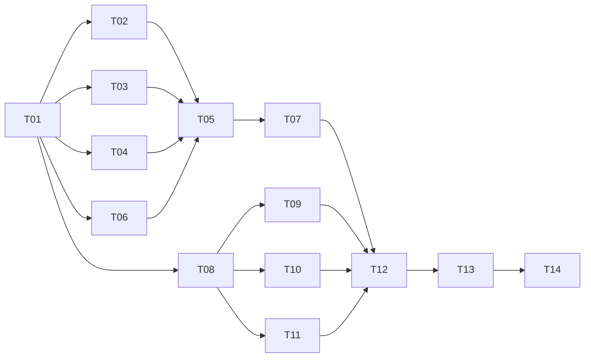

# 实例绑定开发任务看板

**14项任务已完成本轮范围：T01契约冻结，T02–T12实现并验证，T13报告/截图归档，T14完成当前云环境备份和部署。** 后端339通过、HTTP22通过、新页面24检查通过，2项既有压力测试ignored；外部OIDC/用户实机及公网不在本轮实测范围。提交与push使用原分支。详见[验证报告](verification-report.md)和[交付记录](release-record.md)。

|任务|职责|依赖|唯一owner|状态|
|---|---|---|---|---|
|[T01](task-01-contract-and-baseline.md)|冻结存储/API/状态/组件契约|无|contract-owner|契约已冻结|
|[T02](task-02-schema-and-legacy-data.md)|增量迁移、实体和旧资料保留|T01|schema-owner|已验证|
|[T03](task-03-instance-catalog.md)|持久实例目录、来源及候选|T01|instance-owner|已验证|
|[T04](task-04-ipv4-rule-derivation.md)|规则规范化与IPv4主机推导|T01|address-owner|已验证|
|[T05](task-05-asset-writes-and-binding.md)|资产创建、补绑、核对、地址修正事务|T02、T03、T04、T06|asset-store-owner|已验证|
|[T06](task-06-binding-lifecycle.md)|按需状态解析及差异预览|T01|binding-state-owner|已验证|
|[T07](task-07-authorized-api.md)|授权REST与错误/幂等接线|T05（含其前置）|api-owner|已验证|
|[T08](task-08-frontend-client.md)|前端类型、客户端与重试|T01|frontend-client-owner|已验证|
|[T09](task-09-role-and-binding-editors.md)|角色/实例选择、网关/设备父表单|T08|editor-owner|已验证|
|[T10](task-10-address-fields.md)|地址规则与主机部分预览组件|T08|address-ui-owner|已验证|
|[T11](task-11-page-and-list-context.md)|页面上下文、列表、保存定位和失效恢复|T08|page-owner|已验证|
|[T12](task-12-integration-and-polish.md)|前后端组装、旧入口/服务回归准备、交互收口|T07、T09、T10、T11|integration-owner|已验证|
|[T13](task-13-authorized-verification.md)|集中授权测试、实际截图与结果报告|T12、测试授权|verification-owner|已验证/报告归档|
|[T14](task-14-backup-and-delivery.md)|手工备份、升级/恢复准备与交付|T13、当次交付范围|delivery-owner|已备份并部署当前云环境|

## 并行实施波次

1. A波：T01单owner先冻结，避免前后端同时发明字段。
2. B波：T02/T03/T04/T06/T08最多五路并行；每个模块使用契约类型和样例，不争写公共文件。T06以输入快照比较为核心，最终接T03读取不形成实现循环。
3. C波：T08完成后T09/T10/T11并行，和后端T05→T07串行整合重叠。可用slot有限时优先完成阻塞其他任务的模块，不超实际并发容量。
4. D波：T12最后统一集成和修整；组件交接未完成前只接线计划，不让集成人员与原owner同时改同一文件。
5. E波：实现成型后集中提示一次是否测试；有授权才执行T13，之后按交付范围执行T14。规划期间不运行任何测试、构建或CI。

## 文件唯一写入范围

路径以仓库根为基准，`BE=easytier-web/src`，`FE=easytier-web/frontend/src`。新增文件为计划落点，T01可在冻结前调整并同步本表。

|owner/任务|独占文件或模块|公共交接规则|
|---|---|---|
|contract / T01|本轮契约、根/计划/任务汇总|变更协议先由该owner合并再通知各端|
|schema / T02|BE/migrator新迁移及mod注册；相关db/entity模型及其mod注册|保留旧资产/配置表；不写领域CRUD|
|instance / T03|新增BE/db/assets/instances.rs|只读实例及安全摘要，模块注册片段交T12|
|address / T04|新增BE/db/assets/address_derivation.rs|纯函数，不改现有validation.rs或核心网络配置解析器|
|binding-state / T06|新增BE/db/assets/bindings.rs|只比较快照/生成状态与差异，不改普通/中央网络写路径|
|asset-store / T05|BE/db/assets/common.rs、validation.rs、groups.rs、devices.rs、idempotency.rs|这些共享热点归一人；服务模块如需兼容仅交接后顺序修改|
|api / T07|BE/restful/assets/mod.rs|唯一HTTP写入人，其他后端owner交方法签名和错误，不直接加路由|
|frontend-client / T08|FE/types/node-assets.ts、modules/api.ts、composables/useAssetMutation.ts|其他前端owner只消费，新增字段回此owner|
|editor / T09|FE/components/node-assets/{GatewayGroupDialog,AssetDeviceDialog}.vue及新增InstanceBindingSelector/GatewayBindingEditor|统一两个网关创建入口；不写地址子组件/页面|
|address-ui / T10|新增FE/components/node-assets/AssetAddressFields.vue、composables/useInstanceAddressPreview.ts|通过props/events接父表单，不改T09文件|
|page / T11|FE/components/NodeAssetsPage.vue、composables/useNodeAssetsPage.ts、components/node-assets/{AssetDeviceTable,DeviceTypeDialog}.vue|负责页面/列表、R01–R05相关本页修正，翻译清单交T12|
|integration / T12|BE/db/assets/mod.rs等未归T02的必要模块注册；frontend-lib/src/locales/cn.yaml、en.yaml及旧入口必要接线|T02迁移/entity注册不可争写；其他组件完成交接后才允许顺序修正；原别名字段不因R05误改|
|verification / T13|本轮专用测试、实际报告/截图与证据目录|获授权后再写入执行结果；每个测试文件仍唯一owner|
|delivery / T14|交付报告及必要部署配置|不提交数据库/凭据；版本、环境、备份/恢复状态如实记录|

## 交接与完成定义

每项交接必须带：变更文件、契约版本、导出方法或组件事件、调用样例、依赖、错误与状态、翻译key、未执行检查及已知问题。文件按owner先完成后交接，禁止两个agent“各改各的”共享接口/校验/翻译。

状态依次为 `待依赖/可开始 → 开发中 → 待集成 → 待授权验证 → 已验证 → 已交付`。模块代码交接可标任务开发完成，但整体验证/部署单列，不用源码阅读代替运行证据。

## 遗留复审并入位置

原[复审报告](../../node-device-service-discussion/task/review-2026-10-23-feature-coverage.md)的R01操作列、R02同名选择、R03失效上下文、R04返回滚动、R05字符计数，由T09/T11/T12对应文件处理。旧任务继续标待完善，实际修复后再交叉回填，本轮已修改相关源码，回填为待授权复测，不提前标验证通过。
