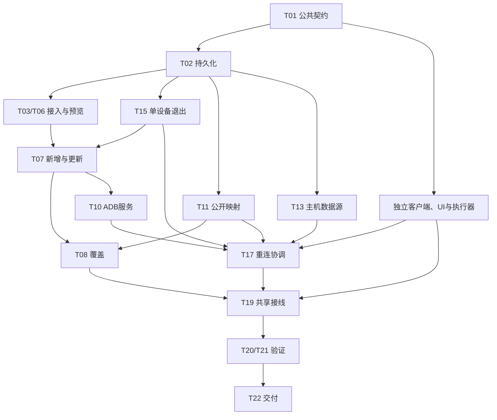

# 实施计划索引与并行边界

需求已确认，当前只完成拆分。10个计划对应22个小任务，所有实现任务未认领。契约：[v1](contracts/v1.md)；完整硬依赖/联调依赖见[任务看板](../task/README.md)。

## 计划拆分

| 计划 | 目标 | 小任务 |
| --- | --- | --- |
| [PLAN-ODS-01](plan-ods-01-contracts-and-storage.md) | 公共契约与持久化基础 | [ODS-T01](../task/task-ods-01-contract-and-shared-skeleton.md)、[ODS-T02](../task/task-ods-02-schema-and-scoped-identity.md) |
| [PLAN-ODS-02](plan-ods-02-gateway-access.md) | 网关授权设置与 LuCI 接入 | [ODS-T03](../task/task-ods-03-gateway-access-api.md)、[ODS-T04](../task/task-ods-04-luci-rpc-client.md)、[ODS-T05](../task/task-ods-05-gateway-access-ui.md) |
| [PLAN-ODS-03](plan-ods-03-discovery-preview.md) | 发现快照与同步预览 | [ODS-T06](../task/task-ods-06-discovery-preview-api.md) |
| [PLAN-ODS-04](plan-ods-04-device-apply.md) | 设备新增、更新与覆盖事务 | [ODS-T07](../task/task-ods-07-device-create-update.md)、[ODS-T08](../task/task-ods-08-device-overwrite-services.md) |
| [PLAN-ODS-05](plan-ods-05-device-sync-ui.md) | 普通设备同步交互 | [ODS-T09](../task/task-ods-09-discovery-review-ui.md) |
| [PLAN-ODS-06](plan-ods-06-adb-single-service.md) | ADB 发现与单服务同步 | [ODS-T10](../task/task-ods-10-adb-reconcile.md)、[ODS-T12](../task/task-ods-12-adb-discovery-ui.md) |
| [PLAN-ODS-07](plan-ods-07-publication-sync.md) | 公开映射更新与应用 | [ODS-T11](../task/task-ods-11-public-mapping-apply.md) |
| [PLAN-ODS-08](plan-ods-08-automation-source.md) | 自动化主机数据源切换 | [ODS-T13](../task/task-ods-13-automation-service-source-api.md)、[ODS-T14](../task/task-ods-14-automation-service-source-ui.md) |
| [PLAN-ODS-09](plan-ods-09-reconnect-and-device-exit.md) | 端口重连与单设备脚本退出 | [ODS-T15](../task/task-ods-15-script-device-exit-api.md)、[ODS-T16](../task/task-ods-16-executor-device-exit.md)、[ODS-T17](../task/task-ods-17-reconnect-coordinator.md)、[ODS-T18](../task/task-ods-18-reconnect-ui.md) |
| [PLAN-ODS-10](plan-ods-10-integration-and-delivery.md) | 接线、验证与交付 | [ODS-T19](../task/task-ods-19-integration-wiring.md)、[ODS-T20](../task/task-ods-20-automated-regression.md)、[ODS-T21](../task/task-ods-21-real-device-acceptance.md)、[ODS-T22](../task/task-ods-22-delivery-and-rollback.md) |

## 实施顺序与可并行批次

硬依赖表示实施前必须交付；联调依赖允许按冻结契约先独立开发，但不能提前宣布端到端通过。以下批次按硬依赖给出可并行候选，按实际agent数量分配，不为并行虚增任务。

| 批次 | 可实施任务 | 串行或交接原因 |
| --- | --- | --- |
| A | T01 | 统一身份、接口、错误码和所有权 |
| B | T02、T04、T05、T09、T12、T14、T16、T18 | 数据、客户端、独立UI和执行器按冻结契约并行 |
| C | T03、T11、T13、T15 | 依赖结构迁移；持久化配置、公开、目标源、单机退出互不抢写 |
| D | T06 | 需网关接入和LuCI客户端 |
| E | T07 | 需预览、结构及T15按设备退出，避免普通更新取消整批 |
| F | T08、T10 | 覆盖事务与ADB维护分文件并行；T08还需T11 |
| G | T17 | 需服务、公开、目标源、服务端与执行器退出能力 |
| H | T19 | 对端完成后统一共享入口接线 |
| I | T20 → T21 → T22 | 自动回归、真实验收、交付依次推进并满足各自授权条件 |

图为模块依赖摘要，精确任务约束以任务元数据为准。T08和T10不互相依赖；人工选择后恢复ADB操作只由T10负责，T07/T19交接结果。

## 独占文件与共享写入

下表中的src路径相对easytier-web；执行器路径相对automation-executor。所有未在基线存在的路径均为拟新增。

| 唯一写入任务 | 文件或职责范围 | 边界 |
| --- | --- | --- |
| T01 → T19（顺序） | 公共契约、Rust discovery/db/restful 模块骨架、公共DTO/ApiClient；随后统一AppState/配置/迁移与路由注册、前端页面嵌入、executor app.py/validation.py | 同一集成职责顺序写；业务任务只提交模块与接线清单 |
| T02 | 拟结构迁移000019、asset/discovery实体与类型语义字段 | 不写行为触发器或devices.rs应用校验 |
| T03 | 拟db/discovery/gateway_access.rs、restful/discovery/gateway_access.rs | 只负责配置/鉴权持久化与处理器 |
| T04 | 拟discovery/luci_client.rs | 只负责固定RPC、认证、超时和结果解析 |
| T05 | 拟GatewayDiscoveryAccess.vue、GatewayDiscoveryActions.vue | 不改共享设备表单/表格；T19嵌入 |
| T06 | 拟discovery/device_preview.rs、db/discovery/preview_store.rs、restful/discovery/preview.rs | 预览与快照；不执行资产覆盖 |
| T07 | 现有db/assets/devices.rs、拟db/discovery/apply.rs | 只新增/更新；先等T15行为迁移 |
| T08 | 拟db/discovery/replacement.rs | 覆盖事务与保留服务；公开helper由T11提供 |
| T09 | 拟node-assets/discovery/DeviceDiscoveryReview.vue、DiscoveryDiffTable.vue、ReplacementServiceSelection.vue | 不写T05授权或T12结果组件 |
| T10 | 拟adb_reconcile/adb_service/adb处理器，现有db/assets/services.rs | 唯一ADB及普通apply后的原操作续接；手工端口共用事件 |
| T11 | 现有db/assets/publications.rs、restful/assets/publication_apply.rs，拟db/discovery/publication_sync.rs | 公开关系迁移/目标更新/运行应用；不写普通设备事务 |
| T12 | 拟node-assets/AdbDiscoveryResultDialog.vue | 只渲染阶段状态及resolve/retry动作 |
| T13 | 现有db/automation/mod.rs与restful/automation/devices.rs的数据源逻辑 | 不写run退出逻辑或共享注册 |
| T14 | AutomationCenter.vue、automation/ConnectionDialog.vue、node-assets/AssetServiceDialog.vue | 源列表/服务编辑/历史类型确认；不写重连hook |
| T15 | db/automation/runs.rs、restful/automation/runs.rs，拟行为迁移000020 | 仅当前设备退出；不修改T13目标解析 |
| T16 | executor runtime.py、worker.py、journal.py、adb.py 的退出/目标清理 | 复用media.close；共享HTTP/校验注册交T19 |
| T17 | 拟discovery/reconnect.rs、db/discovery/reconnect_store.rs、restful/discovery/reconnect.rs | 协调事件、重试/清理/连接；不抢写T16执行器 |
| T18 | automation/usePhoneSession.ts、PhoneCard.vue | 原画面恢复与迟到事件处理；不写T14主机数据源 |
| T20 → T21 → T22（顺序） | 回归材料、真实验收证据、交付/回退记录及test-report各轮条目 | 只在相应授权范围执行，业务修复回交文件所有者 |

同一共享文件T01/T19或T20/T21/T22是明确的顺序交接，不是并行写入。需要新增共享改动时先更新契约和接线清单，由当前唯一写入任务处理。实施认领前检查最新分支/工作区，不能覆盖他人未提交改动。

## 完成含义

每任务交付实现范围、未实现项和验证状态；未测试必须明确写未执行。T20/T21独立承担联调与真实验收，不能把组件完成或文档ready记成功能done。纯文档本轮不运行应用测试/构建/CI；[记录](../task/test-report.md)。

