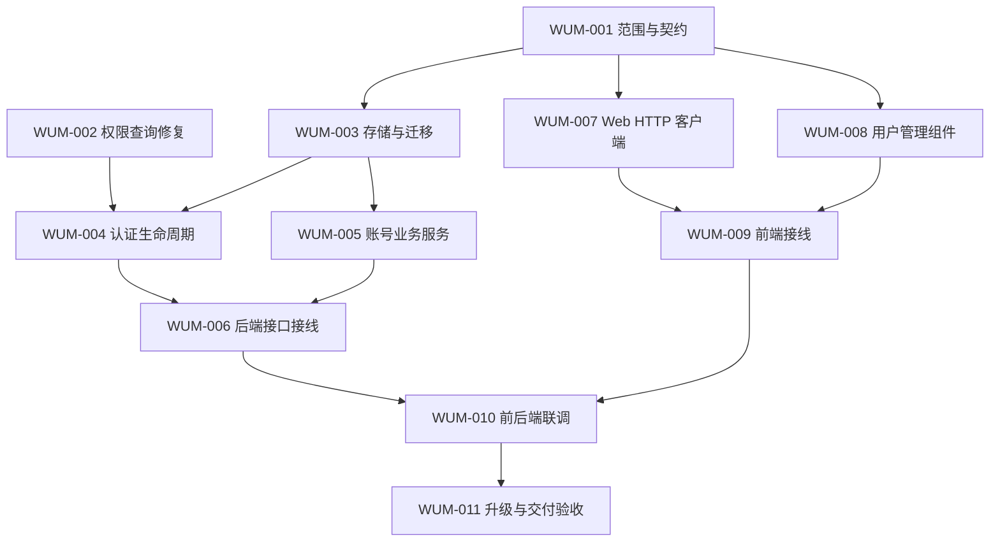

# Web 用户管理需求实施计划

需求依据：[Web 用户管理需求分析](../../docs/requirements/web-user-management.md)。执行入口：[任务看板](../task/README.md)与 [11 项任务文档](../task/web-user-management/README.md)。本文安排工作边界与依赖；任务状态、负责人和执行证据以各任务明细为准。

本计划进入实施，WUM-001 的稳定契约见第8节；各任务状态由协调者维护。这里的契约就绪不表示功能已经实现。

## 1. 目标与范围

交付账号管理闭环：当前身份与能力、用户列表/详情、创建本地账号、停用/恢复控制台访问、适用账号的密码重置、角色分配、会话撤销、注册策略反馈、操作审计和管理员恢复路径，对应需求 UM-01 至 UM-10。

本轮暂按以下建议规划，范围变化应先更新需求，再同步本计划和受影响任务：

- 平台管理员为受信运维角色；不承诺用户数据对管理员强隔离。
- 用户名不可编辑，不物理删除用户；保留现有资源归属和已运行网络。
- 停用对象为控制台访问，不把设备接入、控制连接和网络数据面当成同一生命周期。
- 既有用户、密码输入契约、组关系和接口兼容；历史来源或时间无法证明时保留未知。
- 若目标部署启用 OIDC，则身份绑定、同名冲突和停用一致性属于同阶段工作。完整 IdP 管理、组织协作和独立设备接入 token 不在当前建议范围。

### 需求到工作包的追踪

以下覆盖首期全部 10 项需求。需求的行为定义和 14 个验收场景以分析文档为准；本表分配实施责任，实际执行证据由任务明细记录。WUM-001 为各项提供契约，WUM-003 提供涉及持久化的基础，表中不重复罗列这些公共依赖。

| 需求 | 后端负责工作包 | 前端负责工作包 | 重点验收 |
| --- | --- | --- | --- |
| UM-01 当前用户与管理能力 | WUM-002 权限隔离；WUM-004 身份/能力；WUM-006 管理路由授权 | WUM-007 身份调用；WUM-009 导航与能力变化 | UA-01、UA-10、UA-11 |
| UM-02 用户列表与详情 | WUM-005 查询业务；WUM-006 分页与安全 DTO | WUM-007 查询适配；WUM-008 列表/详情；WUM-009 接线 | UA-02、UA-11、UA-13；WUM-008 的分页/搜索验收 |
| UM-03 管理员创建账号 | WUM-005 创建与冲突规则；WUM-006 管理接口 | WUM-007 创建调用；WUM-008 创建表单；WUM-009 接线 | UA-02、UA-03、UA-13 |
| UM-04 停用/恢复控制台访问 | WUM-004 登录/会话约束；WUM-005 状态与版本；WUM-006 接口 | WUM-007 状态调用；WUM-008 影响确认；WUM-009 权限反馈 | UA-04、UA-06、UA-08、UA-09、UA-10 |
| UM-05 重置本地密码 | WUM-005 重置与凭据能力；WUM-004 受限登录/改密；WUM-006 接口 | WUM-007 凭据处理；WUM-008 重置交互；WUM-009 首次改密 | UA-05、UA-06、UA-13 |
| UM-06 分配角色 | WUM-002 权限隔离；WUM-005 最后管理员/并发保护；WUM-004 权限撤销；WUM-006 授权 | WUM-007 角色调用；WUM-008 角色操作；WUM-009 能力刷新 | UA-01、UA-07、UA-10 |
| UM-07 撤销全部 Web 会话 | WUM-005 版本更新；WUM-004 会话验证；WUM-006 接口 | WUM-007 撤销调用；WUM-008 操作确认；WUM-009 登录失效反馈 | UA-04、UA-10、UA-11；WUM-010 验证不改密码的主动撤销 |
| UM-08 注册策略反馈 | WUM-004 公开策略与服务端限制；WUM-005 管理员建号规则 | WUM-007 策略调用；WUM-008 公共文案；WUM-009 注册入口 | UA-03、UA-11 |
| UM-09 管理审计 | WUM-005 事务审计；WUM-006 只读查询与权限 | WUM-007 审计调用；WUM-008 审计展示；WUM-009 接线 | UA-01、UA-13 |
| UM-10 首个管理员与恢复 | WUM-005 初始化/恢复入口；WUM-011 升级与恢复验收 | 本期不单独增加恢复页面，按 WUM-001 明确的恢复方式交付说明 | UA-12、UA-13 |

WUM-010 汇总真实运行时验收，WUM-011 汇总旧库升级与交付验收。UA-01 的授权和 UA-13 的脱敏要求适用于全部管理接口；UA-14 的跨站写入与部署策略由 WUM-006 实现、WUM-010/011 验证，适用于所有管理写操作。具体验收结果不得用本表中的关联关系代替。

两项需要单独执行的检查：UM-02 覆盖服务端搜索、角色/状态筛选、稳定分页、空结果及历史未知值；UM-07 在密码、角色和访问状态均不变时主动撤销所有 Web 会话，验证旧会话失效且重新登录可用。停用或改密场景不能代替主动撤销检查。

## 2. 先明确契约，再并行实现

WUM-001 交付可供不同 agent 独立实现的契约基线，不编写业务代码。依赖它的任务只能在各自所需契约明确后进入执行；不能让前后端自行猜测字段，或把尚未确定的产品行为写成既成事实。

| 契约主题 | 需要记录的结果 | 消费任务 |
| --- | --- | --- |
| 账号与权限 | 角色映射、`users.manage`、有效管理员定义、自操作规则、受限改密会话允许的操作 | WUM-003/004/005/006/007/008 |
| 用户状态与身份 | 停用/恢复/降权/重置的状态转换、会话版本、历史来源处理、OIDC 绑定和冲突策略 | WUM-003/004/005 |
| HTTP | 路径与方法、请求/响应 DTO、分页/排序、空值、错误码、重试/幂等、密码输入格式 | WUM-006/007/008/009 |
| 数据库与服务 | 存储字段、事务边界、查询/修改接口签名、权限重查、审计一致性、初始化/恢复入口 | WUM-003/004/005/006 |
| UI 组件 | 输入 props、输出事件、UI view model、加载/失败/权限变化状态；不依赖未落地的 HTTP 客户端文件 | WUM-007/008/009 |
| 部署与验收 | 支持的身份模式、Cookie/同源/CSRF 策略、凭据交付/有效期、旧库升级与回退要求 | WUM-004/005/006/010/011 |

契约基线应回写到本计划的执行记录或关联的 `process/plan/` 专项契约文档；产品行为变化同步需求文档。未形成完整记录前，不把本文的候选字段视作稳定接口。契约修改由 WUM-001 的负责人协调受影响任务，完成版本说明后再继续相关写入。

## 3. 任务依赖与并行批次

依赖表达产物先后关系，不代表必须等待同批所有任务完成。没有未满足依赖、写入范围不交叉的任务可同时领取。



| 任务 | 直接依赖 | 产物与独立完成边界 |
| --- | --- | --- |
| [WUM-001 范围与契约](../task/web-user-management/wum-001-contract.md) | 无 | 产品边界、DTO/状态/错误、DB/服务和 UI 组件契约，可独立评审 |
| [WUM-002 权限查询修复](../task/web-user-management/wum-002-permissions.md) | 无 | 限定当前用户的权限查询及隔离回归测试；不等待新管理接口 |
| [WUM-003 存储与迁移](../task/web-user-management/wum-003-storage.md) | WUM-001 | 新增迁移、实体与约定的 DB 接口；迁移和事务基础验证 |
| [WUM-004 认证生命周期](../task/web-user-management/wum-004-auth-lifecycle.md) | WUM-002、WUM-003 | 登录/会话/受限改密/适用 OIDC 策略、当前身份与公开注册策略 |
| [WUM-005 账号业务服务](../task/web-user-management/wum-005-account-service.md) | WUM-003 | 创建、访问状态、角色、重置、会话撤销、审计及管理员保护/恢复的服务规则 |
| [WUM-006 后端接口接线](../task/web-user-management/wum-006-admin-api.md) | WUM-004、WUM-005 | 管理 HTTP API、授权和服务接线；真实 HTTP/数据库行为验证 |
| [WUM-007 Web HTTP 客户端](../task/web-user-management/wum-007-web-client.md) | WUM-001 | HTTP DTO/调用、错误语义、敏感日志处理和针对性验证 |
| [WUM-008 用户管理组件](../task/web-user-management/wum-008-user-interface.md) | WUM-001 | 列表/详情/操作/审计组件、双语文案与独立交互验证 |
| [WUM-009 前端接线](../task/web-user-management/wum-009-web-integration.md) | WUM-007、WUM-008 | 页面路由、导航、身份能力、注册和强制改密流程，连接组件与客户端 |
| [WUM-010 前后端联调](../task/web-user-management/wum-010-full-stack-integration.md) | WUM-006、WUM-009 | 使用真实服务/数据库的跨端验收，验证 UA-01 至 UA-11、UA-13/14；UA-12 的升级整体验收交由 WUM-011 |
| [WUM-011 升级与交付验收](../task/web-user-management/wum-011-upgrade-acceptance.md) | WUM-010 | 旧库升级、管理员初始化/恢复、部署模式及回退验证，交付运维说明 |

可并行窗口：

1. WUM-001 与 WUM-002 独立推进。
2. WUM-001 完成后，WUM-003、WUM-007、WUM-008 可分别交给不同 agent。
3. WUM-003 完成且 WUM-002 已完成后，WUM-004 与 WUM-005 可并行；前端 WUM-007/008 或已就绪的 WUM-009 同时推进。
4. WUM-006 与 WUM-009 分别进行后端/前端接线；双方完成后才进入 WUM-010 全链路联调。
5. WUM-011 在联调通过后进行升级与交付验收，不以独立模块测试代替整体可交付性。

### 阶段交付与退出条件

按以下里程碑汇总交付；里程碑用于观察整体进度，不增加整批等待屏障。某任务的直接依赖已完成且写入范围无冲突，即可提前进入对应工作，例如 WUM-001 完成后可启动前端任务，不必等待 WUM-002。

| 里程碑 | 对应任务与并行方式 | 可交付结果 | 退出条件 |
| --- | --- | --- | --- |
| M1 范围与授权基础 | WUM-001、WUM-002 可并行 | 契约基线；按用户隔离的权限查询 | 产品/接口待决项对下游的影响已明确，权限隔离回归通过 |
| M2 独立模块 | WUM-003、WUM-007、WUM-008 可并行 | 可迁移的存储；类型化客户端；独立用户管理组件与文案 | 存储接口及 UI 输入输出可供消费；各项实际编译/类型与针对性验证通过 |
| M3 业务与接线 | WUM-004/005 可并行；WUM-006 随后接入后端；WUM-009 按前端依赖独立推进 | 认证/账号服务、受保护 API、完整 Web 操作流程 | 后端真实 HTTP/数据库验证和前端流程验证分别通过，具备全链路联调条件 |
| M4 真实联调 | WUM-010，等待 WUM-006/009 | 真实服务、数据库和浏览器的验收记录；可运行测试入口 | 适用运行时验收通过，缺陷已回派并闭环，未执行项明确且不冒充通过 |
| M5 升级交付 | WUM-011，等待 WUM-010 | 旧库升级/恢复证据、运维说明、最终验收清单 | 已有账号与资源兼容，管理员恢复可用，目标部署验收满足且回退边界明确 |

执行排期依据实际负责人、契约收敛情况和验证结果更新到任务记录；本计划以依赖关系与可验证交付为依据安排工作。

## 4. 文件所有权与交接

以下路径均相对仓库根；新增模块、文件或目录是建议，尚未创建。确需调整布局时先更新任务的写入范围，再通知使用该产物的任务。不同 agent 可以同时读取同一文件；同一时间只安排一个写入者。

| 写入范围 | 唯一负责任务及交接规则 |
| --- | --- |
| 需求、计划中的范围和契约 | WUM-001；看板状态由协调者统一同步，其他任务提交变更建议 |
| `easytier-web/src/restful/users.rs` | WUM-002 先完成权限修复并交接，WUM-004 再修改生命周期；禁止同时写入 |
| `easytier-web/src/migrator/`、`easytier-web/src/db/`（含实体及注册） | WUM-003；迁移序号和模块注册统一处理。WUM-004/005 使用约定 DB 接口，缺口回交 WUM-003 |
| `easytier-web/src/restful/auth.rs`、`easytier-web/src/restful/oidc.rs` | WUM-004；使用迁移后的状态和存储接口，不复制账号管理事务 |
| 新增 `easytier-web/src/user_management/` 或相邻领域模块 | WUM-005；业务事务和审计在该边界统一。模块必须接入编译，不能交付从未编译的测试 |
| `easytier-web/src/main.rs` 的新领域模块声明及明确需要的初始化/恢复入口 | WUM-005；WUM-006 只消费已注册服务，不同时改该入口 |
| 新增 `easytier-web/src/restful/admin_users.rs` 及其测试目录、`easytier-web/src/restful/mod.rs` | WUM-006；集中处理路由、服务注入和 HTTP 授权接线，合入 WUM-004 提供的认证策略 |
| `easytier-web/frontend/src/modules/api.ts`、新增 `easytier-web/frontend/src/modules/userManagement.ts` | WUM-007；统一 HTTP/DTO 与日志策略，WUM-008 不直接编辑客户端 |
| 新增 `easytier-web/frontend/src/components/users/`、`easytier-web/frontend-lib/src/locales/cn.yaml`、`easytier-web/frontend-lib/src/locales/en.yaml` | WUM-008；组件按 props/events 契约独立开发，由 WUM-009 接入数据；所需公共登录文案也由此任务协调写入 |
| `easytier-web/frontend/src/main.ts`、`easytier-web/frontend/src/components/MainPage.vue`、`easytier-web/frontend/src/components/Login.vue`、`easytier-web/frontend/src/components/ChangePassword.vue` | WUM-009；集中处理工作区与身份流程接线，避免多个组件任务同时改全局入口 |
| 新增用户管理端到端测试、相关测试入口 | WUM-010；模块内单元/组件测试由各实现任务随同交付，公共测试配置集中由联调负责人协调 |
| 升级/恢复/运维说明与交付证据 | WUM-011；说明放 `docs/`，执行结果放任务明细，计划调整仍由协调者统一 |

WUM-005 在 crate 根添加最小模块声明，保证业务模块和测试可编译；不等待 WUM-006 才首次注册。若实现需改其他共享入口、Cargo/pnpm 清单或锁文件，由协调者指定唯一写入者并登记，不能在并行任务中各自修改。

WUM-004 与 WUM-005 共同消费 WUM-003 已落地的 DB 接口和 WUM-001 契约，不能互相依赖对方尚未实现的新模块。若无法保持这一边界，先调整依赖图和任务明细，再重新安排并行窗口。

联调发现问题时，记录失败证据并回交原所有者修复；若联调负责人接手文件，先明确交接时间与范围。禁止在原 agent 仍写入时“顺手修复”同一文件。

## 5. 测试与交付门槛

| 阶段 | 必须提供的证据 | 不能作为替代的结果 |
| --- | --- | --- |
| 契约 | 关键状态/错误/权限/旧数据语义明确，依赖关系与文件写入范围无冲突 | 只有页面草图或接口名称 |
| 独立模块 | 实际编译或类型检查；与职责相关的行为测试；产物可以被下游消费 | 测试文件未接入 runner、只有空壳或未执行的测试 |
| 后端接线 | 匿名/普通/管理员真实请求、状态/会话撤销、最后管理员并发、审计与敏感信息检查 | 前端隐藏菜单、mock 服务测试 |
| 前端接线 | 列表和操作流程、能力撤销、401/403/网络错误、双语/键盘/窄屏验证 | 单次成功截图 |
| 全链路联调 | 真实服务、真实数据库、至少管理员与普通用户；记录适用 UA 场景与部署模式 | 仅浏览器 mock 成功或构建通过 |
| 升级与交付 | 旧用户/归属/凭据保留、历史未知值、初始化/恢复、回退访问控制边界 | 新建空库正常运行 |

后端检查使用 `easytier-web` 包和实际新增测试；按任务范围选择现有 Cargo 命令。前端在 `easytier-web/frontend/` 使用现有 `pnpm build` 验证类型和构建；已有 `test:browser`、`test:e2e` 脚本当前只指定 dashboard/central 测试文件，新增用户管理测试必须由 WUM-010 接入相应执行入口，不能仅新增文件便宣称获得覆盖。

各任务记录真实运行的命令、环境、结果与未覆盖范围。只有完成其验收、依赖交接和必要验证后才能标记完成。本计划编写阶段仅做文档检查，不运行或声称已通过上述应用测试。

## 6. 待定事项与变更处理

| 决策 | 当前建议 | 最晚明确的任务 |
| --- | --- | --- |
| 管理主体与停用范围 | 平台管理员管理本地控制台访问；不冻结设备数据面 | WUM-001，影响 WUM-003 之后的状态建模 |
| 凭据交付与恢复 | 本地临时凭据、首次改密；有效期、密码规则、再次认证和恢复方式待明确 | WUM-001，影响 WUM-004/005/008 |
| 支持的身份部署 | 明确本地/OIDC/webhook 的适用范围；启用 OIDC 不能跳过绑定与停用一致性 | WUM-001，影响 WUM-003/004/010 |
| Cookie/跨站请求策略 | 根据实际部署明确同源/CSRF/Cookie 行为，不以默认配置替代验证 | WUM-001，WUM-006 实现，WUM-010 验证 |
| 首个管理员与旧库恢复 | 复用真实组/权限与兼容迁移；不按用户名或首个注册用户提权 | WUM-001，WUM-005 实现，WUM-011 验收 |

待定事项应优先根据源码、现有部署约定和已给出的产品要求收敛；真正影响目标且无法推断的选择再向用户澄清。可独立完成的 WUM-002 不因其他范围讨论而停滞。

范围或契约改变时，先同步需求和计划，再检查依赖、任务明细、看板与验收影响；已经完成的产物若不再满足新契约，应明确重开对应任务。不得在任务明细中暗改产品范围而保留过时的计划。

## 7. 执行记录

- 2026-10-21：建立实施计划与并行边界；所有实施任务尚未执行。契约基线待 WUM-001 补齐。
- 2026-10-21：补齐 UM-01 至 UM-10 的实施责任/验收映射及 M1 至 M5 阶段交付条件；沿用 11 个任务及现有依赖，不改变开发任务执行状态。

## 8. WUM 契约 v1.1（2026-10-21）

本节是 WUM-001 交付的实现基线，取代上文“待明确”的候选行为。依据 UM-01 至 UM-10 及用户要求实施既有任务的授权，选择草案中本地控制台管理方案；不是功能已实现声明。所有任务沿用原编号、依赖和写入者。契约变更须协调者通知所有消费方。

### 8.1 角色、状态与凭据

- 角色 `admin | user` 从 `admins` 组成员关系推导；新增 `users.manage` 权限仅授予 `admins`。有效管理员为控制台访问启用且属于 `admins` 的账号；受限首次改密不移除其角色。服务每次写事务内重新读取 actor 的访问状态、权限及受限状态，不相信 HTTP 输入的能力。
- 禁止本人停用、本人降权和本人管理员密码重置，返回 `self_action_forbidden`；本人改密走既有接口。允许本人撤销全部会话，成功后退出。任何降低有效管理员数量的动作必须在同一写事务锁定、计数、更新，不允许零个有效管理员。
- `web_login_enabled=false` 只拒绝控制台登录和后续认证请求；不删除资源，不触发设备断线、Core 重启或网络冻结。恢复仅启用后续登录。访问状态或角色实际改变、密码重置、本人改密及主动撤销均增加 `auth_version`；幂等重复设置不增加版本。会话认证摘要同时覆盖当前密码哈希和版本；上线时旧摘要会话失效一次。
- 新建本地账号和重置由服务端生成 32 个十六进制字符（至少 128 位随机性）的临时密码；仅创建/重置成功响应返回一次，24 小时过期，`must_change_password=true`。数据库只保存现有 password_auth 哈希，输入仍为临时密码的 MD5 小写十六进制摘要；前端旧登录/改密摘要格式不改。新密码不可与临时密码相同。MD5 不提供传输保护。
- 受限会话仅可 GET `auth/me`、旧 `auth/check_login_status`、PUT `auth/password`、退出；所有工作区及管理接口拒绝为 403 `password_change_required`。临时凭据过期后登录和受限会话均拒绝；重新重置可恢复。本人改密成功清除期限/受限标志并退出，必须重新登录。保留旧摘要输入兼容，因此服务端只能验证摘要为 32 位十六进制；UI 新密码要求 12–128 字符，不虚称服务端能由 MD5 验证原始密码强度。
- 历史账号 `source=unknown`、`local_password_enabled=null`：保留原密码登录和成功登录后的本人改密，不向管理员开放重置。密码验证成功可确认本地凭据能力为 true，但 source 仍是 unknown。新注册/管理员创建为 local/true，新增 OIDC 为 oidc/false；设备自动建号为 device/false；历史来源不可由哈希或用户名推断。
- OIDC 使用验证过的 `(issuer, subject)` 唯一绑定；绑定后以 user_id 查找并检查停用/受限。无绑定且用户名未占用可自动创建普通用户；同名已存在但无绑定返回 `identity_conflict`，绝不自动合并，即使名字与已有管理员一致。旧 OIDC 部署升级需运维离线核实映射再绑定，绑定不改变角色、密码或访问状态；禁止仅凭 username 自动迁移。外部 webhook/设备映射仍用原资源归属，不覆盖账号状态。

- 管理写操作不新增二次因素或重新输入管理员密码：每次使用完整非受限会话、事务内权限重查、目标确认和同源保护；这是受信运维角色下的 v1 决定，不声称具备再次认证能力。

### 8.2 HTTP 与 DTO（WUM-006/007/008/009）

所有路径基于 `/api/v1`，JSON 使用 snake_case；ID 为正 i32，日期为 RFC3339 UTC 字符串或 null。用户摘要 `UserSummary`：

```ts
type UserSummary = {
  id: number; username: string; role: 'admin' | 'user';
  web_login_enabled: boolean; source: 'unknown' | 'local' | 'oidc' | 'device';
  local_password_enabled: boolean | null; must_change_password: boolean;
  created_at: string | null; last_login_at: string | null;
};
type Page<T> = { items: T[]; total: number; page: number; page_size: number };
type CurrentUser = UserSummary & { capabilities: string[]; default_password_warning: boolean };
type CredentialDelivery = { user: UserSummary; temporary_password: string; expires_at: string };
type UserEvent = { id: number; actor_id: number | null; target_id: number | null;
  action: string; occurred_at: string; result: 'success' | 'denied' | 'failure' };
```

`capabilities` 当前只暴露 `users.manage`（满足访问/权限且非受限时），不得暴露设备 token、密码哈希、auth_version 或 OIDC subject。审计 action 固定为 `create/access/role/password_reset/revoke_sessions/bootstrap/recover/identity_bind`，不含请求体或凭据。未知时间返回 null，UI 显示未知。

| 方法路径 | 请求 | 成功响应 |
| --- | --- | --- |
| GET `/auth/me` | 无 | 200 CurrentUser |
| GET `/auth/policy` | 无 | 200 `{registration_enabled:boolean,oidc_enabled:boolean}` |
| GET `/admin/users` | `search?`, `role?`, `web_login_enabled?`, `page=1`, `page_size=20` | 200 Page<UserSummary> |
| GET `/admin/users/{id}` | 无 | 200 UserSummary |
| POST `/admin/users` | `{username:string}`，默认普通用户 | 201 CredentialDelivery |
| PUT `/admin/users/{id}/access` | `{web_login_enabled:boolean}` | 200 UserSummary |
| PUT `/admin/users/{id}/role` | `{role:'admin'|'user'}` | 200 UserSummary |
| POST `/admin/users/{id}/password-reset` | `{}` | 200 CredentialDelivery |
| POST `/admin/users/{id}/revoke-sessions` | `{}` | 200 UserSummary |
| GET `/admin/user-events` | `target_id?`, `page=1`, `page_size=20` | 200 Page<UserEvent> |

新管理员创建用户名采用 `^[A-Za-z0-9_.@-]{3,64}$`、大小写敏感、不自动 trim；旧用户名保持可读可登录，不据此重新校验历史记录。列表 search 为用户名大小写不敏感字面子串，SQL LIKE 元字符转义；空 search 等于无筛选。角色/状态条件与 search AND 组合，用户按 id ASC，审计按 id DESC；page>=1、1<=page_size<=100，非法值 400，超出末页为空 items 且 total 保留。稳定排序不保证跨并发修改的快照游标。

错误保持现有 `{message:string,code?:string}` 包络，新接口必须填写稳定 code：400 `invalid_request`；401 `unauthenticated`（包括停用/失效会话）；403 `forbidden`、`password_change_required`、`self_action_forbidden`、`local_password_unavailable`、`csrf_rejected`；404 `user_not_found`；409 `username_conflict`、`last_admin`、`identity_conflict`；500 `internal_error`。登录统一 401 `invalid_credentials`，不泄露是否存在/停用。临时密码过期归此登录失败。HTTP 403 不等于未登录；无响应的网络错误单独表示。

角色/访问 PUT 为幂等设置，重复设置仍授权校验但不撤销会话/重复成功审计。创建/重置/撤销不自动重试；创建唯一约束冲突 409，重置成功但响应丢失需用户明确再次重置，旧临时凭据随即失效。不引入持久缓存凭据以实现幂等重放。

### 8.3 存储与服务边界（WUM-003/004/005）

采用新增 `user_access` 侧表（user_id 主键且外键 users.id），避免直接修改现有标为生成的 users 实体及改变设备端 users::Model 构造路径。字段为 `web_login_enabled`（默认 true）、`auth_version` i64（默认 0）、`must_change_password`（默认 false）、`source`（默认 unknown）、`local_password_enabled` nullable bool、`created_at`/`last_login_at`/`temporary_password_expires_at` nullable UTC 时间。迁移为已有用户建立 unknown 行；后续无侧表的旧自动建号路径读取为同样默认值，写入时幂等补行，不推断来源。

新增 `user_identities`：id、user_id 外键、issuer、subject，唯一 `(issuer,subject)`；新增 `user_events`：上述 UserEvent 字段。新增单行写锁表 `user_management_lock`；事务首先 UPDATE 该锁行后再读取 actor/target/管理员数量，保证 SQLite 写入序列化，不用进程 mutex 代替数据库一致性。迁移添加 users.manage 并幂等关联 admins。历史默认凭据问题见 8.5。

WUM-003 在 `db/user_management.rs` 暴露以下共享 Rust 契约，SeaORM 类型/连接复用已有依赖，不依赖 restful 或业务模块；允许泛型 `C: ConnectionTrait` 供事务和普通连接复用：

```rust
// UserAccess 的字段与侧表一致； UserRecord { user: users::Model, access: UserAccess,
// role: String } 仅供服务端使用，禁止直接序列化到 HTTP。
async fn get_user_record<C: ConnectionTrait>(conn: &C, user_id: i32)
    -> Result<Option<UserRecord>, DbErr>;
async fn ensure_user_access<C: ConnectionTrait>(conn: &C, user_id: i32)
    -> Result<UserAccess, DbErr>;
async fn save_user_access<C: ConnectionTrait>(conn: &C, access: &UserAccess)
    -> Result<(), DbErr>;
async fn set_user_role<C: ConnectionTrait>(conn: &C, user_id: i32, role: &str)
    -> Result<(), DbErr>; // 幂等维护 admins/users 关系，不删除其他既有组
async fn count_enabled_admins<C: ConnectionTrait>(conn: &C) -> Result<u64, DbErr>;
async fn has_manage_permission<C: ConnectionTrait>(conn: &C, user_id: i32)
    -> Result<bool, DbErr>; // 按用户关联的真实 users.manage 权限查询，供事务内重新授权
async fn lock_user_management(txn: &DatabaseTransaction) -> Result<(), DbErr>;
async fn append_user_event<C: ConnectionTrait>(conn: &C, event: NewUserEvent)
    -> Result<(), DbErr>;
async fn find_identity<C: ConnectionTrait>(conn: &C, issuer: &str, subject: &str)
    -> Result<Option<i32>, DbErr>;
async fn bind_identity<C: ConnectionTrait>(conn: &C, user_id: i32, issuer: &str, subject: &str)
    -> Result<(), DbErr>;
```

WUM-003 同时提供 `list_user_records(conn, filter: UserListFilter) -> Result<(Vec<UserRecord>, u64), DbErr>`、`list_user_events(conn, target_id: Option<i32>, page: u64, page_size: u64) -> Result<(Vec<UserEvent>,u64), DbErr>`；UserListFilter 含 search/role/web_login_enabled 可选项及 page/page_size。具体时间类型统一 chrono UTC，存储与 JSON 间集中转换。接口若需调整由 WUM-003 交付前回报协调者并同步本节，004/005 不自行分叉。

WUM-004 自主使用 db 契约实现认证、成功登录时间/凭据能力更新、OIDC 和本人改密事务；WUM-005 自主使用相同 db 契约实现 `UserManagementService::new(Db)`，方法 `list_users(actor_id,filter)`、`get_user(actor_id,target_id)`、`create_user(actor_id,username)`、`set_access(actor_id,target_id,enabled)`、`set_role(actor_id,target_id,role)`、`reset_password(actor_id,target_id)`、`revoke_sessions(actor_id,target_id)`、`list_events(actor_id,target_id,page,page_size)`，返回上述安全 DTO/稳定业务错误；WUM-006 将 HTTP 映射到这些方法。两者不互相调用未落地模块。

每个管理写动作事务顺序：取得 DB 写锁→重新授权→读取目标及不变量→更新账号/版本/关系→成功审计→commit；任一步失败全部回滚。通过身份验证但被业务规则拒绝的管理写动作在回滚后单独记录 denied（actor/可确认 target/action），基础设施错误记录 failure；审计写失败返回 internal_error，不能宣称动作成功。匿名/CSRF 拒绝不写用户审计，避免伪造 actor。只读操作不写管理审计。

### 8.4 UI 边界

WUM-008 输出 `components/users/UserManagement.vue`（及其内部组件），结构化 props 使用上述 DTO 的等价本地类型，不 import 尚未交付客户端。props：`currentUser`, `users:Page<UserSummary>`, `events:Page<UserEvent>`, `selectedUser:UserSummary|null`, `loading:boolean`, `busy:boolean`, `stale:boolean`, `error:{code:string,message:string}|null`, `credential:CredentialDelivery|null`。events：`query(UserListFilter)`、`select(id)`、`create({username})`、`set-access({id,web_login_enabled})`、`set-role({id,role})`、`reset-password(id)`、`revoke-sessions(id)`、`query-events({target_id?,page,page_size})`、`dismiss-credential()`、`retry()`。

WUM-009 唯一持有 HTTP 状态和请求序号，忽略旧查询响应；组件维持非敏感表单草稿，busy 禁止重复提交。成功之后重新读取列表/身份，失败不乐观改变账号。credential 默认遮蔽，关闭/导航/退出立即清空，不存缓存和 toast。组件负责目标/影响确认、键盘焦点、空/错误/过期反馈和窄屏；009 负责 401 退出、403 明确反馈并刷新能力、网络失败保留草稿。WUM-007 提供 `UserManagementClient`（复用 ApiClient 的 axios 实例或等价注入），方法与服务同名但省略 actor_id，另有 `getMe/getPolicy`，错误对象至少有 `status:number|null`、`code:string`、`message:string`。007 删除完整 Axios 响应日志。008 统一提供 `user_management.*` 双语键及强制改密/注册关闭文案，009 向其请求缺失键。

### 8.5 部署、初始化、恢复与兼容

首期支持同源浏览器部署，生产经 HTTPS；跨源带 Cookie 管理不支持。开发仅 loopback HTTP。WUM-006 对管理写入要求 `Content-Type: application/json` 和 `X-Requested-With: EasyTier`；浏览器 Origin 存在时必须与请求受信任外部 origin 完全一致，拒绝 null/跨源；未提供 Origin 的非浏览器客户端仍须自定义头。CORS 不允许任意来源携带此头，拒绝跨源预检。代理必须保留可信 Host；不信任客户端可伪造 forwarded header。会话 HttpOnly、SameSite=Lax；HTTPS 部署 Secure=true（配置由006独占接入），loopback 测试可 false。既有认证写入保持旧客户端兼容，不强制新增头；使用 JSON 内容类型并在 Origin 存在时校验同源。旧 GET logout 保留兼容且不承载其他操作。UA-14 必须验证实际策略而非仅配置存在。

初始化不新增可预测密码、不提升首个注册用户。**D-01 已解除：用户明确选择 A，旧账号保留登录兼容，不因历史默认密码自动停用，并明确提示立即修改默认密码。** 因此既有管理员关系、访问状态及凭据保留，不因用户名或已知固定哈希自动停用、强制改密、提升角色或改变会话权限。

v1.1 新增仅本人可见的 `CurrentUser.default_password_warning:boolean`：WUM-004 在 GET `/auth/me` 将当前账号密码哈希与原迁移已公开固定哈希精确比较，匹配时为 true，否则 false；不按用户名猜测，不返回哈希/默认密码，不放入用户列表、详情或审计。WUM-007 同步 DTO；WUM-008 提供中英文 `user_management.default_password_warning`（“当前账号仍使用历史默认密码，请立即修改密码。” / “This account still uses a historical default password. Change it immediately.”）及改密动作文案；WUM-009 在本人工作区持续显示可访问警告与本人改密入口，不能仅弹一次 toast。改密成功后的重新登录/身份刷新使标志归 false。历史默认凭据仍可登录，提示不阻断任何原有权限；新增临时凭据的强制改密规则不变。WUM-011 以隔离旧库验证默认凭据登录+警告、已改密码无警告及原资源保留。该决定不授权生产账号或凭据操作。

WUM-005 提供显式离线 `--recover-admin <username>` 入口：复用 DB 路径，停止正常服务启动，仅在受控终端从 stdin 读取新密码（不放 argv/env/日志），按旧 MD5+password_auth 存储；存在账号则保留 ID/资源，设为 local 凭据可用（source 历史 unknown 不改）、启用访问、授予 admins、增加版本；新用户名可创建本地管理员。操作员掌握数据库访问权限才可调用，记录 actor_id=null 的 recover/bootstrap 审计。CLI 不输出密码。另提供离线 `--bind-oidc-user <username> --oidc-issuer <issuer> --oidc-subject <subject>`，只建立核实后的绑定，不授予角色、不解除停用；冲突拒绝。恢复/绑定不通过公开 HTTP 暴露。

迁移保留所有旧用户 ID/哈希/关系/资源；历史日期 null。恢复入口在 WUM-011 用隔离旧库验证；按 D-01 用户选择验证兼容登录和默认密码警告，UA-12 仍须实际验证后才能完成。降级旧二进制无法执行新停用/版本/身份边界，不允许以“可启动”代表安全回退；恢复备份前须在外部维护窗口隔离控制台访问，本文不授权操作真实 VPN/防火墙或生产。

### 8.6 契约评审与交接

逐项覆盖 UM-01–10 和 UA-01–14 的责任仍见第1节；现有依赖无环。002→004 对 users.rs 串行交接，003 独占 DB/migration，005 独占 main.rs，006 独占 restful/mod.rs，007 独占客户端，008 独占组件/locale，009 独占页面接线；本契约不新增并行写入重叠。003/007/008 可基于本节并行实现；D-01 已由用户选择 A 解除，不再阻塞独立工作及 UA-12 的执行。所有动态验收仍未执行，不能以本契约代替测试；OIDC 真 IdP、部署 Cookie 和升级验证是010/011的明确验收条件，环境缺失须记录阻塞，不能默默缩减支持范围。

- v1 实现注意：服务端生成凭据与离线恢复需要 MD5 摘要兼容现有客户端；当前 Web crate 无直接 MD5 依赖，由协调者指定清单/锁文件唯一写入者，不由003/005同时改依赖。

- v1.1（2026-10-21）：根据协调者转交的可信用户决定 A 解除 D-01；新增本人 default_password_warning 字段和非阻断提示，新增 DB has_manage_permission 用于真实权限事务重查。其余 v1 行为不变。
