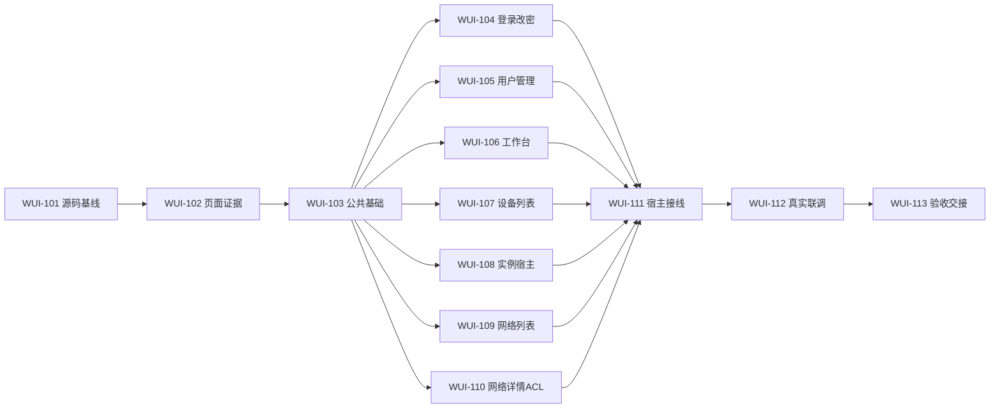

# Web 交互优化与页面美化任务看板

[需求/计划汇总](../README.md) · [需求与验收](../require/README.md) · [计划索引](../plan/README.md) · [全局协作规则](../../README.md)

8份小计划已拆成13个小任务。任务采用 WUI-101～113，原 WUI-001～008 继续表示计划工作包，编号不混用；计划与任务不强制一一对应。13项均已基于真实前态、实现及联调证据验收；详见任务交接和最终验收，不以文档成文代替功能完成。

## 执行状态

| backlog | ready | in_progress | blocked | in_review | done | cancelled |
| --- | --- | --- | --- | --- | --- | --- |
| 0 | 0 | 0 | 0 | 0 | 13 | 0 |

当前任务进度见下方实施快照与任务明细。

## 任务与计划对应

| 任务明细 | 计划明细 | 状态 | 负责人 | 前置任务 | 并行批次 |
| --- | --- | --- | --- | --- | --- |
| [WUI-101 源码、路由与请求基线](task-wui-101-source-baseline.md) | [PLAN-WUI-001](../plan/plan-wui-001-baseline.md) | done | /root/iteration_exec3 | 无 | WUI-G0 |
| [WUI-102 现有页面前态与问题取证](task-wui-102-page-evidence.md) | [PLAN-WUI-001](../plan/plan-wui-001-baseline.md) | done | /root/iteration_exec3 | WUI-101 | WUI-G1 |
| [WUI-103 公共契约、主题与文案基础](task-wui-103-shared-foundation.md) | [PLAN-WUI-002](../plan/plan-wui-002-shared-foundation.md) | done | /root/iteration_exec2 | WUI-102 | WUI-G2 |
| [WUI-104 登录注册与本人改密页面](task-wui-104-auth-pages.md) | [PLAN-WUI-003](../plan/plan-wui-003-accounts.md) | done | /root/iteration_exec2 | WUI-103 | WUI-G3 |
| [WUI-105 用户管理组件交互与视觉](task-wui-105-user-management.md) | [PLAN-WUI-003](../plan/plan-wui-003-accounts.md) | done | /root/iteration_exec2 | WUI-103 | WUI-G3 |
| [WUI-106 工作台信息与操作反馈](task-wui-106-dashboard.md) | [PLAN-WUI-004](../plan/plan-wui-004-dashboard.md) | done | /root/iteration_exec2 | WUI-103 | WUI-G3 |
| [WUI-107 设备列表与设备资料展示](task-wui-107-device-list.md) | [PLAN-WUI-005](../plan/plan-wui-005-devices.md) | done | /root/iteration_exec2 | WUI-103 | WUI-G3 |
| [WUI-108 实例配置宿主交互](task-wui-108-instance-host.md) | [PLAN-WUI-005](../plan/plan-wui-005-devices.md) | done | /root/iteration_exec2 | WUI-103 | WUI-G3 |
| [WUI-109 网络列表与创建入口](task-wui-109-network-list.md) | [PLAN-WUI-006](../plan/plan-wui-006-networks.md) | done | /root/iteration_exec2 | WUI-103 | WUI-G3 |
| [WUI-110 网络详情与 ACL 交互](task-wui-110-network-detail-acl.md) | [PLAN-WUI-006](../plan/plan-wui-006-networks.md) | done | /root/iteration_exec1 | WUI-103 | WUI-G3 |
| [WUI-111 宿主壳层与页面接线](task-wui-111-host-integration.md) | [PLAN-WUI-007](../plan/plan-wui-007-integration.md) | done | /root/iteration_exec2 | WUI-104、WUI-105、WUI-106、WUI-107、WUI-108、WUI-109、WUI-110 | WUI-G4 |
| [WUI-112 真实组合联调与集中回归](task-wui-112-real-integration.md) | [PLAN-WUI-008](../plan/plan-wui-008-acceptance.md) | done | /root/iteration_exec1 | WUI-111 | WUI-G5 |
| [WUI-113 验收归档与交接](task-wui-113-acceptance-handoff.md) | [PLAN-WUI-008](../plan/plan-wui-008-acceptance.md) | done | /root/iteration_exec3 | WUI-112 | WUI-G6 |

## 多 Agent 分工与顺序

- WUI-104～110 的七组文件可独立写入，按可用Agent槽位投放，不要求七项同一时刻全部启动；任务内部的行为验证由各自负责。
- 登录/改密与用户组件拆开，分别只写各自组件；MainPage内的账号管理HTTP调用生命周期、身份刷新、迟到响应和临时凭据宿主状态归 WUI-111；Login/ChangePassword自身的请求反馈仍归WUI-104。
- DeviceList/DeviceDetails 与 DeviceManagement 经既有props和路由契约并行；NetworkDetail 与 ACL 同归 WUI-110，不拆散同一网络状态边界。
- 需求根汇总、看板、计划索引和任务状态由协调者单独写入。实现Agent仅交付自己的文件、接口、证据和问题，不同时改全局状态文档。

## 共享文件与验证资源

| 文件 / 资源 | 本需求唯一写入者 | 其他任务处理方式 |
| --- | --- | --- |
| console.css、style.css、theme.ts、cn/en.yaml、package.json、tests/web-ui-support/ | WUI-103 | 页面提交需求或补丁建议，由103接收；修订契约后回传版本 |
| MainPage.vue、main.ts、user-management-navigation.test.mjs | WUI-111 | 页面任务只读，111收齐页面交付后接线与回归 |
| tests/dashboard.test.mjs、user-management-e2e.test.mjs、web-ui-integration.test.mjs | WUI-112 | 页面使用各自专项文件；原dashboard覆盖多页且mock，不能替代真实服务联调 |
| API客户端、共享RemoteManagement/Config、后端与协议 | 默认只读 | 不因美化任务扩大写入，问题交协调者明确范围 |

跨需求的MainPage/main.ts、locales和package.json按[共享文件调度](../../README.md#跨需求共享文件调度)互斥领取，提交文件/契约/验证限制后交还。仅一方就绪可独立执行；两方同时就绪默认WUI先、ECO后，不形成另一个需求全部完成的硬依赖。

未来执行构建/浏览器验证时，隔离worktree、`frontend-lib/dist`、`frontend/dist`等实际产物与服务端口（既有浏览器入口常用5198），记录每个Agent的运行目录和端口；不能隔离时串行验证。独立源码文件不等于可共用运行产物或服务状态。本轮不启动这些验证。

## 任务启动与完成

第一步由协调者确认WUI-101采用提交并认领，再按依赖推进。WUI-102没有真实取证前，不把页面建议写成发现的缺陷；证据/环境不足只阻塞对应结论与实施范围。各任务有自己的代码依据、输入/输出、写入范围和完成条件。

WUI-111接线结束后才能WUI-112真实组合联调，失败回派原页面/公共/宿主负责人；WUI-113只在证据齐备后归档验收。Mock和真实结果分别记录，禁止用历史通过数或静态效果图代替本专项行为验收。

2026-10-21：从8份计划生成13个任务文件及本看板，均为backlog/null。本轮仅编辑文档并核对路径、编号、依赖与文件范围，没有运行构建、测试或CI，没有认领开发任务。

## 当前实施快照

已验收 13/13；；其余 0 项 backlog。

总控维护任务与共享锁；监工 `/root/iteration_monitor` 审查后才能完成或进入联调。实际验证见各任务交接，未运行场景不作通过结论。
