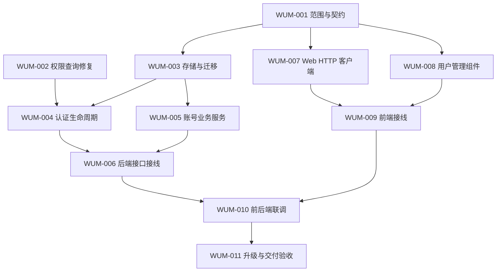

> 历史快照：保留本次整理前文档工作区的原有草案及未提交补充。下文状态仅代表当时记录；当前交付以[需求目录](../../README.md)及已完成任务为准，不据此重开开发。

---
id: PLAN-WUM
status: draft
requirement: process/web-user-management-done/require/README.md
task_board: process/web-user-management-done/task/README.md
updated_at: 2026-10-21
---

# Web 用户管理需求实施计划

需求依据：[Web 用户管理需求分析](../../require/README.md)。执行入口：[任务看板](../../task/README.md)与 [11 项任务文档](../../task/README.md)。本文安排工作边界与依赖；任务状态、负责人和执行证据以各任务明细为准。

本计划尚未执行。首期采用“平台管理员管理本地控制台账号”的建议范围，停用影响、凭据交付和适用身份部署仍需在 WUM-001 明确。这里的任务就绪不表示功能已经实现。

## 1. 目标与范围

交付账号管理闭环：当前身份与能力、用户列表/详情、创建本地账号、停用/恢复控制台访问、适用账号的密码重置、角色分配、会话撤销、注册策略反馈、操作审计和管理员恢复路径，对应需求 UM-01 至 UM-10。

产品上下文已明确为 [EasyTier Web 网络拓扑工作台](../../../easytier-ecosystem-integration-done/require/README.md)，以网络节点、类型目录、服务/设备组及统一设备组织资源。WUM-001 以此设计登录与账号管理边界，区分平台用户、节点、外部应用账号和业务设备；本计划仍只交付当前账号管理范围。资源控制、公网映射、导航发布及后期 deploy 方案另行规划，不增加本计划的前置任务或默认管理权限。

后续页面设计以用户明确的已完成用户管理分支为基础，具体分支/提交在实际设计前核对。本文件保留当前工作区原有规划与执行记录，不据此重做用户管理或推断其他实现分支的交付状态。拓扑需求已明确不采纳上一轮扩展功能，状态采用普通接口按需查询，不新增复杂心跳、轮询或定时任务；这些页面约束不新增 WUM 前置任务，也不改动本轮未核验的任务状态。

本轮暂按以下建议规划，范围变化应先更新需求，再同步本计划和受影响任务：

- 平台管理员为受信运维角色；不承诺用户数据对管理员强隔离。
- 用户名不可编辑，不物理删除用户；保留现有资源归属和已运行网络。
- 停用对象为控制台访问，不把设备接入、控制连接和网络数据面当成同一生命周期。
- 既有用户、密码输入契约、组关系和接口兼容；历史来源或时间无法证明时保留未知。
- 若目标部署启用 OIDC，则身份绑定、同名冲突和停用一致性属于同阶段工作。完整 IdP 管理、组织协作和独立设备接入 token 不在当前建议范围。

### 需求到工作包的追踪

以下覆盖首期全部 10 项需求。需求的行为定义和 14 个验收场景以分析文档为准；本表分配实施责任，实际执行证据由任务明细记录。WUM-001 为各项提供契约，WUM-003 提供涉及持久化的基础，表中不重复罗列这些公共依赖。

| 需求 | 后端负责工作包 | 前端负责工作包 | 重点验收 |
| --- | --- | --- | --- |
| UM-01 当前用户与管理能力 | WUM-002 权限隔离；WUM-004 身份/能力；WUM-006 管理路由授权 | WUM-007 身份调用；WUM-009 导航与能力变化 | UA-01、UA-10、UA-11 |
| UM-02 用户列表与详情 | WUM-005 查询业务；WUM-006 分页与安全 DTO | WUM-007 查询适配；WUM-008 列表/详情；WUM-009 接线 | UA-02、UA-11、UA-13；WUM-008 的分页/搜索验收 |
| UM-03 管理员创建账号 | WUM-005 创建与冲突规则；WUM-006 管理接口 | WUM-007 创建调用；WUM-008 创建表单；WUM-009 接线 | UA-02、UA-03、UA-13 |
| UM-04 停用/恢复控制台访问 | WUM-004 登录/会话约束；WUM-005 状态与版本；WUM-006 接口 | WUM-007 状态调用；WUM-008 影响确认；WUM-009 权限反馈 | UA-04、UA-06、UA-08、UA-09、UA-10 |
| UM-05 重置本地密码 | WUM-005 重置与凭据能力；WUM-004 受限登录/改密；WUM-006 接口 | WUM-007 凭据处理；WUM-008 重置交互；WUM-009 首次改密 | UA-05、UA-06、UA-13 |
| UM-06 分配角色 | WUM-002 权限隔离；WUM-005 最后管理员/并发保护；WUM-004 权限撤销；WUM-006 授权 | WUM-007 角色调用；WUM-008 角色操作；WUM-009 能力刷新 | UA-01、UA-07、UA-10 |
| UM-07 撤销全部 Web 会话 | WUM-005 版本更新；WUM-004 会话验证；WUM-006 接口 | WUM-007 撤销调用；WUM-008 操作确认；WUM-009 登录失效反馈 | UA-04、UA-10、UA-11；WUM-010 验证不改密码的主动撤销 |
| UM-08 注册策略反馈 | WUM-004 公开策略与服务端限制；WUM-005 管理员建号规则 | WUM-007 策略调用；WUM-008 公共文案；WUM-009 注册入口 | UA-03、UA-11 |
| UM-09 管理审计 | WUM-005 事务审计；WUM-006 只读查询与权限 | WUM-007 审计调用；WUM-008 审计展示；WUM-009 接线 | UA-01、UA-13 |
| UM-10 首个管理员与恢复 | WUM-005 初始化/恢复入口；WUM-011 升级与恢复验收 | 本期不单独增加恢复页面，按 WUM-001 明确的恢复方式交付说明 | UA-12、UA-13 |

WUM-010 汇总真实运行时验收，WUM-011 汇总旧库升级与交付验收。UA-01 的授权和 UA-13 的脱敏要求适用于全部管理接口；UA-14 的跨站写入与部署策略由 WUM-006 实现、WUM-010/011 验证，适用于所有管理写操作。具体验收结果不得用本表中的关联关系代替。

两项需要单独执行的检查：UM-02 覆盖服务端搜索、角色/状态筛选、稳定分页、空结果及历史未知值；UM-07 在密码、角色和访问状态均不变时主动撤销所有 Web 会话，验证旧会话失效且重新登录可用。停用或改密场景不能代替主动撤销检查。

## 2. 先明确契约，再并行实现

WUM-001 交付可供不同 agent 独立实现的契约基线，不编写业务代码。依赖它的任务只能在各自所需契约明确后进入执行；不能让前后端自行猜测字段，或把尚未确定的产品行为写成既成事实。

| 契约主题 | 需要记录的结果 | 消费任务 |
| --- | --- | --- |
| 账号与权限 | 角色映射、`users.manage`、有效管理员定义、自操作规则、受限改密会话允许的操作 | WUM-003/004/005/006/007/008 |
| 用户状态与身份 | 停用/恢复/降权/重置的状态转换、会话版本、历史来源处理、OIDC 绑定和冲突策略 | WUM-003/004/005 |
| HTTP | 路径与方法、请求/响应 DTO、分页/排序、空值、错误码、重试/幂等、密码输入格式 | WUM-006/007/008/009 |
| 数据库与服务 | 存储字段、事务边界、查询/修改接口签名、权限重查、审计一致性、初始化/恢复入口 | WUM-003/004/005/006 |
| UI 组件 | 输入 props、输出事件、UI view model、加载/失败/权限变化状态；不依赖未落地的 HTTP 客户端文件 | WUM-007/008/009 |
| 部署与验收 | 支持的身份模式、Cookie/同源/CSRF 策略、凭据交付/有效期、旧库升级与回退要求 | WUM-004/005/006/010/011 |

契约基线应回写到本计划的执行记录或关联的 `process/plan/` 专项契约文档；产品行为变化同步需求文档。未形成完整记录前，不把本文的候选字段视作稳定接口。契约修改由 WUM-001 的负责人协调受影响任务，完成版本说明后再继续相关写入。

## 3. 任务依赖与并行批次

依赖表达产物先后关系，不代表必须等待同批所有任务完成。没有未满足依赖、写入范围不交叉的任务可同时领取。

| 任务 | 直接依赖 | 产物与独立完成边界 |
| --- | --- | --- |
| [WUM-001 范围与契约](../../task/task-wum-001-contract.md) | 无 | 产品边界、DTO/状态/错误、DB/服务和 UI 组件契约，可独立评审 |
| [WUM-002 权限查询修复](../../task/task-wum-002-permissions.md) | 无 | 限定当前用户的权限查询及隔离回归测试；不等待新管理接口 |
| [WUM-003 存储与迁移](../../task/task-wum-003-storage.md) | WUM-001 | 新增迁移、实体与约定的 DB 接口；迁移和事务基础验证 |
| [WUM-004 认证生命周期](../../task/task-wum-004-auth-lifecycle.md) | WUM-002、WUM-003 | 登录/会话/受限改密/适用 OIDC 策略、当前身份与公开注册策略 |
| [WUM-005 账号业务服务](../../task/task-wum-005-account-service.md) | WUM-003 | 创建、访问状态、角色、重置、会话撤销、审计及管理员保护/恢复的服务规则 |
| [WUM-006 后端接口接线](../../task/task-wum-006-admin-api.md) | WUM-004、WUM-005 | 管理 HTTP API、授权和服务接线；真实 HTTP/数据库行为验证 |
| [WUM-007 Web HTTP 客户端](../../task/task-wum-007-web-client.md) | WUM-001 | HTTP DTO/调用、错误语义、敏感日志处理和针对性验证 |
| [WUM-008 用户管理组件](../../task/task-wum-008-user-interface.md) | WUM-001 | 列表/详情/操作/审计组件、双语文案与独立交互验证 |
| [WUM-009 前端接线](../../task/task-wum-009-web-integration.md) | WUM-007、WUM-008 | 页面路由、导航、身份能力、注册和强制改密流程，连接组件与客户端 |
| [WUM-010 前后端联调](../../task/task-wum-010-full-stack-integration.md) | WUM-006、WUM-009 | 使用真实服务/数据库的跨端验收，验证 UA-01 至 UA-11、UA-13/14；UA-12 的升级整体验收交由 WUM-011 |
| [WUM-011 升级与交付验收](../../task/task-wum-011-upgrade-acceptance.md) | WUM-010 | 旧库升级、管理员初始化/恢复、部署模式及回退验证，交付运维说明 |

可并行窗口：

1. WUM-001 与 WUM-002 独立推进。
2. WUM-001 完成后，WUM-003、WUM-007、WUM-008 可分别交给不同 agent。
3. WUM-003 完成且 WUM-002 已完成后，WUM-004 与 WUM-005 可并行；前端 WUM-007/008 或已就绪的 WUM-009 同时推进。
4. WUM-006 与 WUM-009 分别进行后端/前端接线；双方完成后才进入 WUM-010 全链路联调。
5. WUM-011 在联调通过后进行升级与交付验收，不以独立模块测试代替整体可交付性。

### 阶段交付与退出条件

按以下里程碑汇总交付；里程碑用于观察整体进度，不增加整批等待屏障。某任务的直接依赖已完成且写入范围无冲突，即可提前进入对应工作，例如 WUM-001 完成后可启动前端任务，不必等待 WUM-002。

| 里程碑 | 对应任务与并行方式 | 可交付结果 | 退出条件 |
| --- | --- | --- | --- |
| M1 范围与授权基础 | WUM-001、WUM-002 可并行 | 契约基线；按用户隔离的权限查询 | 产品/接口待决项对下游的影响已明确，权限隔离回归通过 |
| M2 独立模块 | WUM-003、WUM-007、WUM-008 可并行 | 可迁移的存储；类型化客户端；独立用户管理组件与文案 | 存储接口及 UI 输入输出可供消费；各项实际编译/类型与针对性验证通过 |
| M3 业务与接线 | WUM-004/005 可并行；WUM-006 随后接入后端；WUM-009 按前端依赖独立推进 | 认证/账号服务、受保护 API、完整 Web 操作流程 | 后端真实 HTTP/数据库验证和前端流程验证分别通过，具备全链路联调条件 |
| M4 真实联调 | WUM-010，等待 WUM-006/009 | 真实服务、数据库和浏览器的验收记录；可运行测试入口 | 适用运行时验收通过，缺陷已回派并闭环，未执行项明确且不冒充通过 |
| M5 升级交付 | WUM-011，等待 WUM-010 | 旧库升级/恢复证据、运维说明、最终验收清单 | 已有账号与资源兼容，管理员恢复可用，目标部署验收满足且回退边界明确 |

执行排期依据实际负责人、契约收敛情况和验证结果更新到任务记录；本计划以依赖关系与可验证交付为依据安排工作。

## 4. 文件所有权与交接

以下路径均相对仓库根；新增模块、文件或目录是建议，尚未创建。确需调整布局时先更新任务的写入范围，再通知使用该产物的任务。不同 agent 可以同时读取同一文件；同一时间只安排一个写入者。

| 写入范围 | 唯一负责任务及交接规则 |
| --- | --- |
| 需求、计划中的范围和契约 | WUM-001；看板状态由协调者统一同步，其他任务提交变更建议 |
| `easytier-web/src/restful/users.rs` | WUM-002 先完成权限修复并交接，WUM-004 再修改生命周期；禁止同时写入 |
| `easytier-web/src/migrator/`、`easytier-web/src/db/`（含实体及注册） | WUM-003；迁移序号和模块注册统一处理。WUM-004/005 使用约定 DB 接口，缺口回交 WUM-003 |
| `easytier-web/src/restful/auth.rs`、`easytier-web/src/restful/oidc.rs` | WUM-004；使用迁移后的状态和存储接口，不复制账号管理事务 |
| 新增 `easytier-web/src/user_management/` 或相邻领域模块 | WUM-005；业务事务和审计在该边界统一。模块必须接入编译，不能交付从未编译的测试 |
| `easytier-web/src/main.rs` 的新领域模块声明及明确需要的初始化/恢复入口 | WUM-005；WUM-006 只消费已注册服务，不同时改该入口 |
| 新增 `easytier-web/src/restful/admin_users.rs` 及其测试目录、`easytier-web/src/restful/mod.rs` | WUM-006；集中处理路由、服务注入和 HTTP 授权接线，合入 WUM-004 提供的认证策略 |
| `easytier-web/frontend/src/modules/api.ts`、新增 `easytier-web/frontend/src/modules/userManagement.ts` | WUM-007；统一 HTTP/DTO 与日志策略，WUM-008 不直接编辑客户端 |
| 新增 `easytier-web/frontend/src/components/users/`、`easytier-web/frontend-lib/src/locales/cn.yaml`、`easytier-web/frontend-lib/src/locales/en.yaml` | WUM-008；组件按 props/events 契约独立开发，由 WUM-009 接入数据；所需公共登录文案也由此任务协调写入 |
| `easytier-web/frontend/src/main.ts`、`easytier-web/frontend/src/components/MainPage.vue`、`easytier-web/frontend/src/components/Login.vue`、`easytier-web/frontend/src/components/ChangePassword.vue` | WUM-009；集中处理工作区与身份流程接线，避免多个组件任务同时改全局入口 |
| 新增用户管理端到端测试、相关测试入口 | WUM-010；模块内单元/组件测试由各实现任务随同交付，公共测试配置集中由联调负责人协调 |
| 升级/恢复/运维说明与交付证据 | WUM-011；说明放 `docs/`，执行结果放任务明细，计划调整仍由协调者统一 |

WUM-005 在 crate 根添加最小模块声明，保证业务模块和测试可编译；不等待 WUM-006 才首次注册。若实现需改其他共享入口、Cargo/pnpm 清单或锁文件，由协调者指定唯一写入者并登记，不能在并行任务中各自修改。

WUM-004 与 WUM-005 共同消费 WUM-003 已落地的 DB 接口和 WUM-001 契约，不能互相依赖对方尚未实现的新模块。若无法保持这一边界，先调整依赖图和任务明细，再重新安排并行窗口。

联调发现问题时，记录失败证据并回交原所有者修复；若联调负责人接手文件，先明确交接时间与范围。禁止在原 agent 仍写入时“顺手修复”同一文件。

## 5. 测试与交付门槛

| 阶段 | 必须提供的证据 | 不能作为替代的结果 |
| --- | --- | --- |
| 契约 | 关键状态/错误/权限/旧数据语义明确，依赖关系与文件写入范围无冲突 | 只有页面草图或接口名称 |
| 独立模块 | 实际编译或类型检查；与职责相关的行为测试；产物可以被下游消费 | 测试文件未接入 runner、只有空壳或未执行的测试 |
| 后端接线 | 匿名/普通/管理员真实请求、状态/会话撤销、最后管理员并发、审计与敏感信息检查 | 前端隐藏菜单、mock 服务测试 |
| 前端接线 | 列表和操作流程、能力撤销、401/403/网络错误、双语/键盘/窄屏验证 | 单次成功截图 |
| 全链路联调 | 真实服务、真实数据库、至少管理员与普通用户；记录适用 UA 场景与部署模式 | 仅浏览器 mock 成功或构建通过 |
| 升级与交付 | 旧用户/归属/凭据保留、历史未知值、初始化/恢复、回退访问控制边界 | 新建空库正常运行 |

后端检查使用 `easytier-web` 包和实际新增测试；按任务范围选择现有 Cargo 命令。前端在 `easytier-web/frontend/` 使用现有 `pnpm build` 验证类型和构建；已有 `test:browser`、`test:e2e` 脚本当前只指定 dashboard/central 测试文件，新增用户管理测试必须由 WUM-010 接入相应执行入口，不能仅新增文件便宣称获得覆盖。

各任务记录真实运行的命令、环境、结果与未覆盖范围。只有完成其验收、依赖交接和必要验证后才能标记完成。本计划编写阶段仅做文档检查，不运行或声称已通过上述应用测试。

## 6. 待定事项与变更处理

| 决策 | 当前建议 | 最晚明确的任务 |
| --- | --- | --- |
| 管理主体与停用范围 | 平台管理员管理本地控制台访问；不冻结设备数据面 | WUM-001，影响 WUM-003 之后的状态建模 |
| 凭据交付与恢复 | 本地临时凭据、首次改密；有效期、密码规则、再次认证和恢复方式待明确 | WUM-001，影响 WUM-004/005/008 |
| 支持的身份部署 | 明确本地/OIDC/webhook 的适用范围；启用 OIDC 不能跳过绑定与停用一致性 | WUM-001，影响 WUM-003/004/010 |
| Cookie/跨站请求策略 | 根据实际部署明确同源/CSRF/Cookie 行为，不以默认配置替代验证 | WUM-001，WUM-006 实现，WUM-010 验证 |
| 首个管理员与旧库恢复 | 复用真实组/权限与兼容迁移；不按用户名或首个注册用户提权 | WUM-001，WUM-005 实现，WUM-011 验收 |

待定事项应优先根据源码、现有部署约定和已给出的产品要求收敛；真正影响目标且无法推断的选择再向用户澄清。可独立完成的 WUM-002 不因其他范围讨论而停滞。

范围或契约改变时，先同步需求和计划，再检查依赖、任务明细、看板与验收影响；已经完成的产物若不再满足新契约，应明确重开对应任务。不得在任务明细中暗改产品范围而保留过时的计划。

## 7. 执行记录

- 2026-10-21：建立实施计划与并行边界；所有实施任务尚未执行。契约基线待 WUM-001 补齐。
- 2026-10-21：补齐 UM-01 至 UM-10 的实施责任/验收映射及 M1 至 M5 阶段交付条件；沿用 11 个任务及现有依赖，不改变开发任务执行状态。
