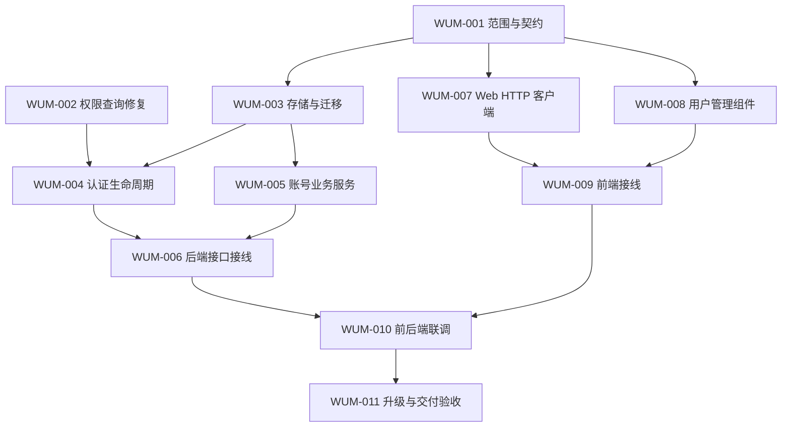

# PLAN-WUM-002：依赖、并行交付与文件所有权

本文件拆自已交付的 PLAN-WUM，保留原节号及当时的计划/契约记录；不是新增任务或重新执行授权。计划细项编号与任务编号不一一对应。总体进度、代码基线及已知问题见[需求/计划汇总](../README.md)，执行状态见[任务看板](../task/README.md)。

- 关联任务：WUM-001～011。
- 现状依据：根汇总的 WUM-EV-001、WUM-EV-003；对应实现已在交付提交，不能将历史“待实施/待验证”措辞当作当前缺口。
- 验证依据：[运维验收记录](operations.md)及任务明细；本次只拆文档，未运行构建、测试或 CI。

## 3. 任务依赖与并行批次

依赖表达产物先后关系，不代表必须等待同批所有任务完成。没有未满足依赖、写入范围不交叉的任务可同时领取。

| 任务 | 直接依赖 | 产物与独立完成边界 |
| --- | --- | --- |
| [WUM-001 范围与契约](../task/task-wum-001-contract.md) | 无 | 产品边界、DTO/状态/错误、DB/服务和 UI 组件契约，可独立评审 |
| [WUM-002 权限查询修复](../task/task-wum-002-permissions.md) | 无 | 限定当前用户的权限查询及隔离回归测试；不等待新管理接口 |
| [WUM-003 存储与迁移](../task/task-wum-003-storage.md) | WUM-001 | 新增迁移、实体与约定的 DB 接口；迁移和事务基础验证 |
| [WUM-004 认证生命周期](../task/task-wum-004-auth-lifecycle.md) | WUM-002、WUM-003 | 登录/会话/受限改密/适用 OIDC 策略、当前身份与公开注册策略 |
| [WUM-005 账号业务服务](../task/task-wum-005-account-service.md) | WUM-003 | 创建、访问状态、角色、重置、会话撤销、审计及管理员保护/恢复的服务规则 |
| [WUM-006 后端接口接线](../task/task-wum-006-admin-api.md) | WUM-004、WUM-005 | 管理 HTTP API、授权和服务接线；真实 HTTP/数据库行为验证 |
| [WUM-007 Web HTTP 客户端](../task/task-wum-007-web-client.md) | WUM-001 | HTTP DTO/调用、错误语义、敏感日志处理和针对性验证 |
| [WUM-008 用户管理组件](../task/task-wum-008-user-interface.md) | WUM-001 | 列表/详情/操作/审计组件、双语文案与独立交互验证 |
| [WUM-009 前端接线](../task/task-wum-009-web-integration.md) | WUM-007、WUM-008 | 页面路由、导航、身份能力、注册和强制改密流程，连接组件与客户端 |
| [WUM-010 前后端联调](../task/task-wum-010-full-stack-integration.md) | WUM-006、WUM-009 | 使用真实服务/数据库的跨端验收，验证 UA-01 至 UA-11、UA-13/14；UA-12 的升级整体验收交由 WUM-011 |
| [WUM-011 升级与交付验收](../task/task-wum-011-upgrade-acceptance.md) | WUM-010 | 旧库升级、管理员初始化/恢复、部署模式及回退验证，交付运维说明 |

可并行窗口：

1. WUM-001 与 WUM-002 独立推进。
2. WUM-001 完成后，WUM-003、WUM-007、WUM-008 可分别交给不同 agent。
3. WUM-003 完成且 WUM-002 已完成后，WUM-004 与 WUM-005 可并行；前端 WUM-007/008 或已就绪的 WUM-009 同时推进。
4. WUM-006 与 WUM-009 分别进行后端/前端接线；双方完成后才进入 WUM-010 全链路联调。
5. WUM-011 在联调通过后进行升级与交付验收，不以独立模块测试代替整体可交付性。

### 阶段交付与退出条件

按以下里程碑汇总交付；里程碑用于观察整体进度，不增加整批等待屏障。某任务的直接依赖已完成且写入范围无冲突，即可提前进入对应工作，例如 WUM-001 完成后可启动前端任务，不必等待 WUM-002。

| 里程碑 | 对应任务与并行方式 | 可交付结果 | 退出条件 | 状态 |
| --- | --- | --- | --- | --- |
| M1 范围与授权基础 | WUM-001、WUM-002 可并行 | 契约基线；按用户隔离的权限查询 | 产品/接口待决项对下游的影响已明确，权限隔离回归通过 | 已处理 |
| M2 独立模块 | WUM-003、WUM-007、WUM-008 可并行 | 可迁移的存储；类型化客户端；独立用户管理组件与文案 | 存储接口及 UI 输入输出可供消费；各项实际编译/类型与针对性验证通过 | 已处理 |
| M3 业务与接线 | WUM-004/005 可并行；WUM-006 随后接入后端；WUM-009 按前端依赖独立推进 | 认证/账号服务、受保护 API、完整 Web 操作流程 | 后端真实 HTTP/数据库验证和前端流程验证分别通过，具备全链路联调条件 | 已处理 |
| M4 真实联调 | WUM-010，WUM-006/009 已交付 | 真实服务、数据库和浏览器的验收记录；可运行测试入口 | 适用运行时验收通过，缺陷已回派并闭环，未执行项明确且不冒充通过 | 已处理 |
| M5 升级交付 | WUM-011，WUM-010 已交付 | 旧库升级/恢复证据、运维说明、最终验收清单 | 已有账号与资源兼容，管理员恢复可用，目标部署验收满足且回退边界明确 | 已处理 |

执行排期依据实际负责人、契约收敛情况和验证结果更新到任务记录；本计划以依赖关系与可验证交付为依据安排工作。

## 4. 文件所有权与交接

以下路径均相对仓库根；本轮模块、文件和目录已交付，最终路径及范围以任务明细为准。确需调整布局时先更新任务的写入范围，再通知使用该产物的任务。不同 agent 可以同时读取同一文件；同一时间只安排一个写入者。

| 写入范围 | 唯一负责任务及交接规则 |
| --- | --- |
| 需求、计划中的范围和契约 | WUM-001；看板状态由协调者统一同步，其他任务提交变更建议 |
| `easytier-web/src/restful/users.rs` | WUM-002 先完成权限修复并交接，WUM-004 再修改生命周期；禁止同时写入 |
| `easytier-web/src/migrator/`、`easytier-web/src/db/`（含实体及注册） | WUM-003；迁移序号和模块注册统一处理。WUM-004/005 使用约定 DB 接口，缺口回交 WUM-003 |
| `easytier-web/src/restful/auth.rs`、`easytier-web/src/restful/oidc.rs` | WUM-004；使用迁移后的状态和存储接口，不复制账号管理事务 |
| 新增 `easytier-web/src/user_management/` 或相邻领域模块 | WUM-005；业务事务和审计在该边界统一。模块必须接入编译，不能交付从未编译的测试 |
| `easytier-web/src/main.rs` 的新领域模块声明及明确需要的初始化/恢复入口 | WUM-005；WUM-006 只消费已注册服务，不同时改该入口 |
| 新增 `easytier-web/src/restful/admin_users.rs` 及其测试目录、`easytier-web/src/restful/mod.rs` | WUM-006；集中处理路由、服务注入和 HTTP 授权接线，合入 WUM-004 提供的认证策略 |
| `easytier-web/frontend/src/modules/api.ts`、新增 `easytier-web/frontend/src/modules/userManagement.ts` | WUM-007；统一 HTTP/DTO 与日志策略，WUM-008 不直接编辑客户端 |
| 新增 `easytier-web/frontend/src/components/users/`、`easytier-web/frontend-lib/src/locales/cn.yaml`、`easytier-web/frontend-lib/src/locales/en.yaml` | WUM-008；组件按 props/events 契约独立开发，由 WUM-009 接入数据；所需公共登录文案也由此任务协调写入 |
| `easytier-web/frontend/src/main.ts`、`easytier-web/frontend/src/components/MainPage.vue`、`easytier-web/frontend/src/components/Login.vue`、`easytier-web/frontend/src/components/ChangePassword.vue` | WUM-009；集中处理工作区与身份流程接线，避免多个组件任务同时改全局入口 |
| 新增用户管理端到端测试、相关测试入口 | WUM-010；模块内单元/组件测试由各实现任务随同交付，公共测试配置集中由联调负责人协调 |
| 升级/恢复/运维说明与交付证据 | WUM-011；原说明现归档为本需求 [operations.md](operations.md)，执行结果放任务明细，计划调整仍由协调者统一 |

WUM-005 在 crate 根添加最小模块声明，保证业务模块和测试可编译；不等待 WUM-006 才首次注册。若实现需改其他共享入口、Cargo/pnpm 清单或锁文件，由协调者指定唯一写入者并登记，不能在并行任务中各自修改。

WUM-004 与 WUM-005 共同消费 WUM-003 已落地的 DB 接口和 WUM-001 契约，不能互相依赖对方尚未实现的新模块。若无法保持这一边界，先调整依赖图和任务明细，再重新安排并行窗口。

联调发现问题时，记录失败证据并回交原所有者修复；若联调负责人接手文件，先明确交接时间与范围。禁止在原 agent 仍写入时“顺手修复”同一文件。
